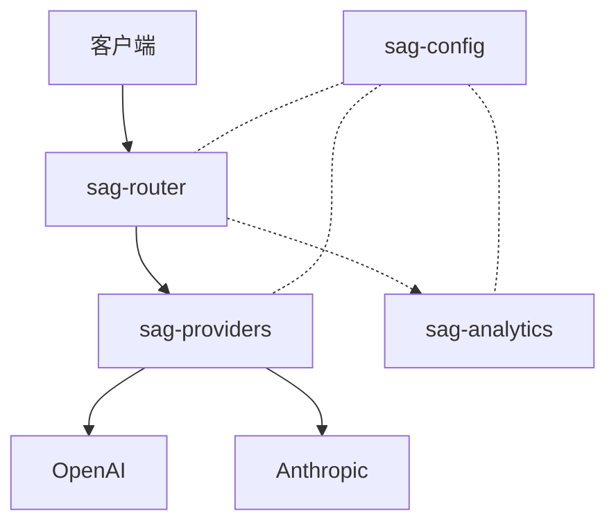
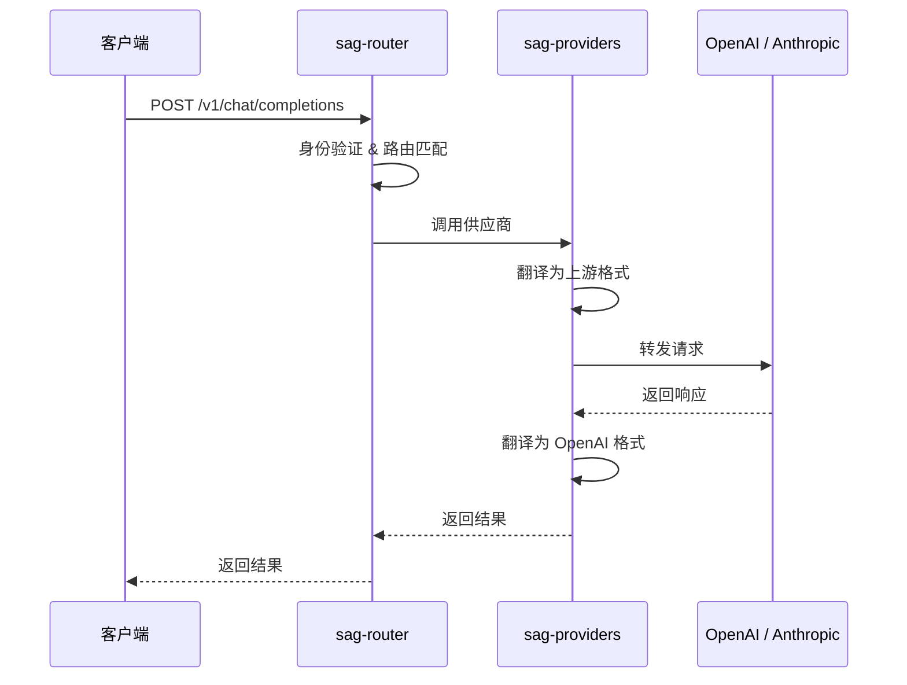

# 架构

SAG 采用模块化工作空间设计，职责清晰分离：

## 请求流程

1. 客户端发送兼容 OpenAI 格式的请求到 `POST /v1/chat/completions`
2. `sag-router` 进行身份验证，根据路由表匹配模型名称
3. 按优先级排序目标，依次尝试直到成功
4. 选中的供应商适配器将请求转换为上游格式（如 Anthropic Messages API）
5. 转发请求到上游 API，等待响应
6. 响应转换回兼容 OpenAI 格式
7. 调用记录异步写入 SQLite 用于分析
## 二进制入口点

`sag-gateway` 子包负责启动编排：
1. 初始化 tracing
2. 从 TOML 文件加载配置
3. 启动配置文件监听，支持热重载（`notify` 监听文件变化，自动更新配置）
4. 初始化分析收集器（SQLite）
5. 构建供应商注册表
6. 构建带状态的 Axum 路由器
7. 启动 HTTP 服务，支持优雅关闭
