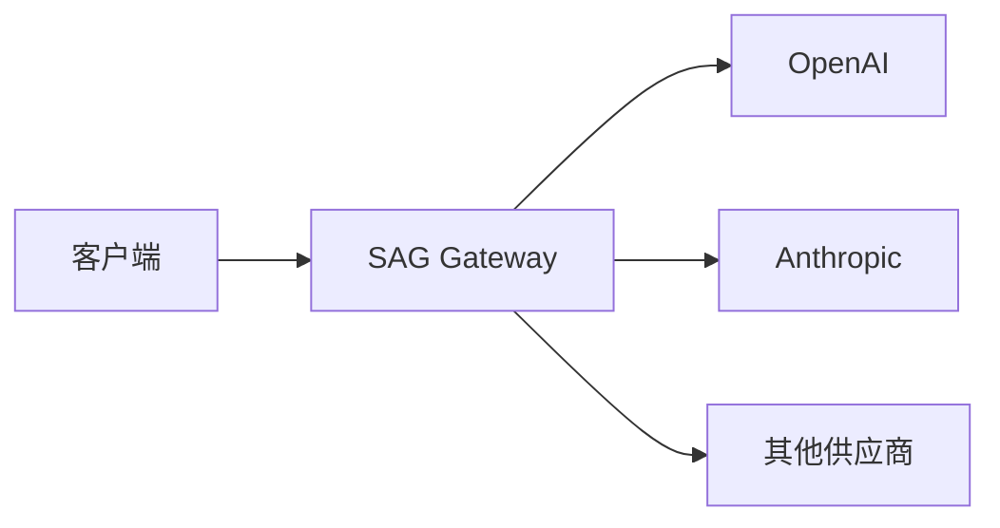

# SAG 使用指南

SAG (Smart AI Gateway) 是一个 LLM API 反向代理网关。它接受 OpenAI 兼容的请求，按优先级自动故障转移到多个上游 LLM 提供商，并附带用量统计和管理面板。

## 快速导航

| 文档 | 说明 |
|------|------|
| [配置](/guide/configuration) | TOML 配置文件参考，所有字段说明 |
| [路由](/guide/routing) | 模型路由、故障转移策略、优先级配置 |
| [供应商](/guide/providers) | OpenAI / Anthropic 适配器配置与扩展 |
| [部署](/guide/deployment) | 构建、运行、Docker、测试环境 |
| [模型 API](/guide/models-api) | OpenAI 兼容的 `/v1/chat/completions` 接口 |
| [管理 API](/guide/admin-api) | 运行时管理供应商和路由的 REST API |
| [分析](/guide/analytics) | SQLite 用量统计、聚合查询 |

## 架构

SAG 接受请求 → 匹配路由 → 按优先级选择目标 → 调用上游 → 翻译响应 → 返回客户端。详细架构见[技术规格](/spec/architecture/requirements)。
