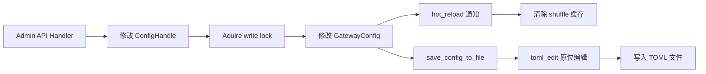

# 管理 API — 规格

## 关键文件

- [sag-admin/src/admin_routes.rs](../../../sag-admin/src/admin_routes.rs) — 管理路由注册
- [sag-admin/src/admin_providers.rs](../../../sag-admin/src/admin_providers.rs) — 供应商 CRUD handler
- [sag-admin/src/admin.rs](../../../sag-admin/src/admin.rs) — 路由 CRUD handler
- [sag-admin/src/admin_logs.rs](../../../sag-admin/src/admin_logs.rs) — 日志查询 handler
- [sag-admin/src/admin_testing.rs](../../../sag-admin/src/admin_testing.rs) — `POST /api/model/test`、`POST /api/providers/probe-protocols`、`POST /api/providers/fetch-models` handler
- [sag-admin/src/probe_request.rs](../../../sag-admin/src/probe_request.rs) — 三协议最小探测请求与探测 URL 的单一来源
- [sag-admin/src/probe_provider.rs](../../../sag-admin/src/probe_provider.rs) — 从表单态合成临时 `ProviderConfig`，按 kind 分派 provider 非流式方法，`AppError` → UI 文案
- [sag-admin/src/test_utils.rs](../../../sag-admin/src/test_utils.rs) — 配置一致性测试工具 + 捕获型 TCP mock 上游
- [sag-admin/src/admin_inflight.rs](../../../sag-admin/src/admin_inflight.rs) — `GET /api/inflight`：per-route 在途计数的 SSE 快照流
- [sag-state/src/inflight.rs](../../../sag-state/src/inflight.rs) — `InFlightRegistry`（计数 + `watch` 快照通道）与 `InFlightGuard`（RAII 释放）
- [sag-admin/src/lib.rs](../../../sag-admin/src/lib.rs) — `build_admin_routes()` 路由构建

## 核心设计

### 配置持久化数据流

## 关键决策

### 配置持久化：toml_edit 原位编辑

管理 API 修改配置后，使用 `toml_edit` 对 TOML 文件做原位编辑，而非重新序列化整个配置。

**Trade-off**: 见 [配置 spec](/spec/config/spec) 的相关讨论。

### 模型测试的独立 Provider

模型测试通过 `probe_provider::synthesize_config` 从**表单当前（可能未保存）的状态**合成一份单 lane `ProviderConfig`（真实 base_url/headers/overrides + 单 key + 钳到 30s 的超时 + 合成名 `__model_test__`），再经 `create_provider_with_proxy` 建临时 provider 实例（不加入 registry），直接调用其非流式方法，不走路由/调度逻辑。

**Trade-off**:
- ✅ 测试不会影响现有配置和路由
- ✅ 认证错误直接暴露（不经过熔断器、重试等 layers）
- ✅ 与生产同链路：per-API headers 分层、`body_overrides`、`strip_fields`、`role_mappings`、`anthropic_cache_control` 都会生效，因此「测试通过」与「生产能跑」不再割裂
- ❌ 临时 provider 的创建开销（但只发生在显式测试触发时）；每个 key 一个实例（各含一个 reqwest client），故 `api_keys` 上限 16

模型级 override 不经合成 config：`ProviderBase` 不读 `ProviderConfig.model_overrides`（生产消费点在 dispatch 的 `merge_model_overrides`），因此 handler 自行计算 `target_extra`（`api.model_overrides[<model>]` 优先于 provider 级）并经 `test_protocol` 的 `target_extra` 参数传入。`model_strip_fields` 相反，由 `ProviderBase` 直接消费，走合成 config。

### 协议探测：原始 HTTP，不复用 adapter

`probe-protocols` 发原始 reqwest 请求，**不**复用 provider adapter，只共享协议知识（`probe_request::minimal_request` + `sag_core::protocol_path` + `sag_providers::provider_auth_headers`），且不读取任何已保存 provider 的配置（裸语义）。

**Trade-off**:
- ✅ 保留原始状态码语义：adapter 内建「200 里夹带 error → `Upstream{429|502}`」改写（analytics / failover 依赖的承载功能，无法关闭），会抹掉「原本是 200」的信息，使本端点的「2xx = supported」判定无法成立
- ✅ 不把 HTTP 层发现变成 schema 层发现：adapter 会解析响应体并要求 schema 合法，对探测器是新增假阴性
- ✅ 结构上保证裸语义：不依赖「合成 config 时记得关掉 `anthropic_cache_control`、清空 overrides」这类约定
- ❌ 看不到 200 内的错误正文 → 由 `message` 列的 body 预览（折叠空白 + 截断 160 字符）弥补

由此两侧的 200 语义**有意分叉**：模型测试回答「这套配置真能跑通吗」（200 + error body 判失败），协议探测回答「这个地址支不支持这个协议」（2xx 恒 `supported`）。

### 路由更新：全量替换 vs Patch

`PUT /api/routes` 采用全量替换（不是 PATCH 语义），原因：
- Route 的 targets 是数组，patch 语义复杂（哪些 target 被修改/添加/删除？）
- 全量替换语义明确，前端可以直接发送完整的 route 对象

**Trade-off**: 发送整个 route 对象 vs 只发送变化的字段：
- 全量替换简单，但需要前端维护完整 state
- PATCH 灵活，但后端需要复杂的 diff 逻辑
- 对于管理面板（前端本就持有完整 state），全量替换最自然

### 供应商更新：PATCH 语义

`PUT /api/providers` 采用 PATCH 语义（只更新传入字段），原因：
- Provider 字段多且独立（timeout、headers、body_overrides 互不影响）
- 允许部分更新（如只想改 timeout_secs，不需要发送完整的 provider）

**Trade-off**: 与路由的 PUT 语义不一致（一个全量替换，一个 partial update）。这是因为两个资源的结构差异——provider 是扁平的 key-value，route 包含嵌套数组。

### 在途计数：全量快照（`watch`）vs 增量事件

`InFlightRegistry` 每次 acquire/release 都重建一份不可变 `InFlightSnapshot`，经 `watch::Sender`
发布；SSE 端点订阅该通道，每帧都是**完整状态**。

**Trade-off**:
- ✅ 消费方不需要从增量重建状态；丢帧不会失步；重连由下一帧自愈，不需要单独的「拉全量」请求
- ✅ 突发流量被 `watch` 合并成「最新快照」，一帧对应一次变化而非一次请求，帧量可控
- ✅ `seq` 与计数在同一把锁内递增，已发布快照的 `seq` 永不倒退
- ❌ 每帧成本随路由数增长（O(路由数) 的 Vec 克隆 + 排序）；管理面量级（数十条路由）下可忽略，若将来路由规模上千需改为增量 + 周期性全量
- ❌ 客户端无法判断「两帧之间漏了什么」，只能整体替换——这也是它被设计成幂等的原因

### 计数释放：`Drop` + `std::sync::Mutex` vs 手写减计数

`InFlightGuard` 的 `Drop` 是唯一的释放路径（流式路径把 guard 移进响应体状态，断连即释放）。
锁用 `std::sync::Mutex` 而不是 `tokio::sync::Mutex`——`Drop` 里不能 `await`，临界区也只有一次 map
更新 + 一次 `send_replace`（永不阻塞、无订阅者也不 panic）。

**Trade-off**:
- ✅ 早退 / 错误 / panic / 客户端断连全部自动释放且恰好一次，没有可遗忘的手写 `release()` 调用点
- ✅ 零计数即删键：被删除或改名的路由不留残影，不需要接 prune
- ❌ `Drop` 里不能做异步工作（比如落日志以外的 IO），将来若要推送「谁释放了」只能走非阻塞 channel
- ❌ 释放未知键只 `tracing::warn!` 后 no-op（析构里 panic 会拖垮进程），因此双重释放这类 bug 只能靠日志发现

## 不变式

- `AppState.in_flight` 与 `DispatchRuntime.in_flight` 必须是**同一个 `Arc`**（`main.rs` 装配后经 `with_shared_state` 注入）；两个实例会得到两份互不相见的计数
- 在途计数必须在 `dispatch_chat` / `dispatch_image` 的**入口** acquire（早于隐私过滤与重试调度），否则退避期间的请求不被计入
- `InFlightGuard` 只能由 `Drop` 释放，不得手写减计数；流式路径的 guard 必须移交给 `StreamState`（`_in_flight`），不得留在 dispatch 栈帧上——否则响应返回时计数就被释放，整条流的传输时间不被计入
- `InFlightSnapshot` 中 `count == 0` 的条目不得存在；`total` 必须等于各 `count` 之和
- `/api/inflight` 自身不 acquire 计数：连接/断开不得改变任何路由的在途数
- SSE 响应必须带 `Cache-Control: no-cache, no-transform` 与 `X-Accel-Buffering: no`；不得加 `Connection: keep-alive`（逐跳头，HTTP/2 禁止）
- 鉴权与其它 `/api/*` 一致：只认 `Authorization: Bearer`，`x-api-key` 不放行
- 模型测试的 per-API `timeout_secs` 一律钳到 30s（`effective_timeout` 会整段替换 caller 值，否则可致 admin 端点阻塞数百秒且文案谎报超时）
- 管理 API 修改后立即 `save_config_to_file()` 持久化
- 配置修改后自动通知 hot_reload，清除 shuffle 缓存
- Provider 删除时级联删除其关联的 route target
- Model name 在路由中是唯一键（创建时检查重复）
- 模型测试 / 协议探测 / fetch-models 三个端点均不写入配置、不写 analytics、不进 provider registry；`admin_testing.rs` 内无 `save_config_to_file`
- 模型测试的上游请求必须经 `ProviderBase::build_request` 链路，不得自行拼装 auth 头或 body；协议探测相反，请求体只能由 `minimal_request` 产生

## 测试策略

- `sag-admin/src/test_utils.rs` — 配置写回与重读一致性测试 + 捕获型 mock 上游（断言上游实际收到的 method / path / headers / body）
- `sag-admin/src/admin_testing.rs` — Admin API handler 测试
- `sag-admin/src/probe_request.rs` — 三协议最小请求体与探测 URL 的纯函数单测
- `sag-admin/src/probe_provider.rs` — 合成 config 与错误文案映射的单测
- `sag-admin/src/admin_inflight.rs` — 帧编码、首帧即连接时快照、空闲心跳、registry 被 drop 时流正常结束
- `sag-admin/tests/inflight_sse.rs` — 真实中间件栈上的鉴权契约（缺 Bearer 401 / `x-api-key` 不放行）、连接即发快照、acquire/release 逐帧推进 `seq`、端点自身不计数、无限流
- `sag-state/src/inflight.rs` — 增减与归零删键、排序与 `total` 求和、`seq` 单调、并发计数守恒、订阅者收到每次发布
- `sag-dispatch/src/dispatch/chat/tests.rs` — 流式在 body 存活期间计数 / `drop(body)` 即释放、非流式返回时已释放、错误路径不泄漏

## 变更记录

- [0003 per-route 在途计数与 `GET /api/inflight` SSE 端点](changes/0003-per-route-in-flight-counters-sse.md)
- [0001 初始化](changes/0001-initial.md)
