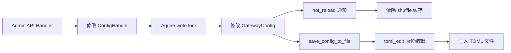

# 管理 API — 规格

## 关键文件

- [sag-admin/src/admin_routes.rs](https://github.com/rainbowatcher/sag/blob/main/sag-admin/src/admin_routes.rs) — 管理路由注册
- [sag-admin/src/admin_providers.rs](https://github.com/rainbowatcher/sag/blob/main/sag-admin/src/admin_providers.rs) — 供应商 CRUD handler
- [sag-admin/src/admin.rs](https://github.com/rainbowatcher/sag/blob/main/sag-admin/src/admin.rs) — 路由 CRUD handler
- [sag-admin/src/admin_logs.rs](https://github.com/rainbowatcher/sag/blob/main/sag-admin/src/admin_logs.rs) — 日志查询 handler
- [sag-admin/src/test_utils.rs](https://github.com/rainbowatcher/sag/blob/main/sag-admin/src/test_utils.rs) — 配置一致性测试工具
- [sag-admin/src/lib.rs](https://github.com/rainbowatcher/sag/blob/main/sag-admin/src/lib.rs) — `build_admin_routes()` 路由构建

## 配置持久化数据流

## 关键决策

### 配置持久化：toml_edit 原位编辑

管理 API 修改配置后，使用 `toml_edit` 对 TOML 文件做原位编辑，而非重新序列化整个配置。

**Trade-off**: 见 [配置 spec](/spec/config/spec) 的相关讨论。

### 模型测试的独立 Provider

模型测试创建一个**临时的 provider 实例**（不加入 registry），直接调用，不走路由/调度逻辑。

**Trade-off**:
- ✅ 测试不会影响现有配置和路由
- ✅ 认证错误直接暴露（不经过熔断器、重试等 layers）
- ❌ 临时 provider 的创建开销（但只发生在显式测试触发时）

### 路由更新：全量替换 vs Patch

`PUT /api/routes` 采用全量替换（不是 PATCH 语义），原因：
- Route 的 targets 是数组，patch 语义复杂（哪些 target 被修改/添加/删除？）
- 全量替换语义明确，前端可以直接发送完整的 route 对象

**Trade-off**: 发送整个 route 对象 vs 只发送变化的字段：
- 全量替换简单，但需要前端维护完整 state
- PATCH 灵活，但后端需要复杂的 diff 逻辑
- 对于管理面板（前端本就持有完整 state），全量替换最自然

### 供应商更新：PATCH 语义

`PUT /api/providers` 采用 PATCH 语义（只更新传入字段），原因：
- Provider 字段多且独立（timeout、headers、body_overrides 互不影响）
- 允许部分更新（如只想改 timeout_secs，不需要发送完整的 provider）

**Trade-off**: 与路由的 PUT 语义不一致（一个全量替换，一个 partial update）。这是因为两个资源的结构差异——provider 是扁平的 key-value，route 包含嵌套数组。

## 不变式

- 管理 API 修改后立即 `save_config_to_file()` 持久化
- 配置修改后自动通知 hot_reload，清除 shuffle 缓存
- Provider 删除时级联删除其关联的 route target
- Model name 在路由中是唯一键（创建时检查重复）

## 测试策略

- `sag-admin/src/test_utils.rs` — 配置写回与重读一致性测试
- `sag-admin/src/admin_testing.rs` — Admin API handler 测试

## 变更记录
- [0001 初始化](changes/0001-initial.md)
