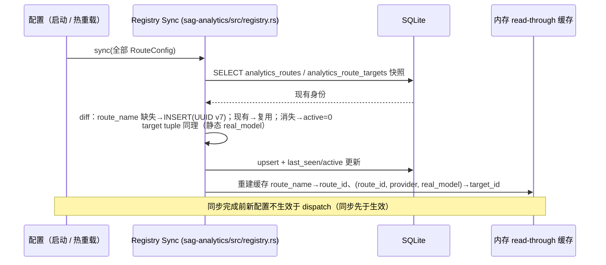
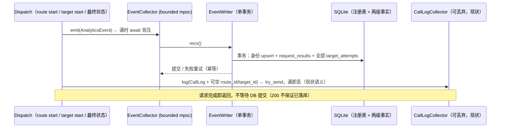
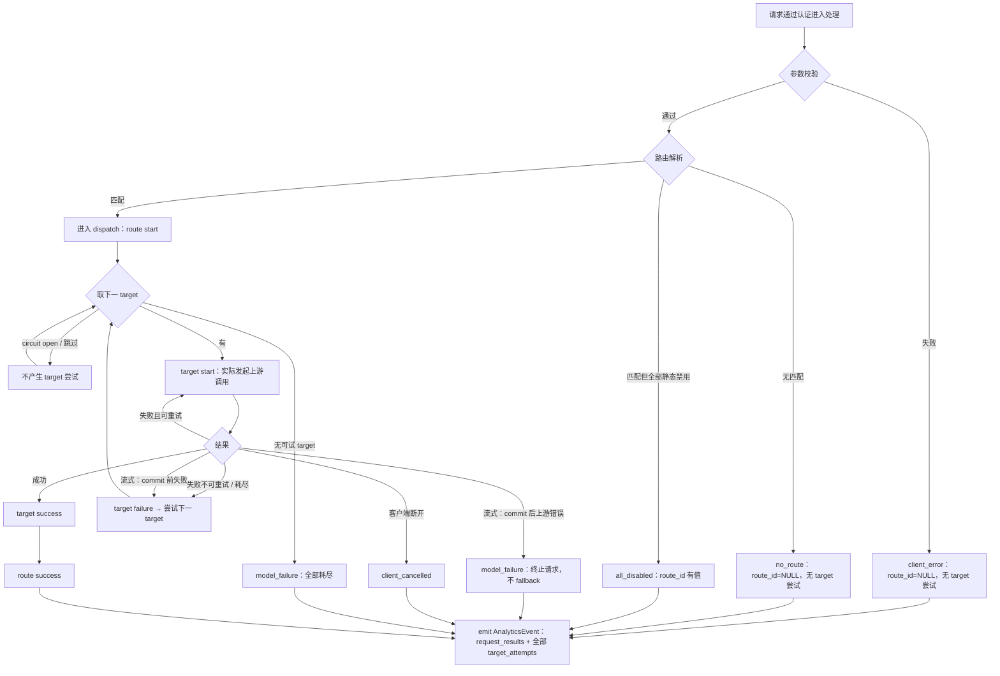
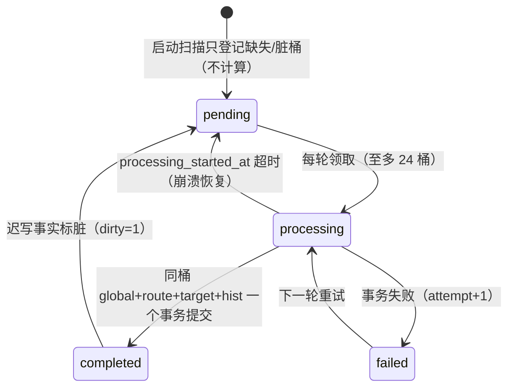

# 分析 — 规格

## 背景与问题

现状（阶段 0）只有单张 `call_logs` 日志表 + 可丢弃的 `CallLogCollector` 写入链路，旧 `/v1/analytics/*` 与 `/api/logs` 接口直接按该明细聚合。需求升级为：route 级（一请求一最终结果）与 target 级（一实际尝试一结果）两级事实、系统生成且只存在 DB 的稳定身份（route_id / target_id）、正式分析事件原子异步写入、统一失败率/延迟/Token/缓存口径、UTC 小时分桶与 1h Rollup、统一查询 API 与 UI 视角切换，同时保留旧链路与旧接口兼容。

本规格把上述设计落成可执行方案。凡是「目标实现」标注的内容均为待实现设计，不是已存在代码；阶段 0 为当前现状。

## 目标实现 / 迁移阶段

| 阶段 | 范围 | 状态 |
| --- | --- | --- |
| 阶段 0 | `call_logs` + `CallLogCollector` + 旧 `/v1/analytics/*`、`/api/logs` 接口 | 已实现（现状，保持兼容） |
| 阶段 1 | 身份注册表（`analytics_routes` / `analytics_route_targets`）+ 两级事实表（`request_results` / `target_attempts`）+ 原子事件队列 + dispatch 接入点 + `call_logs` 可空身份列 | 目标实现 |
| 阶段 2 | 统一查询 API（明细精确口径）+ UI route/target 视角切换 | 目标实现 |
| 阶段 3 | 1h Rollup + 稀疏对数延迟直方图 + 跨度 > 24h 的混合查询 | 目标实现 |

## 关键文件

### 现有链路（阶段 0：call_logs 与旧接口）

- [sag-analytics/src/lib.rs](../../../sag-analytics/src/lib.rs) — `CallLogCollector` 等公共导出（现状）
- [sag-analytics/src/store.rs](../../../sag-analytics/src/store.rs) — `LogStore` trait：`insert_batch` / `query_stats` / `query_logs` / `query_cache_stats` / `query_trend` / `query_distribution`（现状）
- [sag-analytics/src/sqlite_store.rs](../../../sag-analytics/src/sqlite_store.rs) — SQLite 实现：连接池、`call_logs` 写入、旧统计/趋势/分布查询、`ensure_schema_consistency`（现状；0005 起新增 `from_pool` 共享池构造，`insert_batch` 整批 `BEGIN IMMEDIATE` 单事务，`shutdown` 仅拥有 pool 时关闭）
- [sag-analytics/src/collector.rs](../../../sag-analytics/src/collector.rs) — `CallLogCollector`：bounded mpsc + 后台写入 + `try_send` 丢弃语义（现状，可丢弃链路；0005 起新增 `new_shared(pool)` 共享池构造）
- [sag-analytics/migrations/](../../../sag-analytics/migrations/) — `call_logs` schema 迁移（现状，`.sqlite.sql` 后缀约定）
- [sag-router/src/handlers/mod.rs](../../../sag-router/src/handlers/mod.rs) — 旧 `/v1/analytics/stats|trend|distribution|cache` 处理器（现状）
- [sag-admin/src/admin_logs.rs](../../../sag-admin/src/admin_logs.rs) — 旧 `/api/logs` 日志接口（现状）
- [sag-ui/src/pages/AnalyticsPage.vue](../../../sag-ui/src/pages/AnalyticsPage.vue) / [sag-ui/src/stores/analytics.ts](../../../sag-ui/src/stores/analytics.ts) — 旧统计页面与 store（现状）

### 身份注册表与事实写入（目标实现，阶段 1）

- `sag-analytics/src/registry.rs` — 身份注册表：`analytics_routes` / `analytics_route_targets` 的同步（diff/upsert）、active 翻转、内存 read-through 缓存（`route_name → route_id`、`(route_id, provider, real_model) → target_id`）
- `sag-analytics/src/event.rs` — `AnalyticsEvent`（请求级 + target 级全集）与 `FinalStatus` / `TargetStatus` 枚举
- `sag-analytics/src/event_collector.rs` — 正式事件队列：bounded channel + 背压 + 正常 shutdown drain
- `sag-analytics/src/event_writer.rs` — 单事务写入：身份解析-or-创建、`request_results` + `target_attempts` 原子落库、`ON CONFLICT(request_id)` 幂等
- `sag-analytics/migrations/<NNNN>_add_analytics_facts.sqlite.sql` — 注册表 + 事实表 + Rollup 表 schema（沿用 `.sqlite.sql` 命名约定）

### dispatch 接入点（目标实现，阶段 1）

- [sag-dispatch/src/dispatch/mod.rs](../../../sag-dispatch/src/dispatch/mod.rs) — `DispatchCtx` / `ResolvedTarget`；route start 事件载体挂载点
- [sag-dispatch/src/dispatch/chat.rs](../../../sag-dispatch/src/dispatch/chat.rs) / [sag-dispatch/src/dispatch/image.rs](../../../sag-dispatch/src/dispatch/image.rs) — 分发循环：target start（实际 provider call 处）、最终状态判定与事件 emit
- [sag-dispatch/src/dispatch/stream.rs](../../../sag-dispatch/src/dispatch/stream.rs) — `build_streaming_response`：首个数据块输出 = stream commit 点；commit 后错误 → `model_failure`
- [sag-dispatch/src/dispatch/resolve.rs](../../../sag-dispatch/src/dispatch/resolve.rs) — `resolve_route`：no_route / all_disabled 判定与 `route_name`（=`RouteConfig.model_name`）来源
- [sag-core/src/types.rs](../../../sag-core/src/types.rs) — `CallLog` 增加可空 `route_id` / `target_id` 字段（`skip_serializing_if` 保持旧 API 兼容）
- [sag-core/src/error.rs](../../../sag-core/src/error.rs) — `AppError` → `final_status` / `failure_reason` 分类映射

### 查询与 Rollup（目标实现，阶段 2-3）

- `sag-analytics/src/query.rs` — 统一查询引擎：span ≤ 24h 明细精确、> 24h 明细+Rollup 混合、缺失/脏桶明细补齐、Top20+others 趋势
- `sag-analytics/src/rollup.rs` — 1h 后台批处理：桶状态机（pending/processing/completed/failed）、每轮 ≤ 24 桶、同桶多表原子提交、启动只登记缺失
- `sag-router/src/handlers/analytics_v2.rs` — 新统一查询接口 `/v1/analytics/v2/summary|trend`（`scope=route|target`）
- [sag-ui/src/pages/AnalyticsPage.vue](../../../sag-ui/src/pages/AnalyticsPage.vue) / [sag-ui/src/stores/analytics.ts](../../../sag-ui/src/stores/analytics.ts) / [sag-ui/src/types/api.ts](../../../sag-ui/src/types/api.ts) — route/target 视角切换、缓存 unknown 与未命中区分显示、`low_sample` 徽标（扩展）

### 配置与身份来源

- [sag-config/src/config.rs](../../../sag-config/src/config.rs) — `AnalyticsConfig`（`enabled` / `storage_dsn`）、`RouteConfig`（`model_name` 即稳定业务身份）、`RouteTarget`（`provider` / `real_model`）
- [sag-admin/src/admin_routes.rs](../../../sag-admin/src/admin_routes.rs) — route CRUD：`model_name` 为不可变主键（前端不可改 route name 的现状保证）

## 核心设计

### 身份注册表（目标实现，阶段 1）

身份 = 系统生成的 UUID v7，只存在数据库中；`route_name` 是稳定业务身份，当前实现中即 `RouteConfig.model_name`（admin API 以 `model_name` 为不可变主键，前端不能修改）。

```sql
CREATE TABLE IF NOT EXISTS analytics_routes (
    route_id    TEXT PRIMARY KEY,          -- UUID v7，仅 DB 层生成
    route_name  TEXT NOT NULL UNIQUE,      -- 稳定业务身份（= RouteConfig.model_name）
    active      INTEGER NOT NULL DEFAULT 1,
    first_seen  INTEGER NOT NULL,          -- unix ms
    last_seen   INTEGER NOT NULL           -- unix ms
);

CREATE TABLE IF NOT EXISTS analytics_route_targets (
    target_id   TEXT PRIMARY KEY,          -- UUID v7
    route_id    TEXT NOT NULL REFERENCES analytics_routes(route_id) ON DELETE CASCADE,
    provider    TEXT NOT NULL,
    real_model  TEXT NOT NULL,             -- 实际生效模型（passthrough = 请求 model）
    active      INTEGER NOT NULL DEFAULT 1,
    first_seen  INTEGER NOT NULL,
    last_seen   INTEGER NOT NULL,
    UNIQUE (route_id, provider, real_model)
);
CREATE INDEX IF NOT EXISTS idx_route_targets_active
    ON analytics_route_targets (route_id, active);
```

稳定身份规则：

- route 按 `route_name` upsert：`INSERT OR IGNORE` + 命中则复用原 `route_id` 并更新 `last_seen` / `active=1`；配置中消失的 route 仅置 `active=0`，不删除。
- target 按 `(route_id, provider, real_model)` upsert：重排、策略、优先级、重试、超时等字段变化**不**改变身份；`provider` 或 `real_model` 变化形成新 target_id（旧 id 随同步置 `active=0`）；移除后重新出现相同 tuple 复用原 id。
- `real_model = None` 的 passthrough target 无法静态注册（实际模型 = 请求 model，请求时才知），由事件 writer 在**首次实际调用**时于事务内动态注册（幂等），此后同 tuple 复用。
- UUID v7 只在注册（INSERT）时由 DB 层生成；不写入 TOML、不向 API/UI 暴露。

配置同步先于生效：



dispatch 创建事件时优先从缓存解析 id（miss 时事件携带 name 元组，由 writer 事务内兜底解析-or-创建，见「原子分析事件」）。

### 事实表（目标实现，阶段 1）

`request_results` 一请求一行（最终结果）；`target_attempts` 一实际 target 尝试一行（重试序列的最终结果，不记 retry 次数）。

```sql
CREATE TABLE IF NOT EXISTS request_results (
    result_id            INTEGER PRIMARY KEY AUTOINCREMENT,
    request_id           TEXT NOT NULL UNIQUE,   -- 一请求恰一条；幂等键
    route_id             TEXT REFERENCES analytics_routes(route_id),  -- NULL = no_route / client_error
    final_status         TEXT NOT NULL,          -- success|client_error|no_route|all_disabled|model_failure|client_cancelled
    failure_reason       TEXT,                   -- 独立诊断字段，与状态正交
    requested_model      TEXT NOT NULL DEFAULT '',
    actual_model         TEXT,                   -- 最终成功路径的模型；其余 NULL
    stream               INTEGER NOT NULL DEFAULT 0,
    started_at           INTEGER NOT NULL,       -- unix ms
    completed_at         INTEGER NOT NULL,       -- unix ms；分桶时间
    duration_ms          INTEGER NOT NULL,       -- = completed_at - started_at
    prompt_tokens        INTEGER,                -- 仅 final_status=success 非 NULL
    completion_tokens    INTEGER,
    total_tokens         INTEGER,
    cached_tokens        INTEGER,                -- NULL = unknown（≠ 未命中）
    cache_creation_tokens INTEGER,
    ttft_ms              INTEGER,
    upstream_duration_ms INTEGER
);
CREATE INDEX IF NOT EXISTS idx_request_results_completed
    ON request_results (completed_at);
CREATE INDEX IF NOT EXISTS idx_request_results_route_completed
    ON request_results (route_id, completed_at);
CREATE INDEX IF NOT EXISTS idx_request_results_status
    ON request_results (final_status, completed_at);

CREATE TABLE IF NOT EXISTS target_attempts (
    attempt_id           INTEGER PRIMARY KEY AUTOINCREMENT,
    request_id           TEXT NOT NULL REFERENCES request_results(request_id) ON DELETE RESTRICT, -- 事实永久保留：禁止删除/级联
    target_id            TEXT NOT NULL REFERENCES analytics_route_targets(target_id),
    route_id             TEXT NOT NULL REFERENCES analytics_routes(route_id),
    actual_model         TEXT NOT NULL,      -- 本次实际尝试的模型（passthrough = 请求 model）；与注册表 real_model 一致，冗余便于直接过滤
    status               TEXT NOT NULL,      -- success | failure | cancelled（客户端取消的在途尝试）
    failure_reason       TEXT,
    stream               INTEGER NOT NULL DEFAULT 0,
    started_at           INTEGER NOT NULL,
    completed_at         INTEGER NOT NULL,
    duration_ms          INTEGER NOT NULL,
    prompt_tokens        INTEGER,                -- 仅 status=success 非 NULL
    completion_tokens    INTEGER,
    total_tokens         INTEGER,
    cached_tokens        INTEGER,                -- NULL = unknown
    ttft_ms              INTEGER,
    upstream_duration_ms INTEGER
);
CREATE INDEX IF NOT EXISTS idx_target_attempts_request
    ON target_attempts (request_id);
CREATE INDEX IF NOT EXISTS idx_target_attempts_target_completed
    ON target_attempts (target_id, completed_at);
CREATE INDEX IF NOT EXISTS idx_target_attempts_route_completed
    ON target_attempts (route_id, completed_at);
```

可空规则：

| 字段 | 规则 |
| --- | --- |
| `request_results.route_id` | `no_route` / `client_error` 为 NULL（未匹配或未解析）；其余必有值 |
| `request_results.actual_model` | 仅 `success` 非 NULL（= 最终成功尝试的 `real_model`，passthrough = 请求 model）；其余 NULL |
| `target_attempts.actual_model` | 恒非 NULL（该次尝试实际调用模型，passthrough = 请求 model） |
| token 列（两级） | 仅最终成功（`success`）非 NULL；失败/取消**不得**当作 0 |
| `cached_tokens` | NULL = unknown，UI 与「未命中」区分显示 |
| `ttft_ms` / `upstream_duration_ms` | 缺失为 NULL，延迟统计排除并计入 coverage 分母；失败/取消终止一律 NULL（含已转发部分 `Data` 的失败流）——仅成功样本带值 |

`call_logs` 保持现状（可丢弃诊断 + 旧接口数据源），新迁移增加可空列 `route_id TEXT`、`target_id TEXT`（新写入已知则填，旧记录保持 NULL，**不回填**）。

### 原子分析事件（目标实现，阶段 1）

事件携带一次请求的**事实全集**：

```rust
/// 目标实现：sag-analytics/src/event.rs
pub struct AnalyticsEvent {
    pub request_id: uuid::Uuid,
    pub route_name: Option<String>,        // None = no_route / client_error
    pub requested_model: String,
    pub final_status: FinalStatus,         // success|client_error|no_route|all_disabled|model_failure|client_cancelled
    pub failure_reason: Option<String>,
    pub stream: bool,
    pub started_at: DateTime<Utc>,
    pub completed_at: DateTime<Utc>,
    pub usage: Option<Usage>,              // 最终成功才有
    pub cached_tokens: Option<u32>,
    pub cache_creation_tokens: Option<u32>,
    pub ttft_ms: Option<u64>,
    pub upstream_duration_ms: Option<u64>,
    pub targets: Vec<TargetAttemptFact>,   // 一次请求 0..n 条，全集
}

pub struct TargetAttemptFact {
    pub provider: String,
    pub real_model: String,                // 实际生效模型（passthrough = 请求 model），即该次尝试的 actual_model
    pub status: TargetStatus,              // success | failure | cancelled
    pub failure_reason: Option<String>,
    pub started_at: DateTime<Utc>,
    pub completed_at: DateTime<Utc>,
    pub usage: Option<Usage>,
    pub cached_tokens: Option<u32>,
    pub ttft_ms: Option<u64>,
    pub upstream_duration_ms: Option<u64>,
}
```

- `request_results.actual_model` 由 writer 从最终成功尝试的 `real_model` 推导落库；`target_attempts.actual_model` 为冗余列，直接写入每次尝试的实际模型。
- 时间存储格式：事件侧 `started_at` / `completed_at`（`DateTime<Utc>`）在 writer 落库时统一转换为 Unix 毫秒整数（`timestamp_millis()`）写入 `INTEGER` 列；`from`/`to` 查询参数同为 Unix 毫秒，全链路无时区歧义。

队列与写入（`sag-analytics/src/event_collector.rs` / `event_writer.rs`，目标实现）：

- 正式事件队列：`tokio::sync::mpsc::channel` bounded（默认容量 4096）。发送路径先 `try_send`（常见路径零阻塞），Full 时 `send().await` **背压**（放慢请求处理，不静默丢弃）；Closed 表示已 shutdown，丢弃（启动/关闭窗口可接受）。
- 正常 shutdown：drop sender → writer 排空全部事件（drain）→ store flush。异常崩溃允许少量未提交事件丢失（无崩溃恢复）。
- writer 每事件一个 SQLite 事务：
  1. 身份解析-or-创建：按 `route_name` / `(provider, real_model)` upsert 注册表并取 id（含 passthrough 动态注册），更新 `last_seen`；
  2. `INSERT INTO request_results ... ON CONFLICT(request_id) DO NOTHING`；
  3. 插入该事件全部 `target_attempts`；
  4. 提交。
- 幂等：冲突时 `rows() == 0` → 该事件已写入，跳过 target_attempts（同一事务内，防重复）。
- `call_logs` 仍走独立 `CallLogCollector`（可丢弃，无上述原子性/背压保证），仅复用 dispatch 侧已解析的 id 填入可空列。0005 起旧链路并入与正式分析**共享的连接池**（`CallLogCollector::new_shared` / `SqliteLogStore::from_pool`，store 不关闭共享 pool），批量插入整批 `BEGIN IMMEDIATE` 单事务。

数据流：



### dispatch 接入点与控制流（目标实现，阶段 1）

接入点：

| 接入点 | 位置 | 动作 |
| --- | --- | --- |
| route start | 进入 dispatch（`resolve_route` 后、分发循环前，`chat.rs` / `image.rs`） | 创建事件载体：`started_at`、`route_name`、`requested_model`、`stream` |
| target start | 实际发起 provider call 前（`run_with_retries` / 循环内） | 追加 `TargetAttemptFact`：`started_at`、`(provider, real_model)`；circuit-open 跳过、静态禁用的 target **不**产生尝试 |
| stream commit | `build_streaming_response` 转发首个 Data 块 | 记录 commit 点；commit 前失败可 retry/fallback，commit 后上游错误直接 `model_failure` 终止，不切换 target |
| 最终状态 | dispatch 结束/错误分支 | 填 `completed_at` + `final_status` + `failure_reason`，emit 事件 |

状态判定（`AppError` → `FinalStatus` 映射，目标实现）：

| 条件 | final_status |
| --- | --- |
| 认证失败（`gateway_auth` 拒绝） | 不产生事件（完全排除） |
| 认证通过但参数/输入错误（router 校验层） | `client_error` |
| `resolve_route` 无匹配（含无 `*` 兜底） | `no_route` |
| 匹配路由但 target 全部静态不可用（disabled provider / 空 targets） | `all_disabled` |
| 全部耗尽、上游错误/超时、熔断全开、stream commit 后错误 | `model_failure` |
| 客户端主动断开 | `client_cancelled` |
| 完整成功（含流式正常结束） | `success` |

`failure_reason` 分类映射（`AppError` → reason → `final_status`，目标实现；允许扩展，新增 reason 必须登记下表）：

| failure_reason | final_status |
| --- | --- |
| `invalid_request` / `payload_too_large` | `client_error` |
| `model_not_found` | `no_route` |
| `all_disabled` | `all_disabled` |
| `timeout` / `network_error` / `provider_error` / `empty_response` / `rate_limited` / `stream_error_after_commit` / `all_exhausted` | `model_failure` |
| `client_cancelled` | `client_cancelled` |

`failure_reason` 与 `final_status` 正交（同一状态可携带多个 reason 细节），但每个 reason 有确定的归属状态，`(reason, final_status)` 组合必须合法：上表为唯一权威分类，未登记的组合不得出现。

控制流：



「A 失败 / B 成功」双层记录示例：请求内 target A 失败、target B 成功 → `request_results` 一条 `success`（route 级），`target_attempts` 两条：A `failure` + B `success`（target 级）。

### 最终状态与失败率口径（阶段 2 查询实现依据）

分母口径（与 requirements 一致）：

| 指标 | 分子 | 分母 |
| --- | --- | --- |
| 整体失败率 | `final_status != success` | 全部纳入分析请求 |
| 客户端错误率 | `client_error` | 全部通过认证进入 API 处理的请求 |
| route 成功率 | 匹配该 route 且非 `client_error` 的 `success` | 匹配该 route 的非 `client_error` 请求 |
| 路由/配置失败率 | `no_route` + `all_disabled` | 通过认证且非 `client_error` 的请求 |
| 模型失败率 | `model_failure` | `success` + `model_failure` |
| target 成功率 | `status = success` 的尝试 | 全部实际 target 尝试 |

归因与样本规则：

- route 视角只取 `request_results` 最终结果（一请求一条）；`all_disabled` 计入其 route 失败；`no_route` 不归属任何 route（进入 unassigned 分类）。`client_error` 在路由解析前拦截、`route_id` 为 NULL，不进入任何 route 分组。
- target 视角只取 `target_attempts` 实际尝试；circuit-open 跳过不产生尝试，不进分母。
- route 级 e2e 延迟样本 = `final_status ∈ {success, model_failure, all_disabled, client_cancelled}`（进入实际调度的请求；`no_route` / `client_error` 排除，见关键决策）。target 级延迟样本 = 全部实际尝试（含失败/取消尝试）。
- Token 只统计最终成功（两级各自）；失败 Token NULL，统计中不得当作 0。
- 缓存（route/target 两级通用）：请求命中率样本集 S = 该层级最终成功样本（route：`final_status=success` 请求；target：`status=success` 尝试）中 `cached_tokens` 非 NULL 者；请求命中率 = S 中 `cached_tokens > 0` 的样本数 / |S|。Token 命中率样本集 = 全部最终成功样本：Token 命中率 = Σ `COALESCE(cached_tokens, 0)` / Σ `prompt_tokens`（token 加权 SUM/SUM，非每请求比例的算术平均）；NULL / 0 的 `cached_tokens` 分子贡献 0，其 `prompt_tokens` 仍计入分母；分母为 0（无成功样本）时为 null。unknown 单列计数，不并入命中或未命中，**不得当作 0**。
- 缓存命中率只依赖可合并计数（请求命中率：`cached_known_count` / `cached_hit_count`；Token 命中率：`cached_tokens` 之和 / `prompt_tokens` 之和），>24h 历史部分可由 Rollup 跨桶正确合并（见「查询与 Rollup」）；`prompt_tokens_cached_known` 保留为参考计数，不再是 Token 命中率分母。
- 延迟每维度独立：有效样本（非 NULL）→ 平均 / P50 / P95 / P99；coverage = 有值样本 / 全部样本；有效样本 < 100 → `low_sample=true`。span ≤ 24h 明细模式下分位精确计算；Rollup 模式按直方图近似（约 1% 值误差）。

### 查询与 Rollup（目标实现，阶段 2-3）

分桶规则：

- 事实按 `completed_at` 归属 UTC 小时桶：`hour = completed_at / 3_600_000`（向下取整）。
- `from`/`to` 为 Unix 毫秒，区间**左闭右开**：`completed_at >= from AND completed_at < to`。

span ≤ 24h：全明细聚合（精确）。span > 24h：最近 24h（`[to-24h, to)`）用明细，更早（`[from, to-24h)`）用 1h Rollup；历史桶缺失或标脏时该小时**用明细补齐**（精确）并登记为待补算。

Rollup 表（目标实现）：

```sql
CREATE TABLE IF NOT EXISTS rollup_global_hourly (
    hour      INTEGER PRIMARY KEY,        -- 小时起点 unix ms（UTC）
    requests  INTEGER NOT NULL,
    success   INTEGER NOT NULL,
    client_error   INTEGER NOT NULL,
    no_route       INTEGER NOT NULL,
    all_disabled   INTEGER NOT NULL,
    model_failure  INTEGER NOT NULL,
    client_cancelled INTEGER NOT NULL,
    prompt_tokens     INTEGER NOT NULL,
    completion_tokens INTEGER NOT NULL,
    total_tokens      INTEGER NOT NULL,
    cached_tokens     INTEGER NOT NULL,
    cache_creation_tokens INTEGER NOT NULL,
    cached_known_count     INTEGER NOT NULL,  -- 缓存信息已知的成功请求数（命中率分母）
    cached_hit_count       INTEGER NOT NULL,  -- 其中 cached_tokens > 0 的请求数
    prompt_tokens_cached_known INTEGER NOT NULL, -- 已知样本集 prompt_tokens 之和（参考计数；Token 命中率分母 = 全部成功样本的 prompt_tokens）
    e2e_count  INTEGER NOT NULL,          -- 延迟样本数（coverage 分母）
    e2e_sum_ms INTEGER NOT NULL,
    ttft_count INTEGER NOT NULL,
    ttft_sum_ms INTEGER NOT NULL,
    upstream_count INTEGER NOT NULL,
    upstream_sum_ms INTEGER NOT NULL
);

CREATE TABLE IF NOT EXISTS rollup_route_hourly (
    hour      INTEGER NOT NULL,
    route_id  TEXT NOT NULL,
    requests  INTEGER NOT NULL,           -- = success + model_failure + all_disabled + client_cancelled
    success   INTEGER NOT NULL,
    model_failure INTEGER NOT NULL,
    all_disabled  INTEGER NOT NULL,
    client_cancelled INTEGER NOT NULL,
    prompt_tokens     INTEGER NOT NULL,
    completion_tokens INTEGER NOT NULL,
    total_tokens      INTEGER NOT NULL,
    cached_tokens     INTEGER NOT NULL,
    cached_known_count     INTEGER NOT NULL,  -- 缓存信息已知的成功请求数（命中率分母）
    cached_hit_count       INTEGER NOT NULL,  -- 其中 cached_tokens > 0 的请求数
    prompt_tokens_cached_known INTEGER NOT NULL, -- 已知样本集 prompt_tokens 之和（参考计数；Token 命中率分母 = 全部成功样本的 prompt_tokens）
    e2e_count  INTEGER NOT NULL,
    e2e_sum_ms INTEGER NOT NULL,
    ttft_count INTEGER NOT NULL,
    ttft_sum_ms INTEGER NOT NULL,
    upstream_count INTEGER NOT NULL,
    upstream_sum_ms INTEGER NOT NULL,
    PRIMARY KEY (hour, route_id)
);

CREATE TABLE IF NOT EXISTS rollup_target_hourly (
    hour      INTEGER NOT NULL,
    target_id TEXT NOT NULL,
    attempts  INTEGER NOT NULL,           -- = success + failure + cancelled
    success   INTEGER NOT NULL,
    failure   INTEGER NOT NULL,
    cancelled INTEGER NOT NULL,           -- 客户端取消的在途尝试
    prompt_tokens     INTEGER NOT NULL,
    completion_tokens INTEGER NOT NULL,
    total_tokens      INTEGER NOT NULL,
    cached_tokens     INTEGER NOT NULL,
    cached_known_count     INTEGER NOT NULL,  -- 缓存信息已知的成功尝试数（命中率分母）
    cached_hit_count       INTEGER NOT NULL,  -- 其中 cached_tokens > 0 的尝试数
    prompt_tokens_cached_known INTEGER NOT NULL, -- 已知样本集 prompt_tokens 之和（参考计数；Token 命中率分母 = 全部成功样本的 prompt_tokens）
    e2e_count  INTEGER NOT NULL,
    e2e_sum_ms INTEGER NOT NULL,
    ttft_count INTEGER NOT NULL,
    ttft_sum_ms INTEGER NOT NULL,
    upstream_count INTEGER NOT NULL,
    upstream_sum_ms INTEGER NOT NULL,
    PRIMARY KEY (hour, target_id)
);

CREATE TABLE IF NOT EXISTS rollup_latency_hist (
    hour       INTEGER NOT NULL,
    scope      TEXT NOT NULL,             -- 'route' | 'target'
    owner_id   TEXT NOT NULL,             -- route_id 或 target_id
    dim        TEXT NOT NULL,             -- 'e2e' | 'ttft' | 'upstream'
    bucket_idx INTEGER NOT NULL,          -- 0 = 0ms 桶；1..N = 对数桶；容量外 = overflow 桶
    count      INTEGER NOT NULL,
    PRIMARY KEY (hour, scope, owner_id, dim, bucket_idx)
);

CREATE TABLE IF NOT EXISTS rollup_bucket_state (
    hour      INTEGER PRIMARY KEY,
    state     TEXT NOT NULL,              -- pending | processing | completed | failed
    dirty     INTEGER NOT NULL DEFAULT 0, -- 已完成桶收到迟写事实 → 1
    attempt   INTEGER NOT NULL DEFAULT 0, -- 幂等重试计数
    processing_started_at INTEGER,        -- 超时恢复判定
    updated_at INTEGER NOT NULL
);
```

稀疏对数延迟桶：0ms 单独成桶（`bucket_idx=0`）；v ≥ 1ms 时 `bucket_idx = floor(log(v) / log(1.01)) + 1`（1ms 起、约 1.01 倍递增，桶内最大相对误差约 1%，对应「约 1% 值误差」目标）；超过固定容量上限进 overflow 桶；NULL 不入桶（只计入 coverage 分母）。P50/P95/P99 由累计计数反查桶下界得到。

缓存列口径：三张 Rollup 表的 `cached_tokens` / `cache_creation_tokens` 只累计已知样本（非 NULL）的值（`cached_tokens` 即 Token 命中率分子，NULL 贡献 0）；请求命中率由 `cached_known_count` / `cached_hit_count` 计算；Token 命中率由 `cached_tokens` 之和 / `prompt_tokens` 之和计算（分母为全部成功样本的 prompt_tokens，`prompt_tokens_cached_known` 仅为参考计数）；unknown 不计请求命中率分母、不作为 0。

历史延迟分位（Rollup 模式）：global overall 合并选定时间范围内同一 `dim`（e2e/ttft/upstream）的全部 route 直方图行，按 `bucket_idx` 求和（跨 route_id），再按累计计数反查桶下界估算 P50/P95/P99；route / target 分组同理，先按 `owner_id`（route_id / target_id）筛选该对象的行再合并。明细模式（≤24h）直接按样本精确计算。

混合查询切分：

```mermaid
flowchart TD
    Q[summary/trend: scope + from/to（必填）] --> W{to - from <= 24h?}
    W -->|是| D[全明细聚合，精确]
    W -->|否| S[切分：明细 [to-24h, to) + Rollup [from, to-24h)]
    S --> M{历史小时桶缺失或 dirty?}
    M -->|是| I[该小时用明细补齐（精确）<br/>+ 登记 rollup_bucket_state=pending 补算]
    M -->|否| R[读 Rollup 表]
    D --> O[合并输出：overall + groups + unassigned_failures]
    I --> O
    R --> O
```

1h 批处理与桶状态机（`sag-analytics/src/rollup.rs`，目标实现）：



- 每小时执行一轮；启动时只检测缺失/标脏的桶并登记 `pending`，不立即计算。
- 启动扫描只**登记**缺失/脏桶，不同步计算；已登记但长期未补算的缺口（如长时间停机）在查询时始终回查明细补齐（精确），不会因状态机未推进而返回空值或近似值。
- 每轮最多处理 24 个小时桶（`ORDER BY hour LIMIT 24`）。
- 只重算缺失或 `dirty=1` 的桶；重算幂等（同桶多表一个事务，失败整体回滚）。
- 事实 writer 在插入完成于已 `completed` 小时的事实后，将该小时 `dirty=1`（迟写标脏）。
- Rollup 只加速查询，**不得删除**事实明细。

### API 与 UI（目标实现，阶段 2）

- 旧接口保留且行为不变：`GET /v1/analytics/stats|trend|distribution|cache`、`GET /api/logs`（旧明细聚合口径，不迁移为两级事实）。
- 新统一查询接口（目标实现，query 参数风格，避免路径参数）：

| 接口 | 参数 | 说明 |
| --- | --- | --- |
| `GET /v1/analytics/v2/summary` | `scope=route\|target`、`from`、`to`（必填，unix ms）、`route=<route_name>`（可选）、`provider`/`real_model`（仅 target 视角） | overall + groups + unassigned_failures |
| `GET /v1/analytics/v2/trend` | 同上 | 小时序列，默认 Top20 + others，最多 50 个序列 |

- 响应形状：`overall`（请求数、整体/客户端/路由配置/模型失败率、Token 汇总、缓存命中率与 unknown 计数、三组延迟 avg/P50/P95/P99 + coverage + low_sample）；`groups`（按 route_name 或 `(provider, real_model)` 分组的 key + 各指标）；`unassigned_failures`（`no_route` 等未归属失败分类）。
- `scope` 默认 `route`；UI 提供 target 视角切换。route 视角**不**提供 `provider` / `actual_model` 过滤，仅在 target 视角提供。
- **UUID 不暴露**：分组 key 一律用 `route_name` 或 `(provider, real_model)`，响应中不含 `route_id` / `target_id`。
- UI（`sag-ui/src/pages/AnalyticsPage.vue` + `stores/analytics.ts` 扩展）：scope 切换、缓存命中率区分 unknown/未命中显示、`low_sample` 徽标、趋势 Top20+others 图例。

## 关键决策

### UUID 只存在 DB，不写 TOML

**背景**：route/target 需要稳定系统标识，但配置是用户可编辑的语义文件。

**Trade-off**:
- ✅ `route_id` / `target_id` 由 DB 注册层生成（UUID v7），TOML 与 API 零感知：配置 diff 无噪声、旧配置无需迁移、身份不会被用户误改。
- ❌ 放弃「把 id 写进 TOML / 用 `model_name` 直接当主键」：TOML 手写 id 破坏可编辑语义且与既有配置不兼容；`model_name` 是匹配键，一旦未来允许改名会断裂全部历史事实关联。

### request_id 用 v4、身份 ID 用 v7 的分层

**背景**：仓库同时使用 UUID v4（`request_id` / `trace_id`）与 v7（`route_id` / `target_id`），需要明确这是有意分工还是历史遗留。

**两层 ID 的业务角色**：
- `request_id`（v4）：每请求一个的临时追踪 token，由 `sag-router/src/middleware/trace.rs` 生成，经 dispatch 链传到 analytics event，作为 `request_results` 主键 + `ON CONFLICT(request_id) DO NOTHING` 幂等去重依据。不进 API 响应。
- `route_id` / `target_id`（v7）：`IdentityRegistry` 给每条 route / 每个 `(provider, real_model)` target 分配的持久身份，存 `analytics_routes` / `analytics_route_targets` 主键，被事实表外键引用。不进 API 响应。

**Trade-off**（v4 + v7 共存 vs 统一为单一版本）：
- ✅ **v4 给 request_id**：纯随机 122 位，高并发无冲突；不含时间戳，不泄露请求发生时间（防御性属性，即便当前不外泄 trace_id 也保留）；幂等去重走哈希/点查而非范围扫，随机主键的 B-tree 页分裂缺点不成立。
- ✅ **v7 给身份 ID**：前 48 位毫秒时间戳，B-tree 插入单调递增、页分裂少、写放大低；运维查库可从 id 解出创建时间辅助排查；与 `registry.rs`「System-generated UUID v7 identities live only in the database」一致。
- ❌ 放弃「全用 v4」：身份 ID 失去时间有序，DB 插入代价上升、调试可读性降。
- ❌ 放弃「全用 v7」：request_id 失去不泄露时间属性，幂等去重无业务变化但安全属性降。

**共存代价评估**（产物大小）：uuid crate 是单 crate 多 feature 架构，v4 与 v7 共存只多编译两组 `new_v4` / `now_v7` 方法体（几十行纯算术），LTO 后 inline 进调用方。实测 release binary 20 MB，v4/v7 共存的代码体积增量 < 10 KB（千分之零点几），不可测量。v4 拉入的 `getrandom` 是 Rust 生态近乎必然存在的依赖，即便去掉 v4 大概率仍被其它 crate 拉进。**为省产物大小而砍任一方无意义。**

**结论**：v4 + v7 共存是「临时追踪 token vs 持久身份」的语义分层，不是待清理技术债。保持现状，不为了版本统一而合并。

### 不直接从 call_logs 推导两级事实

**背景**：旧 `call_logs` 一请求多行、可丢弃、无最终状态与 target 尝试语义。

**Trade-off**:
- ✅ 新事实表一次请求恰一条 `request_results` + 实际尝试逐条 `target_attempts`，失败率/延迟口径可精确定义，不依赖日志是否被丢弃。
- ❌ 放弃「扩展现有 `call_logs` 聚合推导」：推导无法恢复被丢弃的诊断行、无法区分 retry/fallback、无原子性保证，口径不可验收。

### 事实事件与 call_logs 分层

**背景**：正式统计需要原子性/背压/排空保证；`call_logs` 的「可丢弃」是旧接口的既有契约。

**Trade-off**:
- ✅ 两条写入链路契约分离：正式事件（原子、背压、drain）与诊断日志（可丢弃）互不拖累；旧接口数据源与行为不变。
- ❌ 放弃「把 `call_logs` 写入链路升级为不丢弃」：改变旧链路语义、影响旧接口延迟与背压行为，且 `call_logs` 一请求多行的结构仍无法承载一请求一事实。

### 正式事件队列背压，不丢弃

**背景**：需求要求队列满时不得静默丢弃正式事件，但请求处理不能被 DB I/O 阻塞。

**Trade-off**:
- ✅ bounded channel + `try_send` 快路径 + Full 时 `await` 背压：常态零阻塞，极端拥塞时请求处理自然降速，不丢事实；正常 shutdown 排空后退出。
- ❌ 放弃「unbounded channel」（OOM 风险）与「满即丢」（正式事实不可丢）；也放弃「同步写 DB」：直接阻塞请求路径，与「HTTP 200 先于落库」的异步语义冲突。

### 身份解析在 writer 事务内兜底

**背景**：dispatch 与配置热重载并发，同步先于生效只能覆盖「已同步」的身份。

**Trade-off**:
- ✅ 事件携带 `route_name` / `(provider, real_model)` 元组，writer 事务内解析-or-创建（幂等 upsert）：与事实写入同事务，天然原子、无竞态；passthrough target 也借此在首次调用时动态注册。
- ❌ 放弃「dispatch 侧强制解析并携带 id」：缓存 miss（热重载窗口、passthrough 首调）时无法生成 id，会丢事实或要求同步阻塞 dispatch。

### 不做同步 Rollup

**背景**：实时更新小时桶会让每次写入都触碰聚合状态。

**Trade-off**:
- ✅ 1h 后台批处理 + 持久化桶状态机 + 查询时缺失/脏桶用明细补齐：写入路径只做单事务事实落库，Rollup 故障不影响新数据写入，且「只加速不删事实」随时可重算。
- ❌ 放弃「写入时同步更新 Rollup 桶」：写放大、事务耦合、崩溃时桶与事实难以对齐；也放弃「不做 Rollup」：>24h 跨度的分组聚合会随数据量线性变慢。

### 按完成时间 + UTC 分桶

**背景**：请求的开始与完成可能跨小时，分桶归属必须唯一且稳定。

**Trade-off**:
- ✅ `completed_at` 是请求生命周期最后确定的时间点，归属唯一；UTC 小时桶无夏令时歧义，跨时区部署一致。事实同时保存 `started_at`/`completed_at` 供明细展示。
- ❌ 放弃「按开始时间分桶」（跨小时请求归属前移、与延迟归属语义割裂）与「本地时间分桶」（夏令时跳变产生缺失/重复小时桶）。

### 24h 明细精确 + 历史 1h Rollup

**背景**：精确统计与查询成本需要平衡。

**Trade-off**:
- ✅ 近 24h 全明细保证「今天的数据永远精确」，历史只保留 1h 粒度 + 稀疏对数直方图（存储有界）；查询按小时切分，缺失/脏桶在线用明细补齐并登记补算。
- ❌ 放弃「任意跨度全明细」（数据量线性增长、>24h 查询慢）与「全量 Rollup」（最近数据失去精确性，迟写事实无法反映）。

### 不统计 retry count

**背景**：重试次数是内部调度细节，随策略/配置演化，且与用户可验收的结果指标无关。

**Trade-off**:
- ✅ `target_attempts` 只记录一次 target 重试序列的最终结果（成功/失败），route 延迟自然包含重试/退避/fallback 时间；指标集收敛、口径稳定。
- ❌ 放弃「记录每次重试流水或 retry 计数字段」：需求明确不提供该指标，记录只会带来未消费的存储与语义分歧。

### 稀疏对数桶而非 JSON 样本 / t-digest

**背景**：延迟分位需要聚合存储，且 Rollup 与明细两种模式要能合并。

**Trade-off**:
- ✅ 固定稀疏对数桶（1ms 起 1.01 倍，0 单独成桶，overflow 兜底，NULL 不入桶）：表行数有界、可直接 SQL 累计求分位、桶内误差约 1% 贴合「约 1% 值误差」目标、明细与 Rollup 同构可合并。
- ❌ 放弃「JSON 存全部样本」（膨胀且不可 SQL 查询）与「t-digest」（引入外部依赖、合并与序列化复杂、误差特性不透明）。

## 不变式

可直接 grep 验证（关键字为代码/schema 中应出现的字面量）：

### 身份
- `UNIQUE (route_id, provider, real_model)` — target 身份键唯一
- `route_name TEXT NOT NULL UNIQUE` — route 身份唯一
- 配置（`gateway.toml` / `*.toml`）中**不出现** `route_id` / `target_id` 键
- `route_name` 恒等于 `RouteConfig.model_name`（admin API 不可变主键）
- 事件/API 响应中不出现 `route_id` / `target_id` 字段（`route_id`/`target_id` 仅存在于 DB 与内部事件）
- `active` 置 0 不删除行；同 tuple 重出现复用原 id

### 事实
- `request_id TEXT NOT NULL UNIQUE`（`request_results`）— 纳入分析的请求至多/恰一条
- `target_attempts` 只记录真实上游调用（circuit-open 跳过、静态禁用不产生行）
- `request_id TEXT NOT NULL REFERENCES request_results(request_id) ON DELETE RESTRICT` — target 尝试必关联请求事实；事实永久保留，禁止删除（不级联）
- `final_status` 取值 ∈ `success|client_error|no_route|all_disabled|model_failure|client_cancelled`；`target_attempts.status` ∈ `success|failure|cancelled`
- `completed_at >= started_at`；两列均为 unix ms（`INTEGER`，事件侧 `DateTime<Utc>` 在 writer 落库时转换）
- `request_results.actual_model` 仅 `success` 非 NULL；`target_attempts.actual_model` 恒非 NULL（= 注册表 `real_model`，passthrough = 请求 model）
- `duration_ms = completed_at - started_at`
- 查询条件恒为 `completed_at >= from AND completed_at < to`（左闭右开）
- 失败/取消行的 token 列为 NULL（`total_tokens` 仅 `success` 非 NULL）；`cached_tokens` NULL = unknown
- 一请求 `target_attempts` 为 0..n 条；route 级事实恒一条

### 事件链路
- 事件包含 `request_results` + 全部 `target_attempts` 全集，单事务写入（`BEGIN`/`COMMIT` 包裹）
- `ON CONFLICT(request_id) DO NOTHING` — 幂等防重复
- 正式队列 bounded（容量常量）+ 满时 `await`（无 `drop` 路径）
- shutdown 先 drop sender 再等 writer 排空
- `call_logs` 保持 `try_send` 丢弃语义（可丢弃）
- 旧 call_logs store（`SqliteLogStore`）与正式 writer / rollup / 查询引擎**共享同一个连接池**（`from_pool` / `CallLogCollector::new_shared`）；store 不拥有该 pool，`shutdown` 不 close 调用方 pool（DSN 构造的 store 仍拥有并 close 自己的 pool）
- file DSN 连接统一 `analytics_connect_options`（foreign_keys + 5s busy_timeout + WAL + `synchronous=NORMAL`）；`:memory:` 跳过 WAL
- 所有分析写事务（`EventWriter::write` / `RollupEngine::compute_bucket` / `IdentityRegistry::sync` / `SqliteLogStore::insert_batch` 整批）以 `BEGIN IMMEDIATE` 开始，先取写锁避免 deferred BEGIN 升级竞态

### 查询与 Rollup
- `hour = completed_at / 3_600_000`（UTC）
- 每轮补算 ≤ 24 桶（`LIMIT 24`）
- `state` ∈ `pending|processing|completed|failed`；`processing` 超时回 `pending`
- 只重算缺失或 `dirty=1` 的桶
- 同小时桶的 global/route/target/hist 行同一事务提交
- `bucket_idx`：`0` = 0ms 桶；`overflow` 桶存在；NULL 不入桶
- `rollup_target_hourly.attempts = success + failure + cancelled`
- 三张 Rollup 表均含 `cached_known_count` / `cached_hit_count` / `prompt_tokens_cached_known` 列；`cached_known_count >= cached_hit_count`；Token 命中率分子分母 = `cached_tokens` 之和 / `prompt_tokens` 之和（全部成功样本）
- Rollup 表只被批处理 upsert，`request_results` / `target_attempts` 只增不删（Rollup 不删事实）

### API
- 旧 `/v1/analytics/*` 与 `/api/logs` 接口签名与行为不变
- `scope` 取值 ∈ `route|target`，默认 `route`；`from`/`to` 必填
- route 视角查询不出现 `provider` / `actual_model` 过滤参数
- 分组 key 用 `route_name` 或 `(provider, real_model)`，不用 UUID

## 测试策略

### 单元测试（目标实现，内联于被测模块）

- `sag-analytics/src/registry.rs` — 身份注册表：`route_name` 复用/新建、`(route_id, provider, real_model)` 唯一、active 翻转、passthrough 动态注册幂等
- `sag-analytics/src/event_writer.rs` — 事务原子性（request+targets 全有或全无）、`ON CONFLICT(request_id)` 幂等跳过、身份解析-or-创建
- `sag-analytics/src/sqlite_store.rs` — 事实表写入/查询、迁移测试、`completed_at` 半开区间查询
- `sag-analytics/src/rollup.rs` — 桶状态机迁移、每轮 ≤ 24 桶、processing 超时回 pending、同桶多表原子提交、重复计算幂等
- `sag-analytics/src/query.rs` — 24h 切分、缺失/脏桶明细补齐、Top20+others 序列裁剪
- `sag-dispatch/src/dispatch/chat.rs` — dispatch 事件生成断言（现有内联测试扩展）

### 集成测试（目标实现）

- `sag-analytics/tests/facts_regression.rs` — 端到端：emit → 落库 → 查询 → Rollup 对照
- `sag-dispatch/tests/` — dispatch 完整生命周期产生正确事件全集

### 关键场景

1. **直接成功**：单 target 成功 → `request_results` 一条 `success` + `target_attempts` 一条 `success`，Token/延迟有值。
2. **重试成功**：target 内多次重试后成功 → `target_attempts` 仅一条 `success`；重试/退避耗时计入 route `duration_ms`。
3. **A 失败 B 成功**：route `success` 1 条；A `failure` 1 条 + B `success` 1 条；route 成功率不降，target 成功率 = 1/2。
4. **全败**：所有 target 耗尽 → `model_failure`；各 target 各记 `failure`。
5. **四类特殊状态**：`no_route`（无匹配）、`all_disabled`（全静态禁用，route_id 有值）、`client_error`（参数校验失败，无 target 尝试，不入延迟）、`client_cancelled`（独立，不计模型失败率/客户端错误率）。
6. **stream commit 前后**：commit 前失败 → 可 retry/fallback 最终成功；commit 后 `stream_error` → 立即 `model_failure` 终止请求，不切换 target，该 target 尝试记 `failure`（`failure_reason=stream_error_after_commit`）。
7. **时间边界**：`completed_at` 恰等于 `from`（包含）与 `to`（排除）的归属；23:59:59.999 与 00:00:00.000 分属相邻小时桶；UTC 无时区偏移。
8. **Rollup 精确对照**：同一小时桶的 Rollup 聚合值 == 明细聚合值（请求数、状态计数、Token 和、延迟 sum/count、直方图）。
9. **迟到/缺失桶、幂等、恢复**：已完成桶收到迟写事实 → `dirty=1` → 下一轮重算；启动扫描只登记缺失/脏桶不计算；processing 超时回 pending 可恢复；同桶事务失败整体回滚后重试幂等。
10. **缓存/缺失延迟/low_sample**：`cached_tokens` NULL 与 0 区分（unknown vs 未命中）；延迟 NULL 样本排除且 coverage 正确；有效样本 < 100 → `low_sample=true`。
11. **client_cancelled 边界**：取消发生在无在途 target 尝试时（重试/退避/fallback 间隙）→ `request_results` 一条 `client_cancelled`、当前 target 的 `target_attempts` 不产生；取消发生在在途调用 → 该尝试记 `cancelled`（不计 success/failure）。多 target fallback 下若前序 target 已完成（已产生 `TargetAttemptFact`）而取消落在后续 target，则事件必须按尝试顺序携带前序已完成事实 + 在途 `cancelled` 事实（实现：`DispatchAnalytics::completed` 镜像 + `DispatchCancelGuard::drop` 拼接；正常终止先消费局部 `target_facts` 再 `mark_done`，镜像副本永不被读，故无重复）。
12. **缓存命中率 Rollup 对照**：`cached_known_count` / `cached_hit_count` 与明细口径一致（请求命中率，unknown 不计分母）；Token 命中率 = `cached_tokens` 之和 / `prompt_tokens` 之和（全部成功样本），跨桶合并（>24h 混合查询）与明细计算值一致；覆盖 成功 + cached>0 / cached=0 / cached=NULL 与失败请求被排除四种组合。
13. **失败原因映射合法组合**：`failure_reason` 与 `final_status` 的组合符合「状态判定」映射表；未登记的非法组合不得产生。
14. **取消/出错流写 call_logs**：客户端断开（未到正常终结）→ `request_results` 一条 `client_cancelled` + `call_logs` 恰一条（状态码 499、`error_category=client_cancelled`、usage NULL）；流式中段错误后断开 → `model_failure` / `stream_error_after_commit`（不被降级为 `client_cancelled`）+ `call_logs` 恰一条（502 + 上游错误消息）。同一失败契约适用**正常 EOF/Done 终止**：中段错误后客户端继续读到流结束同样写 502 / `stream_error` + 上游消息，且 usage / cached / cache_creation / reasoning / `ttft_ms` / `upstream_duration_ms` 均 NULL（失败行绝不携带成功形态的 token/timing 样本）。
15. **200 状态内上游错误**：SSE data frame / 200 body 顶层 `error` 对象被识别为上游错误——流式进入 `stream_error_after_commit` 失败路径（错误帧仍透传）；非流式记为失败尝试并 failover，全耗尽保持标准错误 envelope 并保留消息；限流特征（数字 code 429 或 code/message 含 rate limit/burst/flow/quota）→ `failure_reason=rate_limited`，否则 `provider_error`。

## 变更记录

- [0006 200 状态内上游错误识别 + 取消流写 call_logs](changes/0006-upstream-error-in-200-and-cancelled-call-logs.md)
- [0005 共享 SQLite 连接池 + WAL / BEGIN IMMEDIATE 锁修复](changes/0005-shared-pool-lock-fix.md)
- [0004 Token 命中率分母改为全部成功样本](changes/0004-token-cache-hit-rate-all-success.md)
- [0003 UUID v4/v7 版本分层决策](changes/0003-uuid-version-layering.md)
- [0002 双层事实与 Rollup](changes/0002-two-level-facts.md)
- [0001 初始化](changes/0001-initial.md)
