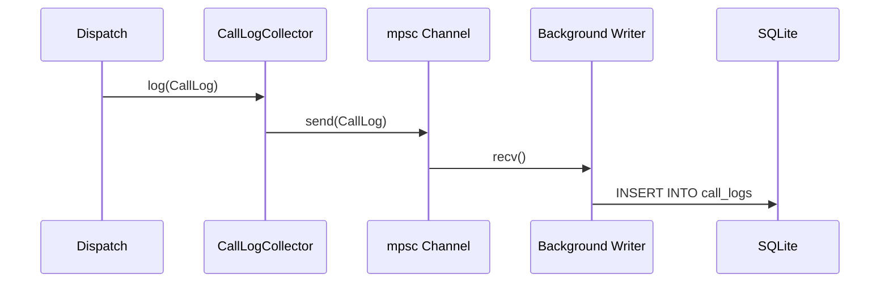

# 分析 — 规格

## 关键文件

- [sag-analytics/src/lib.rs](https://github.com/rainbowatcher/sag/blob/main/sag-analytics/src/lib.rs) — `CallLogCollector` 结构体 + 公共 API
- [sag-analytics/src/store.rs](https://github.com/rainbowatcher/sag/blob/main/sag-analytics/src/store.rs) — Store trait 定义
- [sag-analytics/src/sqlite_store.rs](https://github.com/rainbowatcher/sag/blob/main/sag-analytics/src/sqlite_store.rs) — SQLite 实现（连接池、写入、查询）
- [sag-analytics/src/collector.rs](https://github.com/rainbowatcher/sag/blob/main/sag-analytics/src/collector.rs) — Channel 收集器（mpsc channel + 后台写入任务）
- [sag-analytics/migrations/20260615000001_init.sqlite.sql](https://github.com/rainbowatcher/sag/blob/main/sag-analytics/migrations/20260615000001_init.sqlite.sql) — SQLite schema 迁移

## 写入数据流

## 关键决策

### Channel 异步写入 vs 同步写入

使用 `tokio::sync::mpsc::unbounded_channel()` 解耦请求处理和数据库写入。

**Trade-off**:
- ✅ 请求处理不被 SQLite I/O 阻塞
- ✅ 后台写入任务可以批量处理（虽然当前是逐条 INSERT）
- ❌ unbounded channel 在极端情况下可能 OOM（但 CallLog 很小，且写入远快于 LLM API 调用）
- ❌ shutdown 时需要等待 channel 排空，否则会丢日志

### Store trait vs 硬编码 SQLite

定义了 `Store` trait，当前只有 SQLite 实现。

**Trade-off**:
- ✅ 未来可以替换为其它存储后端
- ❌ trait 增加了间接层（dyn dispatch），但调用频率低，开销可忽略

### SQLite vs PostgreSQL

选择 SQLite 作为默认存储。

**Trade-off**:
- ✅ 零配置、零依赖、嵌入式
- ✅ 分析数据量小（每次调用一条记录），SQLite 完全胜任
- ❌ 不支持多实例共享（SAG 本身是单进程，无此需求）

对于 LLM 网关的分析场景（不是高吞吐 OLTP），SQLite 是 pragmatic 选择。

### 迁移策略

使用 `sqlx::migrate!()` 宏进行数据库迁移，迁移文件放在 `migrations/` 目录。

**Trade-off**: sqlx 的编译期迁移检查要求迁移文件在编译时存在，意味着迁移文件必须 check in 到版本控制中。这对 schema 演化提供了编译期安全保证。

## 不变式

- `timestamp` 列必须是 `INTEGER`（Unix 毫秒），不能是 TEXT 或 REAL
- `request_id` 唯一（UUID v4）
- 统计查询返回空数组而不是 null 当无数据时
- Shutdown 时先关闭 channel sender，后台任务排空后退出

## 测试策略

- `sag-analytics/src/sqlite_store.rs` — SQLite 写入/查询单元测试
- 迁移测试：验证 `migrations/` 的 forward/reverse 正常

## 变更记录
- [0001 初始化](changes/0001-initial.md)
