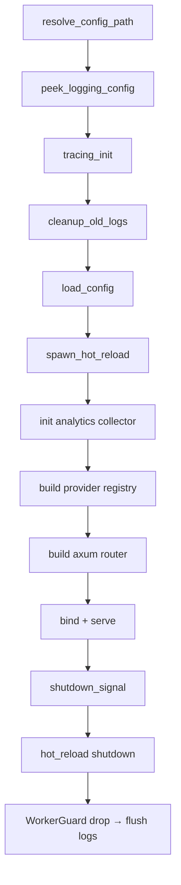

# 架构 — 规格

## 关键文件

- [Cargo.toml](../../../Cargo.toml) — workspace 定义
- [sag-gateway/src/main.rs](../../../sag-gateway/src/main.rs) — 启动编排
- [sag-gateway/src/tracing_init.rs](../../../sag-gateway/src/tracing_init.rs) — tracing 初始化
- [sag-core/src/lib.rs](../../../sag-core/src/lib.rs) — 共享类型导出
- [sag-router/src/lib.rs](../../../sag-router/src/lib.rs) — 路由器构建
- [sag-router/src/routes.rs](../../../sag-router/src/routes.rs) — 中间件链与响应压缩层
- [sag-gateway/src/ui_routes/mod.rs](../../../sag-gateway/src/ui_routes/mod.rs) — 内嵌 UI serve（SPA fallback）
- [sag-ui/scripts/postbuild-compress.mjs](../../../sag-ui/scripts/postbuild-compress.mjs) — UI 构建期预压缩

## 核心设计

### 启动数据流

## 关键决策

### 响应压缩：三层各管一段

| 层 | 覆盖对象 | 时机 | 代价 |
|------|------|------|------|
| SSE 防护头 | 所有 `text/event-stream` 响应 | 运行期（仅设头） | 零 |
| UI 预压缩 | `sag-ui/dist/` 下的文本产物 | 构建期（brotli q11 / gzip 9） | 二进制体积 ≈ 713 KiB（当前 53 个 `.br` + 51 个 `.gz` 实测 730,544 B） |
| 动态压缩层 | ≥ 1 KiB（含 1024 字节整）的 API 响应 | 运行期（`Fastest`） | 每请求一次快速编码 |

**Trade-off**：内嵌 UI 与 API 响应走不同路径，不是实现分裂，而是中间件挂载顺序的必然结果 —— `build_router` 的 `.layer()` 只对当时已注册的路由生效，`main.rs` 在 `build_router` 返回后才 `.fallback(ui_handler)`，UI fallback 永远不经过压缩层 / CORS / body limit / `http_log`。因此 UI 侧的 `Content-Encoding` / `Vary` / `Cache-Control` 必须由 handler 自己设。

**动态压缩 predicate**：不用 tower-http 的 `DefaultPredicate`（尺寸下限 32 字节，对网关响应太低），改取 `SizeAbove(1024) ∧ ¬SSE ∧ ¬GRPC ∧ ¬IMAGES`。`SizeAbove` 把「尺寸未知」视为可压缩，而 SSE 正是尺寸未知，所以 SSE 必须显式排除。级别取 `CompressionLevel::Fastest`：网关延迟敏感，压缩比的边际收益不如 CPU 时间。默认开启，无配置开关。

**压缩层必须在 `http_log` 之外**：`log_http` 缓冲响应体以记录明文预览与 `content-length`；若压缩层在其内侧，日志会记录压缩后的乱码且 `content-length` 被 tower-http 移除。

**已知边界**：`Accept-Encoding: identity;q=0` 时 tower-http 返回 406（无可用编码），不额外兜底；该 406 对 SSE 路径同样生效（发生在 predicate 判定之前）。

### 日志输出：TTY 检测 + 双重路径

日志根据 `std::io::stdout().is_terminal()` 选择输出目标：
- **TTY（开发）**：仅输出到 stdout，保持开发体验简洁
- **非 TTY（生产/test-env）**：写入 `$XDG_STATE_HOME/sag/logs/sag.*.log` 每日轮转文件

**Trade-off**: 生产环境中 stdout/stderr 被 DEVNULL 丢弃，日志仅存于文件。意味着 `panic!` 导致的非 tracing 输出会丢失。但 tracing 覆盖了所有正常的日志路径，panic 消息通过 tracing-subscriber 的 panic hook 也能捕获。

### 单一二进制 vs 微服务

SAG 选择单进程架构，所有功能在一个二进制中。

**Trade-off**: 
- ✅ 部署简单（一个文件）、无进程间通信开销、资源开销低
- ❌ 无法独立扩缩容子功能、一个模块 panic 影响全局

对于 LLM 网关的场景，请求量瓶颈在上游 API 而非网关本身，单进程架构足够。

### 共享状态：Arc + RwLock

所有共享状态（providers、config、analytics）通过 `Arc<RwLock<T>>` 在线程间共享。

**Trade-off**: `RwLock` 在读多写少场景（路由查询远多于配置更新）下比 `Mutex` 高效。但也意味着需要显式 `.read().await` / `.write().await`，不能隐式地跨 `.await` 持有锁。

### WorkerGuard 生命周期

`tracing_appender::non_blocking()` 返回 `(NonBlocking, WorkerGuard)`。Guard 管理一个后台线程，drop 时 flush 并关闭。

Guard 在 `main()` 中声明为第一个局部变量，利用 Rust 的**反向 drop 顺序**确保它在所有其它资源之后释放——包括 `hot_reload_handle` 和 axum server。这保证了所有 tracing 消息在进程退出前被 flush。

## 版本升级脚本

版本唯一源是根 `Cargo.toml` 的 `[workspace.package] version`；9 个成员 crate 通过 `version.workspace = true` 继承，升级脚本不再改写成员 `Cargo.toml`。一次升级只写入并提交四类文件：根 `Cargo.toml`、`Cargo.lock`（成员条目以 crate 名从根版本 (旧, 新) 推导）、`sag-ui/package.json`、`docs/package.json`。

`scripts/release.py` 将每个版本源文件实际修改后的路径收集为候选变更文件，行为与 `bumpp` 的 `updatedFiles` 类似：只有检测到替换的文件才进入候选列表。自动提交前通过 `git ls-files --cached` 过滤候选列表，仅向 `git commit -- <paths>` 传入已被 Git 跟踪的路径。

因此，Cargo workspace 即使因项目策略将 `Cargo.lock` 放入 `.gitignore`，脚本仍会同步本地 lockfile，但会跳过该文件的自动提交，不会因无效 pathspec 失败。其它未跟踪或忽略的版本文件遵循同样规则。

CI 的版本门禁（`.github/workflows/release.yml`）同样从根 `Cargo.toml` 的 `[workspace.package] version` 读取，维持单一版本源。

## 不变式

- `sag-core` 不依赖任何工作区子包
- dependents 只向下依赖（无循环依赖）
- 配置文件路径解析支持 `--config <path>`、`--config=<path>`、位置参数三种形式
- Shutdown 顺序：server → hot_reload → analytics → WorkerGuard
- `CompressionLayer` 始终注册在 `http_log` 之后（更外层），顺序不可调换
- UI fallback 永远不经过 `build_router` 的中间件栈；其 `Content-Encoding` / `Vary` / `Cache-Control` 由 `ui_handler` 自己设置
- UI 静态资源缓存头按 `assets/` 前缀分档：`assets/**` 为 `public, max-age=31536000, immutable`，`index.html`（及未来根级无 hash 文件）为 `no-cache` 且带 `ETag`，`If-None-Match` 命中返空 body `304`；ETag 取自**实际下发表示**（`.br`/`.gz` sibling 与 identity 各自独立）
- 兜底顺序不可调换：`api/` / `v1/` 前缀先返 404 JSON（`NOT_FOUND`，与已注册路由同形），静态面的 `405 + Allow: GET, HEAD` 与 `404` 只在非 API 命名空间生效；`assets/` 前缀永远不回 shell
- `*.br` / `*.gz` 预压缩件不可作为独立资源访问（404），且仅在收益 ≥ 2% 时才随构建产出

## 测试策略

- 单元测试：各子包 `#[cfg(test)] mod tests`
- 集成测试：`sag-router/tests/auth_regression.rs`、`sag-router/tests/compression.rs`
- 单元测试（无特性依赖）：`sag-gateway/src/ui_routes/negotiate.rs` 的 `Accept-Encoding` 协商
- 单元测试（需 `embed-ui`）：`sag-gateway/src/ui_routes/mod.rs` 的预压缩下发；`just clippy` / `just test-rust` 各带一条 `--features embed-ui` 命令覆盖该门控代码（需先有 `sag-ui/dist/`）
- 端到端：`scripts/test-env.py` 启动 release 二进制测试真实行为

## 变更记录
- [0001 初始化](changes/0001-initial.md)
- [0002 版本升级提交按实际变更文件过滤](changes/0002-version-bump-commit-files.md)
- [0003 HTTP 响应压缩：SSE 防护头、UI 构建期预压缩、动态压缩层](changes/0003-http-response-compression.md)
