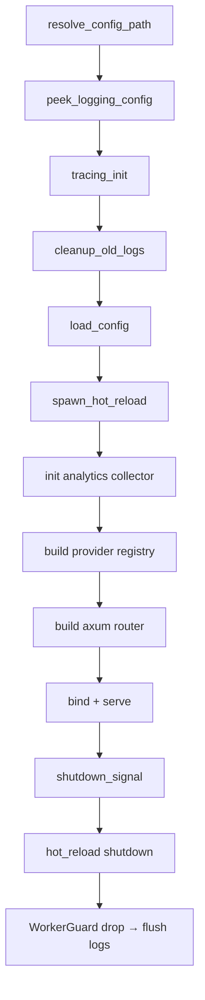

# 架构 — 规格

## 关键文件

- [Cargo.toml](../../../Cargo.toml) — workspace 定义
- [sag-gateway/src/main.rs](../../../sag-gateway/src/main.rs) — 启动编排
- [sag-gateway/src/tracing_init.rs](../../../sag-gateway/src/tracing_init.rs) — tracing 初始化
- [sag-core/src/lib.rs](../../../sag-core/src/lib.rs) — 共享类型导出
- [sag-router/src/lib.rs](../../../sag-router/src/lib.rs) — 路由器构建

## 核心设计

### 启动数据流

## 关键决策

### 日志输出：TTY 检测 + 双重路径

日志根据 `std::io::stdout().is_terminal()` 选择输出目标：
- **TTY（开发）**：仅输出到 stdout，保持开发体验简洁
- **非 TTY（生产/test-env）**：写入 `logs/sag.*.log` 每日轮转文件

**Trade-off**: 生产环境中 stdout/stderr 被 DEVNULL 丢弃，日志仅存于文件。意味着 `panic!` 导致的非 tracing 输出会丢失。但 tracing 覆盖了所有正常的日志路径，panic 消息通过 tracing-subscriber 的 panic hook 也能捕获。

### 单一二进制 vs 微服务

SAG 选择单进程架构，所有功能在一个二进制中。

**Trade-off**: 
- ✅ 部署简单（一个文件）、无进程间通信开销、资源开销低
- ❌ 无法独立扩缩容子功能、一个模块 panic 影响全局

对于 LLM 网关的场景，请求量瓶颈在上游 API 而非网关本身，单进程架构足够。

### 共享状态：Arc + RwLock

所有共享状态（providers、config、analytics）通过 `Arc<RwLock<T>>` 在线程间共享。

**Trade-off**: `RwLock` 在读多写少场景（路由查询远多于配置更新）下比 `Mutex` 高效。但也意味着需要显式 `.read().await` / `.write().await`，不能隐式地跨 `.await` 持有锁。

### WorkerGuard 生命周期

`tracing_appender::non_blocking()` 返回 `(NonBlocking, WorkerGuard)`。Guard 管理一个后台线程，drop 时 flush 并关闭。

Guard 在 `main()` 中声明为第一个局部变量，利用 Rust 的**反向 drop 顺序**确保它在所有其它资源之后释放——包括 `hot_reload_handle` 和 axum server。这保证了所有 tracing 消息在进程退出前被 flush。

## 不变式

- `sag-core` 不依赖任何工作区子包
- dependents 只向下依赖（无循环依赖）
- 配置文件路径解析支持 `--config <path>`、`--config=<path>`、位置参数三种形式
- Shutdown 顺序：server → hot_reload → analytics → WorkerGuard

## 测试策略

- 单元测试：各子包 `#[cfg(test)] mod tests`
- 集成测试：`sag-router/tests/auth_regression.rs`
- 端到端：`scripts/test-env.py` 启动 release 二进制测试真实行为

## 变更记录
- [0001 初始化](changes/0001-initial.md)
