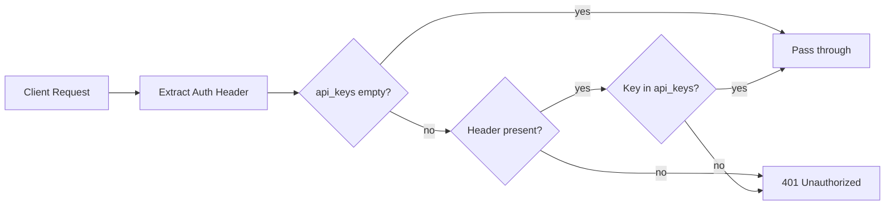

# 认证 — 规格

## 关键文件

- [sag-router/src/middleware/auth.rs](https://github.com/rainbowatcher/sag/blob/main/sag-router/src/middleware/auth.rs) — 认证中间件（提取 Bearer token、比对 api_keys）
- [sag-config/src/config.rs](https://github.com/rainbowatcher/sag/blob/main/sag-config/src/config.rs) — `GatewayAuthConfig`
- [sag-ui/src/stores/connection.ts](https://github.com/rainbowatcher/sag/blob/main/sag-ui/src/stores/connection.ts) — 前端连接状态管理（localStorage 持久化）

## 认证数据流

## 关键决策

### 简单 Bearer token vs JWT

选择静态 API Key 列表，不使用 JWT。

**Trade-off**:
- ✅ 极简实现（中间件只需比对字符串）
- ✅ 无需密钥管理（无 JWT secret 配置）
- ❌ 无过期机制（key 永久有效直到手动删除）
- ❌ 无细粒度权限

对于 LLM 网关的内部使用场景，静态 key 足够。JWT 的复杂度（secret 管理、过期策略、刷新机制）不值得。

### 中间件 vs Handler 内认证

认证在 Axum 中间件层（`tower_http::auth::RequireAuthorizationLayer`），而非在 handler 内手动检查。

**Trade-off**:
- ✅ 所有路由自动受保护，不会遗漏
- ✅ 认证失败在请求生命周期的最早阶段被拒绝，不浪费下游资源
- ❌ 中间件覆盖所有路由（目前所有路由都需要认证，所以这不是问题）

### 热重载不支持 auth

`[gateway_auth]` 修改需要重启，不支持热重载。这是因为认证层在 Axum router 构建时注入，热替换需要重建 router。

**Trade-off**: 支持热重载的复杂度（需要动态更新中间件中的 key 列表）显著高于运维价值（API key 很少在运行时变更）。

## 不变式

- `api_keys` 为空 → 等于无 `[gateway_auth]` 段
- 认证中间件先于所有业务 handler 执行
- 管理 API 和模型 API 共享同一认证逻辑

## 测试策略

- `sag-router/tests/auth_regression.rs` — 端到端认证测试

## 变更记录
- [0001 初始化](changes/0001-initial.md)
