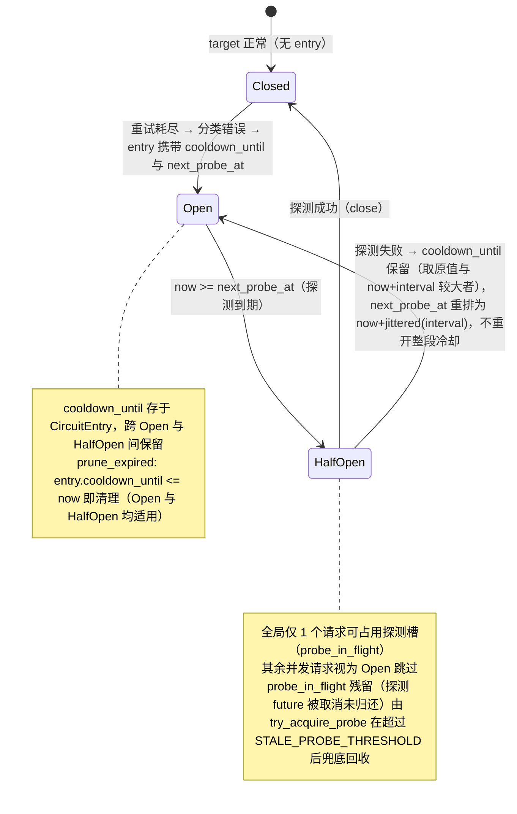
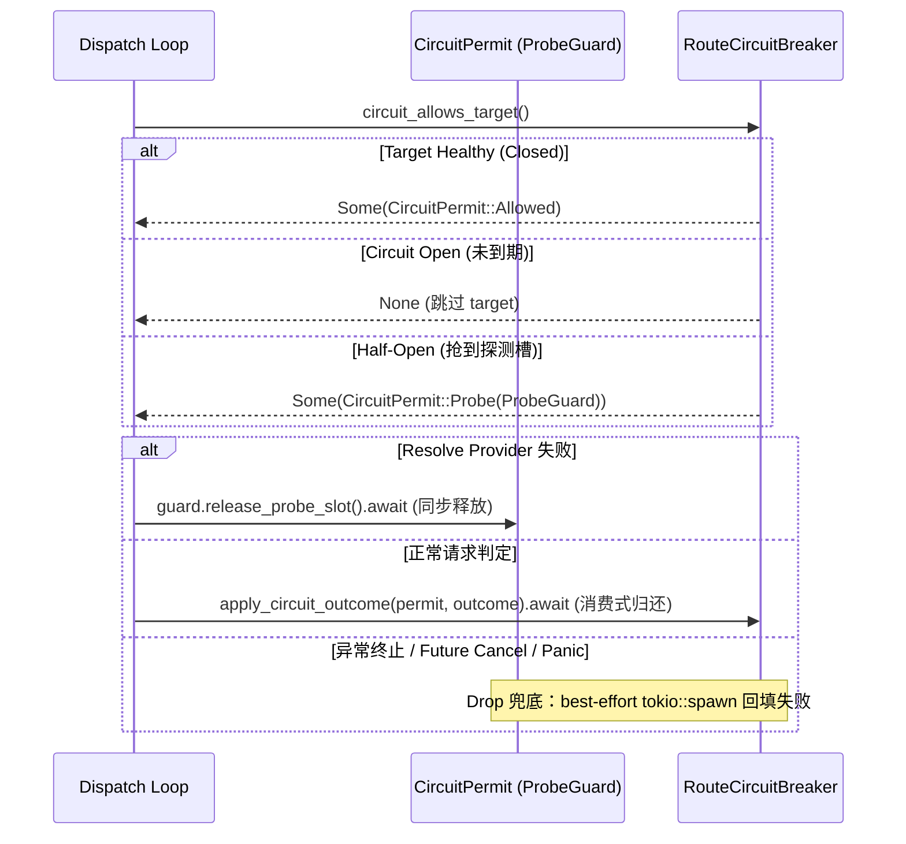

# 熔断器 — 规格

## 关键文件

### 核心状态机与类型
- [sag-core/src/circuit_breaker.rs](../../../sag-core/src/circuit_breaker.rs) — 熔断器核心三态机、探测槽抢占与快照数据结构
- [sag-core/src/types.rs](../../../sag-core/src/types.rs) — `CircuitHint` 枚举与 `AppError::circuit_hint()` 错误分类
- [sag-config/src/config.rs](../../../sag-config/src/config.rs) — `CircuitBreakerConfig` 配置段

### 门禁守卫与调度
- [sag-dispatch/src/dispatch/mod.rs](../../../sag-dispatch/src/dispatch/mod.rs) — `CircuitPermit` 与 `ProbeGuard` RAII 门禁守卫、`circuit_allows_target`、`apply_circuit_outcome`
- [sag-dispatch/src/dispatch/chat/mod.rs](../../../sag-dispatch/src/dispatch/chat/mod.rs) 与 [sag-dispatch/src/dispatch/image.rs](../../../sag-dispatch/src/dispatch/image.rs) — 消费门禁许可的主调度循环

### 状态共享与管理端点
- [sag-state/src/lib.rs](../../../sag-state/src/lib.rs) — `AppState.circuit_breaker` 全局状态持有与 `force_close_circuit` 业务组合操作
- [sag-admin/src/admin_circuit_breaker.rs](../../../sag-admin/src/admin_circuit_breaker.rs) — admin 端点：`GET /api/circuit-breaker`、`POST /api/circuit-breaker/close`

## 核心设计

### 熔断器状态机



一个 entry 涉及两个时间点：`cooldown_until`（错误类型决定的硬下限，存于 `CircuitEntry`，跨 `Open`/`HalfOpen` 保留以确保探测失败不丢失原始冷却窗口）；此外 `CircuitState::Open` 变体携带 `next_probe_at`（下次允许探测的时刻，初始为 `open` 时刻 + `jittered(probe_interval)`）。`Closed` 由"无 entry"隐式表示。

### RAII 门禁守卫与探测槽生命周期



## 关键决策

### 半开探测 + 冷却期周期探测（ reversal of 初始决策）

初始规格明确"不包含半开状态（half-open）探测"。本变更**反转**该决策：引入三态机与冷却期内的周期探测。

**动机**：纯时间驱动无法感知"上游是否真的恢复"。LLM 供应商普遍提供 5 小时限额 / 每日限额 / RPM 瞬时限流，额度可能在冷却窗口中途被补充——原实现要傻等满冷却（默认 1h）才发现，对 fill-first / sticky-failover 首选 target 尤其伤。

**Trade-off**:

- ✅ 上游恢复后最多 `probe_interval_secs` 内被发现并解除跳过（提前感知）
- ✅ 冷却期内探测带 jitter 且全局仅 1 次，额外上游流量极小
- ❌ 冷却期内会产生低频真实探测请求（运营已确认可接受）
- ❌ 实现复杂度上升（状态机、并发探测槽、失败重排）

### 探测失败仅重排 interval，不重开整段冷却

探测失败（含 4xx）只把 `next_probe_at` 推后一个 `probe_interval_secs`，保持 `Open` 继续轮询。若失败重开整段 `duration`（如 1h），则又回到"等满冷却才再探测"，提前感知失效。

### RAII 门禁守卫单次完成机制 vs 手工布尔与显式释放分支

**背景**：调度主循环需在抢占探测槽后维护槽位归还，手工传递 `is_probe` 与在分支中手动释放极易漏还。

**Trade-off**:

- ✅ 通过 `CircuitPermit` / `ProbeGuard` 封装探测槽生命周期：正常路径通过消费式 `apply_circuit_outcome` 或 `guard.release_probe_slot()` 同步 `await` 归还，类型系统消除了 `is_probe` 布尔变量；异常路径通过 `Drop` 兜底（`completed` 标志保证单次完成）。
- ❌ 放弃「手动传递 `is_probe: bool` 并在每个早退分支手工调用释放函数」：多调度入口下心智负担重，极易产生探测槽泄漏。

### `force_close_circuit` 领域方法下沉 vs Handler 手工组合

**背景**：关闭目标熔断时必须同步清理该模型的粘性路由记忆。

**Trade-off**:

- ✅ 在 `AppState` 下沉 `force_close_circuit` 组合方法，顺序获取写锁并通过既有 `routes_version` / `generation` / `epoch` 校验防御 stale writeback，保证最终一致性。
- ❌ 放弃「在 Axum Admin Handler 中硬编码多锁组合」：避免业务语义泄露到 HTTP 传输层。

### 4xx 行为非对称（有意设计）

非可重试 4xx 经归因后（见 [4xx Failover 归因策略](../failover-4xx-policy/spec.md)）：客户端归因（400/413/422/未知）直接返客户端、不进 failover；provider 持续性归因（401/404/403-非quota）failover 但不开闸；403-quota 已重分类为可重试，耗尽后开闸（`QuotaExhausted`）。

- 健康 target 收到非可重试 4xx（客户端 / provider 持续性）→ 不打开熔断，零惩罚（前者是客户端请求问题、后者是持续性配置问题，探针自愈对两者无意义）。
- 探测期收到 4xx → 按失败探测重排（短暂跳过），原因：探测必须回填结果，4xx 表示"此刻不可用"，避免 half-open 槽卡死。

### `CircuitHint` 的分类粒度

```rust
pub enum CircuitHint {
    QuotaExhausted,  // 1h
    RateLimited,     // 10s
    Generic,         // 60s
}
```

**Trade-off**: 三种分类 vs 更多细分：

- 三种覆盖了主要的故障模式
- 更多分类（如区分 timeout 和 500）会增加配置复杂度，但效用有限

### 全局状态 vs 每 target 状态

熔断器状态存储在 `AppState` 与 `DispatchRuntime.circuit_breaker` 共享的 `Arc<RwLock<RouteCircuitBreaker>>` 中（内部以 `RouteTargetKey = (model, provider, real_model)` 为键索引）。

**Trade-off**: 全局 HashMap vs 嵌入 RouteTarget：

- 全局：简单，热重载时只需清除对应 key
- 嵌入：与 target 生命周期绑定，但 target 可能在热重载时被删除

选择全局是因为热重载安全——即使 target 被删除又重建，状态可以通过 `(model, provider, real_model)` key 找到。

## 不变式

### 状态机与时间下限
- 冷却期按 `opened_at + cooldown_secs` 计算（不依赖定时器）
- 同一个 target 的多个错误不叠加冷却（取最近的）
- 熔断器打开时记录的是当时的时间戳，不是 UTC 字符串
- `Open` 态始终携带 `next_probe_at`（`cooldown_until` 存于 `CircuitEntry`，跨 `Open`↔`HalfOpen` 保留）；`can_probe_now` 对 `Closed`/`HalfOpen`/到期 `Open` 返回 true
- `prune_expired` 基于 `CircuitEntry.cooldown_until` 判断，对 `Open` 和 `HalfOpen` 一视同仁：`cooldown_until <= now` 即清理 entry
- 无探测次数上限：真耗尽目标按 `probe_interval_secs` 无限期低频探测直到恢复

### 探测槽与并发控制
- 半开探测槽（`probe_in_flight`）全局唯一：探测期间仅 1 个请求打上游，其余视为 `Open` 跳过
- 探测槽生命周期由 `ProbeGuard` 守卫：正常路径同步 `await`（消费式 `apply_circuit_outcome` 或 `release_probe_slot`），异常路径（panic / future drop）由 `ProbeGuard::drop` 兜底
- `ProbeGuard` 单次完成机制：`mark_completed()` 在任何 await 之前置位，绝不产生重复归还
- 探测槽僵死回收：若探测槽因 runtime 不可用未能回收，`try_acquire_probe` 在 `probe_acquired_at` 超过 `STALE_PROBE_THRESHOLD`（3600s）后兜底回收，目标不会被永久跳过

### 状态联动与命名
- `force_close_circuit` 最终一致性：顺序执行 `circuit_breaker.close()` 与 `active_targets.clear()`；并发请求写回由 `insert_if_generation` 版本机制拦截
- 命名统一：`AppState.circuit_breaker` 与 `DispatchRuntime.circuit_breaker` 保持同名，内部引用直达 `sag_core` Primitives

## 测试策略

- `sag-core/src/circuit_breaker.rs` — 单元测试：状态转换、周期探测到期、失败重排 interval（非整段冷却）、并发仅 1 次探测
- `sag-dispatch/src/dispatch/chat/tests.rs` 与 `image.rs` — 集成测试：冷却期内提前恢复、探测失败重排、并发 in-flight skip、探测槽泄漏回归（`resolve_provider` 失败路径）
- `sag-dispatch/src/dispatch/mod.rs` — RAII 专项单元测试：`ProbeGuard` Drop 不 panic / detach 归还、消费式 `apply_circuit_outcome` 单次完成、非对称 4xx 开闸语义
- `sag-config/src/config.rs` — `probe_interval_secs` 校验
- `sag-admin/src/admin_circuit_breaker.rs` — admin 端点测试：快照查询、手动恢复与 Sticky 记忆清理联动

## 变更记录

- [0001 4xx Failover 归因策略](../failover-4xx-policy/changes/0001-4xx-attribution-policy.md)（跨模块：403-quota 重分类为可重试 + 开闸）
- [0001 初始化](changes/0001-initial.md)
- [0002 熔断半开探测与冷却期周期探测](changes/0002-half-open-periodic-probe.md)
- [0003 探测失败隐瞒冷却下界与流式取消探测槽泄漏修复](changes/0003-probe-lifetime-fix.md)
- [0004 熔断状态可观测化](changes/0004-observability.md)
- [0005 手动关闭熔断时清除 StickyFailover 粘性记忆](changes/0005-manual-close-clears-sticky.md)
- [0006 熔断器逻辑概念内聚与探测槽生命周期治理（RAII）](changes/0006-concept-consolidation-and-probe-guard-lifecycle.md)（`CircuitPermit`/`ProbeGuard` RAII 守卫、`force_close_circuit` 下沉 `sag-state`、移除 shim、`DispatchRuntime.circuit_breaker` 命名统一）
