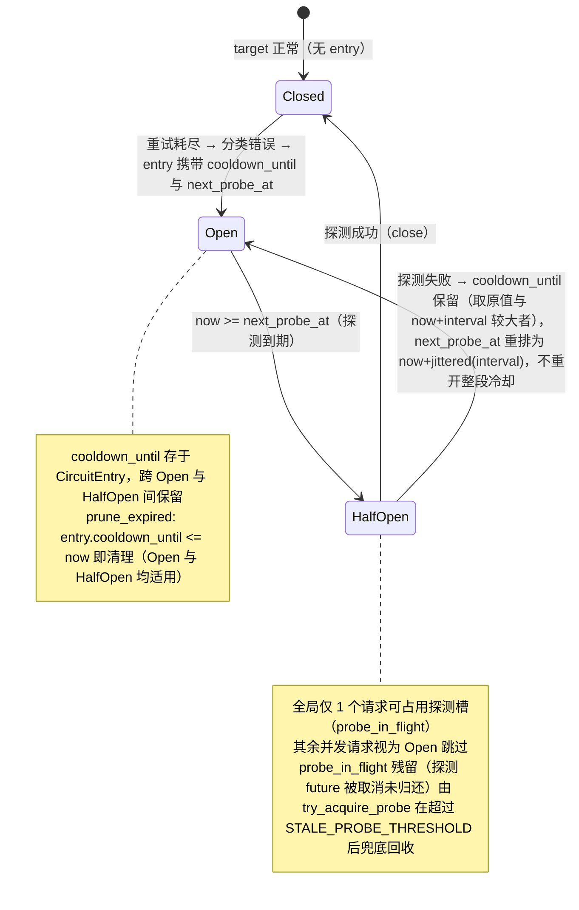

# 熔断器 — 规格

## 关键文件

- [sag-dispatch/src/circuit_breaker.rs](../../../sag-dispatch/src/circuit_breaker.rs) — 熔断器状态管理
- [sag-core/src/types.rs](../../../sag-core/src/types.rs) — `CircuitHint` 枚举（错误分类）
- [sag-config/src/config.rs](../../../sag-config/src/config.rs) — `CircuitBreakerConfig` 配置段

## 核心设计

### 熔断器状态机



一个 entry 涉及两个时间点：`cooldown_until`（错误类型决定的硬下限，存于 `CircuitEntry`，跨 `Open`/`HalfOpen` 保留以确保探测失败不丢失原始冷却窗口）；此外 `CircuitState::Open` 变体携带 `next_probe_at`（下次允许探测的时刻，初始为 `open` 时刻 + `jittered(probe_interval)`）。`Closed` 由"无 entry"隐式表示。

## 关键决策

### 半开探测 + 冷却期周期探测（ reversal of 初始决策）

初始规格明确"不包含半开状态（half-open）探测"。本变更**反转**该决策：引入三态机与冷却期内的周期探测。

**动机**：纯时间驱动无法感知"上游是否真的恢复"。LLM 供应商普遍提供 5 小时限额 / 每日限额 / RPM 瞬时限流，额度可能在冷却窗口中途被补充——原实现要傻等满冷却（默认 1h）才发现，对 fill-first / sticky-failover 首选 target 尤其伤。

**Trade-off**:
- ✅ 上游恢复后最多 `probe_interval_secs` 内被发现并解除跳过（提前感知）
- ✅ 冷却期内探测带 jitter 且全局仅 1 次，额外上游流量极小
- ❌ 冷却期内会产生低频真实探测请求（运营已确认可接受）
- ❌ 实现复杂度上升（状态机、并发探测槽、失败重排）

### 探测失败仅重排 interval，不重开整段冷却

探测失败（含 4xx）只把 `next_probe_at` 推后一个 `probe_interval_secs`，保持 `Open` 继续轮询。若失败重开整段 `duration`（如 1h），则又回到"等满冷却才再探测"，提前感知失效。

### 4xx 行为非对称（有意设计）

- 健康 target 收到 4xx（NonRetryable）→ 不打开熔断，零惩罚（4xx 通常是客户端请求问题，非 target 故障）。
- 探测期收到 4xx → 按失败探测重排（短暂跳过），原因：探测必须回填结果，4xx 表示"此刻不可用"，避免 half-open 槽卡死。

### `CircuitHint` 的分类粒度

```rust
pub enum CircuitHint {
    QuotaExhausted,  // 1h
    RateLimited,     // 10s
    Generic,         // 60s
}
```

**Trade-off**: 三种分类 vs 更多细分：
- 三种覆盖了主要的故障模式
- 更多分类（如区分 timeout 和 500）会增加配置复杂度，但效用有限

### 全局状态 vs 每 target 状态

熔断器状态存储在 `DispatchRuntime` 的 `HashMap<RouteTargetKey, CircuitEntry>` 中（`RouteTargetKey = (model, provider, real_model)`，避免不同逻辑路由共享同一 provider 的熔断状态）。

**Trade-off**: 全局 HashMap vs 嵌入 RouteTarget：
- 全局：简单，热重载时只需清除对应 key
- 嵌入：与 target 生命周期绑定，但 target 可能在热重载时被删除

选择全局是因为热重载安全——即使 target 被删除又重建，状态可以通过 `(model, provider, real_model)` key 找到。

## 不变式

- 冷却期按 `opened_at + cooldown_secs` 计算（不依赖定时器）
- 同一个 target 的多个错误不叠加冷却（取最近的）
- 熔断器打开时记录的是当时的时间戳，不是 UTC 字符串
- `Open` 态始终携带 `next_probe_at`（`cooldown_until` 存于 `CircuitEntry`，跨 `Open`↔`HalfOpen` 保留）；`can_probe_now` 对 `Closed`/`HalfOpen`/到期 `Open` 返回 true
- 半开探测槽（`probe_in_flight`）全局唯一：探测期间仅 1 个请求打上游，其余视为 `Open` 跳过
- `resolve_provider` 返回 `None` 且已占用探测槽时，必须调用 `release_probe_slot` 回填失败结果，避免 `probe_in_flight` 残留
- 探测 future 被取消（客户端断连导致 handler future 被 drop）未归还探测槽时，`HalfOpen + probe_in_flight` 残留由 `try_acquire_probe` 在 `probe_acquired_at` 超过 `STALE_PROBE_THRESHOLD`（3600s）后兜底回收，避免目标永久跳过
- `prune_expired` 基于 `CircuitEntry.cooldown_until` 判断，对 `Open` 和 `HalfOpen` 一视同仁：`cooldown_until <= now` 即清理 entry（`HalfOpen` 且 cooldown 到期表示目标已过冷却期，残留无意义）
- 无探测次数上限：真耗尽目标按 `probe_interval_secs` 无限期低频探测直到恢复

## 测试策略

- `sag-dispatch/src/circuit_breaker.rs` — 单元测试：状态转换、周期探测到期、失败重排 interval（非整段冷却）、并发仅 1 次探测
- `sag-dispatch/src/dispatch/chat.rs` 与 `image.rs` — 集成测试：冷却期内提前恢复、探测失败重排、并发 in-flight skip、探测槽泄漏回归（`resolve_provider` 失败路径）
- `sag-config/src/config.rs` — `probe_interval_secs` 校验

## 变更记录
- [0001 初始化](changes/0001-initial.md)
- [0002 熔断半开探测与冷却期周期探测](changes/0002-half-open-periodic-probe.md)
- [0003 探测失败隐瞒冷却下界与流式取消探测槽泄漏修复](changes/0003-probe-lifetime-fix.md)
