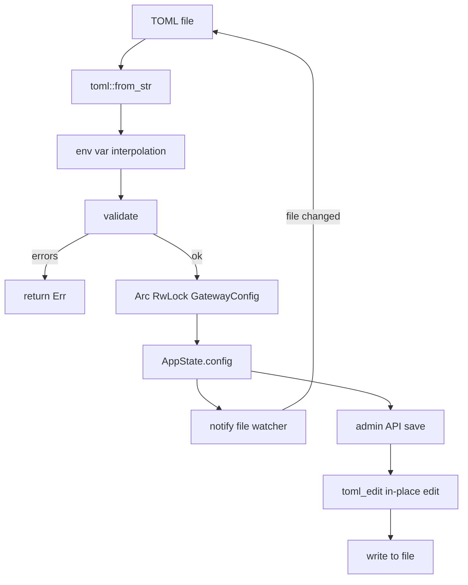

# 配置 — 规格

## 关键文件

- [sag-config/src/config.rs](https://github.com/rainbowatcher/sag/blob/main/sag-config/src/config.rs) — `GatewayConfig`、所有子结构体、`validate()`、序列化辅助函数
- [sag-config/src/loader.rs](https://github.com/rainbowatcher/sag/blob/main/sag-config/src/loader.rs) — `load_config()`、`peek_logging_config()`、`spawn_hot_reload()`、`save_config_to_file()`
- [sag-config/src/toml_edit_util.rs](https://github.com/rainbowatcher/sag/blob/main/sag-config/src/toml_edit_util.rs) — `toml_edit` 原地编辑工具函数
- [sag-config/src/lib.rs](https://github.com/rainbowatcher/sag/blob/main/sag-config/src/lib.rs) — `ConfigHandle` 类型别名

## 配置生命周期

## 关键决策

### Peek vs 完整加载

`peek_logging_config()` 在完整加载前单独读取 `[logging]` 段，因为 tracing 必须在最早时刻初始化。

**Trade-off**: 需要两次读取配置文件（peek + 完整加载），但只需几毫秒。换来的是 startup log 也遵循配置的日志级别。

### toml_edit vs toml 序列化

保存配置时使用 `toml_edit` 做原位编辑，而非用 `toml` crate 重新序列化整个文件。

**Trade-off**:
- ✅ 保留用户原有的注释、空白、字段顺序
- ✅ 只修改变化的部分（增量编辑）
- ❌ 需要手动维护 inline table array 的同步逻辑
- ❌ `toml_edit` API 比 `toml` 的 serde 序列化复杂得多

这个 trade-off 是值得的——配置文件是用户手写的，保留注释和格式是基本体验要求。

### 验证 fail-all vs fail-fast

`validate()` 收集所有错误后一次性返回，而不是遇到第一个错误就停止。

**Trade-off**:
- ✅ 用户一次看到所有问题，不需要反复修改-验证
- ❌ 错误列表中可能包含级联错误（如 provider 不存在 → 路由引用它），但总体体验更好

### 热重载 vs 重启

大部分配置支持热重载，但 `[server]` 和 `[gateway_auth]` 不支持。这是因为：
- `[server].host/port`：已绑定的 TCP socket 无法热迁移到新地址
- `[gateway_auth]`：认证中间件在 Axum 路由构建时注入，热替换需要重建整个 router（等同于重启）

**Trade-off**: 大部分运维场景中 server/auth 在部署时确定，不需要运行时修改。Provider 和 routes 是运维日

常调整的，热重载提供即时生效。

### 序列化默认值跳过

通过 `#[serde(skip_serializing_if)]` 跳过默认值字段，保持配置文件简洁。

**Trade-off**: 用户看到的配置就是他们实际修改的部分。但也意味着"想显式设置为默认值"的场景无法表达（如 `timeout_secs = 120` 不会出现在文件中，除非它已经是默认值）。这在当前场景中是可接受的——如果用户想确认某个值是默认值，可以查看文档。

## 不变式

- `ConfigHandle` = `Arc<RwLock<GatewayConfig>>`（唯一的配置访问路径）
- `GatewayConfig::validate()` 在每次加载和保存时都运行
- 热重载用 `notify` 的 `macos_kqueue` 特性（macOS 上）
- `toml_edit` 编辑以 `(provider, real_model)` 为 key 定位 route target inline table

## 测试策略

- `sag-config/src/config.rs` tests — 大量单元测试（解析、验证、边界情况）
- `sag-config/src/loader.rs` tests — 热重载和保存测试

## 变更记录
- [0001 初始化](changes/0001-initial.md)
