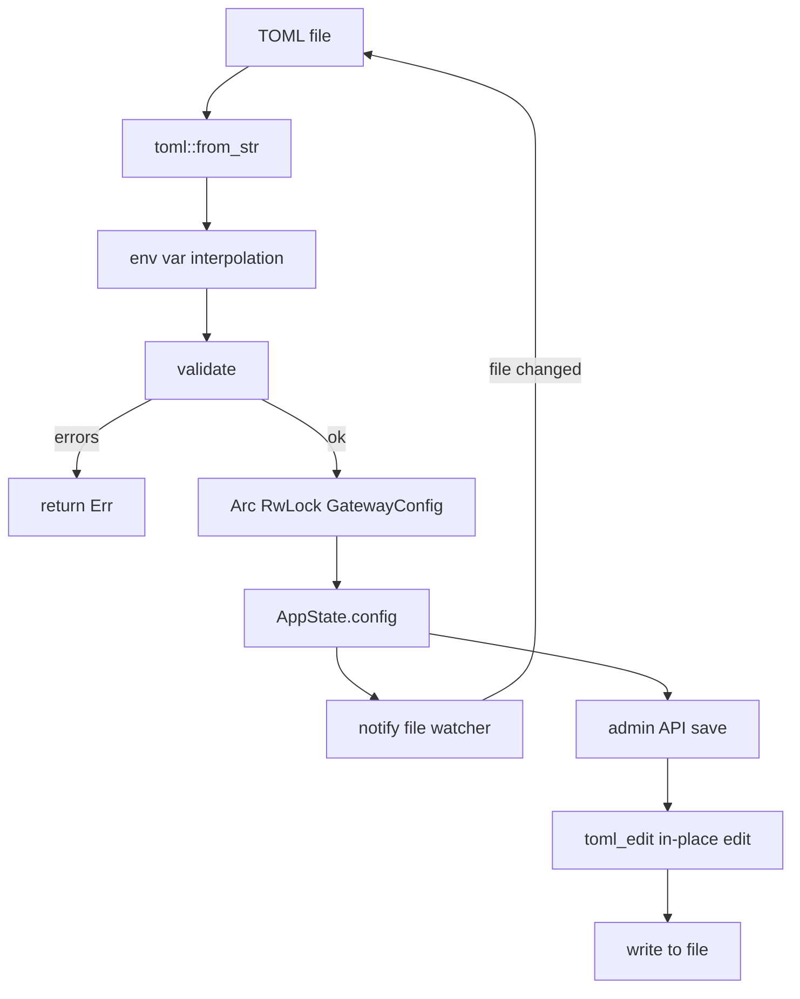
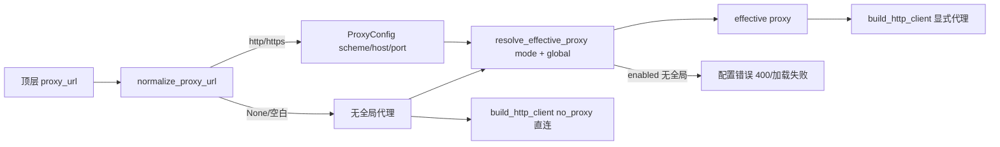

# 配置 — 规格

## 关键文件

- [sag-config/src/config.rs](../../../sag-config/src/config.rs) — `GatewayConfig`、所有子结构体、`validate()`、序列化辅助函数
- [sag-config/src/loader/load.rs](../../../sag-config/src/loader/load.rs) — `load_config()`、`peek_logging_config()`、统一 typed 反序列化（`deserialize_config` / `deserialize_config_collecting`，基于 `serde_ignored`）
- [sag-config/src/loader/reload.rs](../../../sag-config/src/loader/reload.rs) — `spawn_hot_reload()` 热重载 watcher（尾部防抖、目录+文件双监听、有界重试）
- [sag-config/src/loader/save.rs](../../../sag-config/src/loader/save.rs) — `save_config_to_file()` 原子保存
- [sag-config/src/toml_edit_util.rs](../../../sag-config/src/toml_edit_util.rs) — `toml_edit` 原地编辑工具函数
- [sag-config/src/lib.rs](../../../sag-config/src/lib.rs) — `ConfigHandle` 类型别名
- [sag-core/src/http_client.rs](../../../sag-core/src/http_client.rs) — `build_http_client()`：显式代理（`reqwest::Proxy::all`）或直连（`no_proxy()` 屏蔽系统代理环境变量）
- [sag-providers/src/lib.rs](../../../sag-providers/src/lib.rs) — `create_provider_with_proxy()` 公开构造入口
- [sag-providers/src/base.rs](../../../sag-providers/src/base.rs) — `ProviderBase::new_with_proxy()` 有效代理构造
- [sag-state/src/config_mutation.rs](../../../sag-state/src/config_mutation.rs) — `effective_proxy_for()` 统一解析、`update_settings()`、mutation hot reload 按 effective proxy 差异重建
- [sag-admin/src/admin_settings.rs](../../../sag-admin/src/admin_settings.rs) — `GET|PUT /api/settings` handler
- [sag-admin/src/admin_testing.rs](../../../sag-admin/src/admin_testing.rs) — fetch-models / model-test 临时测试按当前内存代理解析
- [sag-gateway/src/main.rs](../../../sag-gateway/src/main.rs) — 启动时按 effective proxy 构造 provider adapter

## 核心设计

### 配置生命周期

热重载 watcher（`loader/reload.rs`）在 [0002](changes/0002-hot-reload-trailing-debounce.md) 起同时监听**父目录**与**配置文件本身**：目录监听保证原子 temp-file + rename 保存（inode 替换）后监听不失效，直接文件监听覆盖 macOS kqueue 目录监听不报告文件内就地编辑的情况。事件按配置路径/文件名过滤，`Access` 只读事件忽略。触发采用**尾部防抖**（`DEBOUNCE`=300ms，`DEBOUNCE_TICK`=100ms 轮询）+ settle 窗口（`SETTLE`=100ms）边界排空：突发写入期间不断重置窗口，保证读取的是最终版本；防抖窗口后若排空到新相关事件则重新武装。加载失败最多重试 `MAX_RELOAD_RETRIES`（2）次后等待下一个文件事件。

### 出站代理解析链路

代理策略在[0005](changes/0005-outbound-proxy-configuration.md) 起形成统一解析链路，启动 / hot reload / admin mutation / 临时测试全部走同一路径：

- `normalize_proxy_url()` 只接受 `http://` / `https://` 且非空 host、拒绝 userinfo；`None` / 空白归一为「未配置」。
- `ProxyConfig` 仅存 scheme/host/port，不存原始 URL 文本与凭据；`to_connect_url()` 由 transport 层重建连接 URL。
- `effective_proxy_for()`（`sag-state/src/config_mutation.rs`）把 `GatewayConfig` + `ProviderConfig` 解析为单个有效代理，所有构造路径（gateway 启动、`ConfigMutationCoordinator` registry sync、测试 registry）共用，保证代理决策一致。
- transport 层统一走 `sag_core::build_http_client()`：`Some(proxy)` → `reqwest::Proxy::all` 单代理；`None` → `no_proxy()` 显式直连，屏蔽 `HTTP_PROXY` / `HTTPS_PROXY` / `ALL_PROXY` 及大小写变体。

## 关键决策

### serde_ignored vs 手写白名单

未知字段告警使用 `serde_ignored` 在 typed 反序列化过程中收集不识别的字段路径（`toml::Deserializer`），而非旧方案的 raw TOML + 手工枚举白名单（`warn_unknown_fields`）。

**Trade-off**: 白名单方案每次新增 Schema 字段都要同步维护 `load.rs` 的键名数组，遗漏即产生误报警告（如 0003 的 `retry_on_empty_response` 虚警）；`serde_ignored` 与 `GatewayConfig` 结构体自动同步，结构体加字段即自动识别，且 load / reload 共用同一路径、行为一致。代价是告警路径变为点分路径格式（如 `providers.openai.max_tokens`），与结构体字段一一对应，调试时同样可读。

### Peek vs 完整加载

`peek_logging_config()` 在完整加载前单独读取 `[logging]` 段，因为 tracing 必须在最早时刻初始化。

**Trade-off**: 需要两次读取配置文件（peek + 完整加载），但只需几毫秒。换来的是 startup log 也遵循配置的日志级别。

### toml_edit vs toml 序列化

保存配置时使用 `toml_edit` 做原位编辑，而非用 `toml` crate 重新序列化整个文件。

**Trade-off**:
- ✅ 保留用户原有的注释、空白、字段顺序
- ✅ 只修改变化的部分（增量编辑）
- ❌ 需要手动维护 inline table array 的同步逻辑
- ❌ `toml_edit` API 比 `toml` 的 serde 序列化复杂得多

这个 trade-off 是值得的——配置文件是用户手写的，保留注释和格式是基本体验要求。

### 尾部防抖 vs 前缘防抖

热重载 watcher 使用尾部防抖（仅当文件静默超过 300ms 后才加载），而非旧的前缘防抖（首个事件后立即加载、随后 500ms 内忽略）。

**Trade-off**: 尾部防抖会引入一点加载延迟（突发写入停止后最多 300ms+100ms 才生效），但保证永远读取突发写入的**最终版本**；前缘防抖可能在编辑器分段原子保存时把中间态当作最终配置加载且不再重新读取，造成永久错误的运行态。这个 trade-off 是值得的——热重载的首要正确性是「加载最终版本」，而不是「尽快加载」。

### 验证 fail-all vs fail-fast

`validate()` 收集所有错误后一次性返回，而不是遇到第一个错误就停止。

**Trade-off**:
- ✅ 用户一次看到所有问题，不需要反复修改-验证
- ❌ 错误列表中可能包含级联错误（如 provider 不存在 → 路由引用它），但总体体验更好

### 热重载 vs 重启

大部分配置支持热重载，但 `[server]` 和 `[gateway_auth]` 不支持。这是因为：
- `[server].host/port`：已绑定的 TCP socket 无法热迁移到新地址
- `[gateway_auth]`：认证中间件在 Axum 路由构建时注入，热替换需要重建整个 router（等同于重启）

**Trade-off**: 大部分运维场景中 server/auth 在部署时确定，不需要运行时修改。Provider 和 routes 是运维日

常调整的，热重载提供即时生效。

### 显式代理 vs 系统代理环境变量

出站代理策略选择「配置显式控制 + 屏蔽系统代理环境变量」，而非「未配置时回退系统代理」。

**Trade-off**: 放弃 reqwest 默认的系统代理发现能力（宿主机设置了 `HTTP_PROXY` 时不再自动生效），换来行为完全可预测：代理是否生效只取决于 `proxy_url` / `proxy_mode` 配置，部署环境变量不再悄悄影响流量路径；同时避免代理凭据被 reqwest 透传、避免「测试环境直连、生产环境走代理」的隐式差异。代价是用户必须显式配置代理——这是网关类组件应有的显式性。

### proxy_mode 三态 vs 布尔开关

provider 级代理策略用三态枚举（`inherit` / `enabled` / `disabled`）而非布尔开关。

**Trade-off**: 布尔开关只能表达「用不用全局代理」，无法区分「默认跟随全局」与「明确强制直连」。三态中 `inherit` 是向后兼容的默认值（旧配置无 `proxy_mode` 字段行为不变），`enabled` 把「依赖全局代理」变成显式声明（无全局代理时配置错误，而不是静默直连），`disabled` 提供强制隔离（如直连内网 LLM 的 provider 不受全局代理影响）。代价是多一个需要文档化的枚举值，但其语义与运维直觉一致。

### 代理重建边界 vs 全量重建

热重载 / settings 变更后 provider adapter 的重建按 **effective proxy 差异** 判定，而非「全局代理变了就重建全部」。

**Trade-off**: 比较解析后的 effective proxy（而不是原始 `proxy_url` 或 `proxy_mode` 字段），使顶层代理变化只重建实际受影响的 provider：`inherit` / `enabled` 的 effective proxy 变化时重建，`disabled` 的 effective proxy 恒为 `None`、不受全局代理变化影响、不重建。代价是重建判定需要额外解析步骤，但换来更少的无谓重建与更稳定的运行态。在途请求不强行中断。

### 序列化默认值跳过

通过 `#[serde(skip_serializing_if)]` 跳过默认值字段，保持配置文件简洁。

**Trade-off**: 用户看到的配置就是他们实际修改的部分。但也意味着"想显式设置为默认值"的场景无法表达（如 `timeout_secs = 120` 不会出现在文件中，除非它已经是默认值）。这在当前场景中是可接受的——如果用户想确认某个值是默认值，可以查看文档。

### 多协议 fallback：显式策略 vs 静默默认

`apis` 声明多个协议 key 时 `fallback` 必填（值 ∈ 协议 key 集）；恰好一个协议 key 时可省略，自动取该协议。校验直接报错，不做静默默认。

**背景**: IR（协议中立中间表示）使任意入口协议 ↔ 任意目标协议的翻译成为通用能力，「能不能翻译」不再由配置回答；`fallback` 回答的是「译到哪一个已声明协议」。该值经 `used_protocol()`（`sag-dispatch/src/dispatch/capability.rs`）决定 translated 请求的实际使用协议，进而决定 `apis.<key>` 节的取用（上游地址、鉴权头形状、协议相关覆盖字段）、能力预检档位（如 `responses` 声明 `documents=false`，带文件块的请求被剔除）与 IR 编码的字段损耗清单——目标协议不同则行为不同。

**被放弃的方案**: ① 多协议 key 时静默取默认（如取第一个协议 key）——行为改变不可见（可路由性、保真度、地址与鉴权随默认值漂移）；② 按请求硬需求动态选择编码目标——与能力预检职责重叠，且使同一 target 的 lane 随请求变化，行为不可预测、不可审计。

**Trade-off**: 显式必填换来配置即意图、行为可预测可审计；代价是多协议 provider 需多写一个字段（校验报错附带建议值降低摩擦）。三协议全声明时不存在 translated 车道，字段不参与运行。

## 不变式

- 未知配置字段**只告警、绝不拒绝**（`serde_ignored` 收集 + `warn!`），向前兼容；load / reload 共用统一反序列化路径
- 动态 HashMap key（provider 名、header 名、body override key、`RouteTarget.extra` key 等）不视为未知字段
- `ConfigHandle` = `Arc<RwLock<GatewayConfig>>`（唯一的配置访问路径）
- `GatewayConfig::validate()` 在每次加载和保存时都运行
- 热重载始终读取并发布**最终版本**（尾部防抖），绝不发布编辑器分段保存的中间态
- 原子 temp-file + rename 保存不中断监听（目录监听不受 inode 替换影响）
- 热重载在 macOS 上使用原生 FSEvents（`macos_fsevent`，避免 kqueue 占用文件句柄）
- `toml_edit` 编辑以 `(provider, real_model)` 为 key 定位 route target inline table
- SAG 不读系统代理环境变量：无显式代理时所有 outbound client 走 `no_proxy` 直连，绝不静默走 `HTTP_PROXY` / `HTTPS_PROXY` / `ALL_PROXY`
- 有效代理统一经 `effective_proxy_for()`（全局 `proxy_url` + provider `proxy_mode`）解析，启动 / hot reload / mutation / 临时测试共用同一路径
- `ProxyConfig` 仅存 scheme/host/port，不存原始 URL / userinfo；日志与 `Debug` 永不泄漏代理凭据
- `proxy_mode='enabled'` 且无可用顶层 `proxy_url` 是配置错误，validate / 保存 / 接口请求一致拒绝
- 全局代理变化按 effective proxy 差异重建受影响 provider；`disabled` provider 不重建；在途请求不强行中断
- `fallback` 必须 ∈ `apis` 的协议 key 集；`apis` 声明多个协议 key 时必填（缺省 = 校验错误），恰好一个协议 key 时省略即自动取之

## 测试策略

- `sag-config/src/config.rs` tests — 大量单元测试（解析、验证、边界情况）
- `sag-config/src/loader/load.rs` tests — 基于 `serde_ignored` 的未知字段检测 / 忽略 / 告警 / 不拒绝系列单元测试（load 与 reload 双路径）
- `sag-config/src/loader/reload.rs` tests — watcher 事件过滤（`event_targets_config`）与监听目录解析单元测试
- `sag-state/tests/hot_reload_watcher.rs` tests — watcher ↔ `ConfigMutationCoordinator` 集成测试（外部编辑重载、原子替换突发写入只加载最终版本、未重载外部编辑仍冲突、SAG 自身持久化不误报）
- `sag-state/tests/settings_proxy.rs` tests — `update_settings` 持久化与 hot rebuild、畸形 proxy_url 拒绝、清空全局代理与 `enabled` provider 冲突拒绝、空白归一、仅受影响 provider 重建
- `sag-admin/src/admin_settings.rs` tests — GET/PUT `/api/settings` 行为（读取/设置/清空/400 映射）与 rebuild 验证
- `sag-core/src/http_client.rs` tests — 显式 http/https 代理构建、直连构建、无效代理拒绝
- `sag-config/src/config.rs` tests — `normalize_proxy_url` / `resolve_effective_proxy` 系列（scheme 限制、userinfo 拒绝、空白归一、三态解析）

## 变更记录
- [0005 出站代理配置：顶层 proxy_url + provider proxy_mode 三态](changes/0005-outbound-proxy-configuration.md)
- [0004 配置未知字段告警重构：serde_ignored 统一 typed 反序列化](changes/0004-warn-unknown-config-fields.md)
- [0003 修复 macOS 文件句柄耗尽与回退白名单遗漏](changes/0003-use-native-fsevent-and-backoff-whitelist.md)
- [0002 热重载 watcher 加固：尾部防抖、目录监听与瞬时失败重试](changes/0002-hot-reload-trailing-debounce.md)
- [0001 初始化](changes/0001-initial.md)
