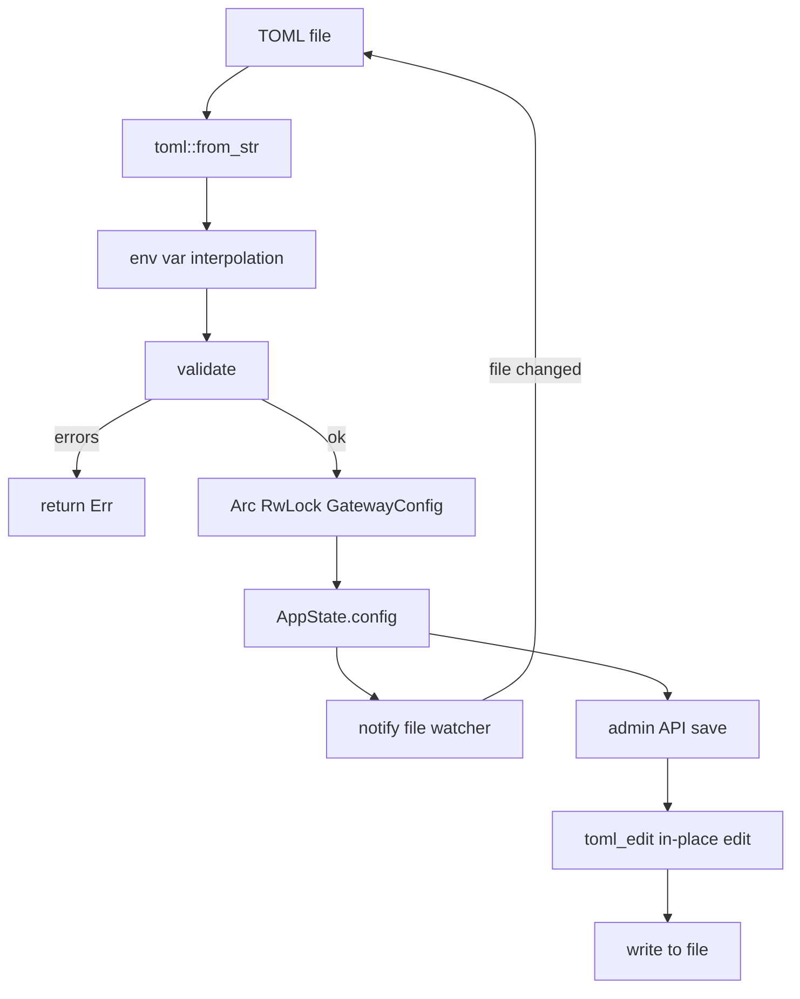

# 配置 — 规格

## 关键文件

- [sag-config/src/config.rs](../../../sag-config/src/config.rs) — `GatewayConfig`、所有子结构体、`validate()`、序列化辅助函数
- [sag-config/src/loader/load.rs](../../../sag-config/src/loader/load.rs) — `load_config()`、`peek_logging_config()`
- [sag-config/src/loader/reload.rs](../../../sag-config/src/loader/reload.rs) — `spawn_hot_reload()` 热重载 watcher（尾部防抖、目录+文件双监听、有界重试）
- [sag-config/src/loader/save.rs](../../../sag-config/src/loader/save.rs) — `save_config_to_file()` 原子保存
- [sag-config/src/toml_edit_util.rs](../../../sag-config/src/toml_edit_util.rs) — `toml_edit` 原地编辑工具函数
- [sag-config/src/lib.rs](../../../sag-config/src/lib.rs) — `ConfigHandle` 类型别名

## 核心设计

### 配置生命周期

热重载 watcher（`loader/reload.rs`）在 [0002](changes/0002-hot-reload-trailing-debounce.md) 起同时监听**父目录**与**配置文件本身**：目录监听保证原子 temp-file + rename 保存（inode 替换）后监听不失效，直接文件监听覆盖 macOS kqueue 目录监听不报告文件内就地编辑的情况。事件按配置路径/文件名过滤，`Access` 只读事件忽略。触发采用**尾部防抖**（`DEBOUNCE`=300ms，`DEBOUNCE_TICK`=100ms 轮询）+ settle 窗口（`SETTLE`=100ms）边界排空：突发写入期间不断重置窗口，保证读取的是最终版本；防抖窗口后若排空到新相关事件则重新武装。加载失败最多重试 `MAX_RELOAD_RETRIES`（2）次后等待下一个文件事件。

## 关键决策

### Peek vs 完整加载

`peek_logging_config()` 在完整加载前单独读取 `[logging]` 段，因为 tracing 必须在最早时刻初始化。

**Trade-off**: 需要两次读取配置文件（peek + 完整加载），但只需几毫秒。换来的是 startup log 也遵循配置的日志级别。

### toml_edit vs toml 序列化

保存配置时使用 `toml_edit` 做原位编辑，而非用 `toml` crate 重新序列化整个文件。

**Trade-off**:
- ✅ 保留用户原有的注释、空白、字段顺序
- ✅ 只修改变化的部分（增量编辑）
- ❌ 需要手动维护 inline table array 的同步逻辑
- ❌ `toml_edit` API 比 `toml` 的 serde 序列化复杂得多

这个 trade-off 是值得的——配置文件是用户手写的，保留注释和格式是基本体验要求。

### 尾部防抖 vs 前缘防抖

热重载 watcher 使用尾部防抖（仅当文件静默超过 300ms 后才加载），而非旧的前缘防抖（首个事件后立即加载、随后 500ms 内忽略）。

**Trade-off**: 尾部防抖会引入一点加载延迟（突发写入停止后最多 300ms+100ms 才生效），但保证永远读取突发写入的**最终版本**；前缘防抖可能在编辑器分段原子保存时把中间态当作最终配置加载且不再重新读取，造成永久错误的运行态。这个 trade-off 是值得的——热重载的首要正确性是「加载最终版本」，而不是「尽快加载」。

### 验证 fail-all vs fail-fast

`validate()` 收集所有错误后一次性返回，而不是遇到第一个错误就停止。

**Trade-off**:
- ✅ 用户一次看到所有问题，不需要反复修改-验证
- ❌ 错误列表中可能包含级联错误（如 provider 不存在 → 路由引用它），但总体体验更好

### 热重载 vs 重启

大部分配置支持热重载，但 `[server]` 和 `[gateway_auth]` 不支持。这是因为：
- `[server].host/port`：已绑定的 TCP socket 无法热迁移到新地址
- `[gateway_auth]`：认证中间件在 Axum 路由构建时注入，热替换需要重建整个 router（等同于重启）

**Trade-off**: 大部分运维场景中 server/auth 在部署时确定，不需要运行时修改。Provider 和 routes 是运维日

常调整的，热重载提供即时生效。

### 序列化默认值跳过

通过 `#[serde(skip_serializing_if)]` 跳过默认值字段，保持配置文件简洁。

**Trade-off**: 用户看到的配置就是他们实际修改的部分。但也意味着"想显式设置为默认值"的场景无法表达（如 `timeout_secs = 120` 不会出现在文件中，除非它已经是默认值）。这在当前场景中是可接受的——如果用户想确认某个值是默认值，可以查看文档。

## 不变式

- `ConfigHandle` = `Arc<RwLock<GatewayConfig>>`（唯一的配置访问路径）
- `GatewayConfig::validate()` 在每次加载和保存时都运行
- 热重载始终读取并发布**最终版本**（尾部防抖），绝不发布编辑器分段保存的中间态
- 原子 temp-file + rename 保存不中断监听（目录监听不受 inode 替换影响）
- 热重载在 macOS 上使用原生 FSEvents（`macos_fsevent`，避免 kqueue 占用文件句柄）
- `toml_edit` 编辑以 `(provider, real_model)` 为 key 定位 route target inline table

## 测试策略

- `sag-config/src/config.rs` tests — 大量单元测试（解析、验证、边界情况）
- `sag-config/src/loader/reload.rs` tests — watcher 事件过滤（`event_targets_config`）与监听目录解析单元测试
- `sag-state/tests/hot_reload_watcher.rs` tests — watcher ↔ `ConfigMutationCoordinator` 集成测试（外部编辑重载、原子替换突发写入只加载最终版本、未重载外部编辑仍冲突、SAG 自身持久化不误报）

## 变更记录
- [0003 修复 macOS 文件句柄耗尽与回退白名单遗漏](changes/0003-use-native-fsevent-and-backoff-whitelist.md)
- [0002 热重载 watcher 加固：尾部防抖、目录监听与瞬时失败重试](changes/0002-hot-reload-trailing-debounce.md)
- [0001 初始化](changes/0001-initial.md)
