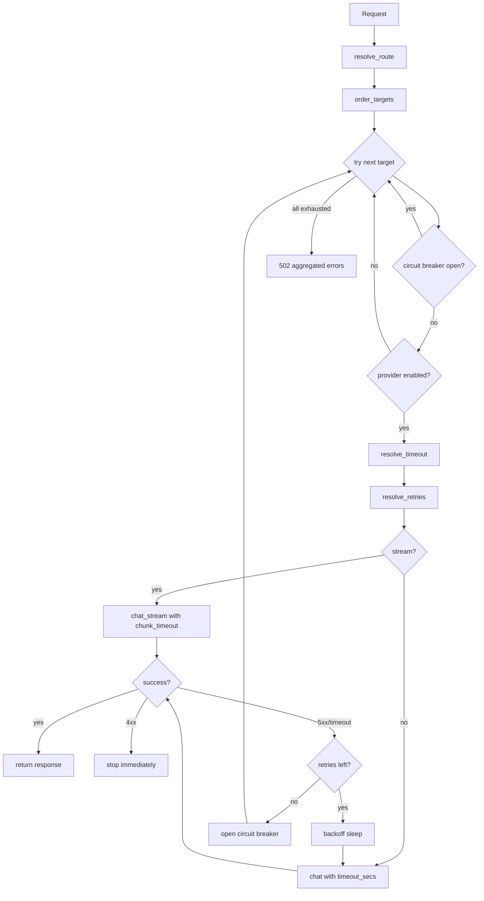

# 调度 — 规格

## 关键文件

- [sag-dispatch/src/dispatch/chat.rs](../../../sag-dispatch/src/dispatch/chat.rs) — 聊天补全分发（非流式 + 流式）
- [sag-dispatch/src/dispatch/image.rs](../../../sag-dispatch/src/dispatch/image.rs) — 图片生成分发
- [sag-dispatch/src/dispatch/stream.rs](../../../sag-dispatch/src/dispatch/stream.rs) — SSE 流式处理
- [sag-dispatch/src/dispatch/retry.rs](../../../sag-dispatch/src/dispatch/retry.rs) — 重试退避逻辑
- [sag-dispatch/src/dispatch/resolve.rs](../../../sag-dispatch/src/dispatch/resolve.rs) — 路由匹配 + 目标选择
- [sag-dispatch/src/order.rs](../../../sag-dispatch/src/order.rs) — 目标排序

## 核心设计

### 分发数据流



## 关键决策

### 同步重试 vs 异步重试

重试在单个请求处理中同步执行（循环内 await），而非 spawn 新任务。

**Trade-off**:
- ✅ 实现简单，请求上下文天然传递（不需要为每个重试创建新的 span）
- ✅ 自然利用 tokio 的协作调度——sleep 时让出 CPU
- ❌ 长时间重试会占用一个 tokio task。但 LLM API 的典型延迟是秒级，task 数量本就不高

### SSE 流式：channel 模式

使用 `tokio::sync::mpsc::unbounded_channel()` 连接 provider 流和 axum streaming body：

```rust
let (tx, rx) = tokio::sync::mpsc::unbounded_channel();
// spawn provider call → tx.send(chunk)
// return axum streaming body from rx
```

**Trade-off**:
- ✅ 解耦 provider（生产者）和 axum（消费者），任一端可以独立处理
- ✅ unbounded channel 避免 provider 生产速度受限于消费速度——SSE chunk 通常很小
- ❌ 错误无法通过 `?` 传播，需要通过 channel 发送错误 chunk
- ❌ unbounded 可能内存无限增长（但 SSE chunk 很小 + 通常及时消费）

### chunk_timeout 实现

```rust
tokio::time::timeout(Duration::from_secs(n), stream.next()).await
```

每次等待下一个 chunk 时加上 timeout。超时后断开连接并返回错误。

**Trade-off**: timeout 作用于单个 chunk 的等待，不是整个请求的总时长。这意味着即使单个 chunk 都很快，长时间的静默期（silence）也会触发。这正是想要的行为——LLM 推理中长时间无输出通常意味着卡住了。

### Retry 和 Backoff 的实现位置

重试逻辑在 dispatch 层（不在 provider 层），每个 target 的 retry 独立计数。

**Trade-off**:
- ✅ Provider 不需要关心重试，保持简单
- ✅ Dispatch 可以看到完整的 targets 列表，做跨 target 的 fallthrough
- ❌ Provider 内部的错误（如网络）和业务错误（如 4xx）在 dispatch 层区分，增加了判断逻辑

### 错误聚合

当所有 targets 耗尽时，返回一个聚合的 502 错误，附带所有 target 的失败原因。不返回最后一个错误（那会误导）。

**Trade-off**: 返回所有错误信息有助于排障（知道哪些供应商都失败了），但响应体可能较大。在实际中，最多几个 targets，错误信息主要是状态码和简短描述。

## 不变式

- `resolve_route()` 通过对比 `ConfigHandle.routes_version` 与 `DispatchRuntime.last_prune_version` 实现惰性缓存清理；仅在版本差异时移除已不存在路由对应的 `fill_first_orders`、`route_counters`、`active_targets` 条目。路由变更方（admin API / 热重载）负责递增 `routes_version`
- 4xx 错误永远不会触发重试（不管 retries 设多少）
- 非流式请求使用 `timeout_secs` 做整体超时；流式请求使用 `chunk_timeout_secs` 做 chunk 间超时
- backoff 在每次重试前 sleep（不是在失败后立即 sleep）
- 流式请求的 response body 不等待（不缓存整个响应）

## 测试策略

- `sag-dispatch/src/testing.rs` — 集成测试
- `sag-dispatch/src/dispatch/retry.rs` — 退避公式单元测试
- 关键场景：熔断器交互、重试耗尽、流式超时、4xx 立即停止、时间穿越（UTC 时间戳）

## 变更记录
- [0002 路由删除后缓存泄漏修复](changes/0002-cache-leak-fix.md)
- [0001 初始化](changes/0001-initial.md)
