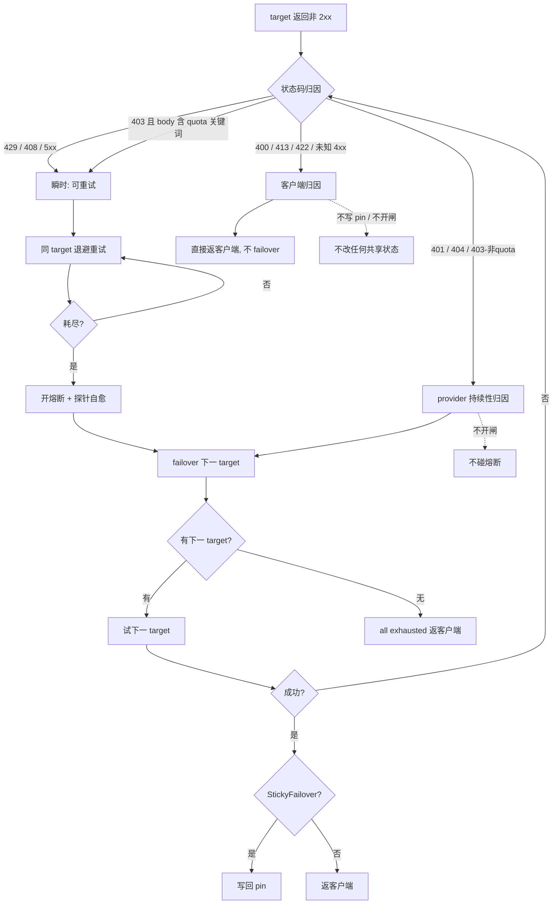

# 4xx Failover 归因策略 - 规格

## 背景与问题

StickyFailover 策略下，pin（按 `request.model` 索引、**全员共享**的"当前主用 target"）会在 failover 成功后写回到备用 target。当前实现里，**所有非可重试 4xx**（400/401/403/404/413/422，除 408/429 外）走同一条路径：不重试、不开熔断、failover 到下一 target、成功则写回 pin。

由此产生爆炸半径：**单个用户**用某个客户端发了一个 provider 不支持的参数（400/422），主用 target A 返 4xx -> failover 到 B -> B 成功 -> pin 被改成 B -> **所有用户**后续请求都走 B，而 A 明明没坏。这是"一个客户端的烂参数改了全员共享状态"。

> 注：FillFirst / RoundRobin 不写 pin（`chat.rs`/`image.rs` 的 writeback 被 `if strategy == StickyFailover` 门控），天然免疫此问题。本策略仅影响 StickyFailover。

## 关键文件

### 错误分类与归因

- [`sag-dispatch/src/dispatch/retry.rs`](../../../sag-dispatch/src/dispatch/retry.rs) - `is_retryable_error` 错误可重试性判定；**新增**非可重试 4xx 的归因分类（客户端 vs provider 持续性）
- [`sag-core/src/error.rs`](../../../sag-core/src/error.rs) - `AppError` 枚举、`circuit_hint`；**扩展** `circuit_hint` 识别 403-quota
- [`sag-providers/src/base.rs`](../../../sag-providers/src/base.rs) - `check_upstream_error`，provider 非 2xx 一律包成 `AppError::Upstream{status, body}`，原样保留状态码

### 分发循环与 pin 写回

- [`sag-dispatch/src/dispatch/chat.rs`](../../../sag-dispatch/src/dispatch/chat.rs) - chat 分发循环 + pin 写回（`insert_if_generation`，约 L406）
- [`sag-dispatch/src/dispatch/image.rs`](../../../sag-dispatch/src/dispatch/image.rs) - image 分发循环 + pin 写回（约 L152）
- [`sag-dispatch/src/dispatch/mod.rs`](../../../sag-dispatch/src/dispatch/mod.rs) - `apply_circuit_outcome`，熔断开闸/关闸/探针落点
- [`sag-dispatch/src/order.rs`](../../../sag-dispatch/src/order.rs) - `order_targets`，StickyFailover 把 pin 的 target prepend 到 position 0
- [`sag-state/src/lib.rs`](../../../sag-state/src/lib.rs) - `ActiveTargetsInner`，pin 表（`insert_if_generation` / `clear` / `retain`）
- [`sag-core/src/circuit_breaker.rs`](../../../sag-core/src/circuit_breaker.rs) - 熔断三态机（Closed/Open/HalfOpen）+ 周期探针

## 核心设计

### 4xx 归因决策流

dispatch 循环内，target 返回非 2xx 后的归因分支：

### 三类故障归因

| 故障类 | 状态码 | 会自愈? | 机制 | failover | 写 pin | 开熔断 |
|---|---|---|---|---|---|---|
| 客户端参数错 | 400 / 413 / 422 / 未知 4xx | n/a | 返客户端 | 否 | 否 | 否 |
| provider 持续性故障 | 401 / 404 / 403-非quota | 否（需人修） | 挪 pin（切走且待着） | 是 | 是 | 否 |
| provider 瞬时故障 | 429 / 408 / 5xx / 403-quota | 是 | 熔断（探针自愈） | 是 | 是 | 是 |

> "写 pin = 是"仅在 StickyFailover + 该请求 failover 到备用 target 试成时发生（现有 writeback 路径，不变）。

## 关键决策

### 归因三分

**背景**：原实现把所有非可重试 4xx 一视同仁（failover + 挪 pin + 不开闸），无法区分"客户端参数错"和"provider key 坏了"。

**Trade-off**:

- ✅ 按 HTTP 语义 + "谁该负责"三分：请求形状类（400/413/422）归客户端；鉴权/不存在类（401/404）归 provider 持续性；限流/配额/5xx 归 provider 瞬时。分类依据是稳定的 HTTP 状态码语义，歧义仅 403 一处（见下）。
- ❌ 放弃"所有 4xx 一律不 failover / 一律 failover"的二元方案：前者让 provider key 坏了时客户端吃 401（被误导）且不切走；后者正是爆炸半径的根。

### 挪 pin vs 熔断 的分工

**背景**：持续性故障（401 key 坏、404 model 下架）不会自己好，瞬时故障（429 限流、5xx 抖动、quota 待补）会自己好。两套机制各自只对一类有效。

**Trade-off**:

- ✅ 挪 pin = 持续性故障的正确响应：切到备用、不再骚扰坏 target、等人修或 pin TTL（`sticky_failover_reset_secs`，默认 7200s）到期再重评估。熔断 = 瞬时故障的正确响应：周期探针（`probe_interval_secs` 默认 60s）等它自愈。
- ❌ 放弃"给 401/404 开熔断"（探针每 60s 探一个不会自己好的配置问题 = 空转，key 不会自己修好）；放弃"所有 4xx 都不挪 pin"（持续性故障不挪 pin 则每请求都白跑一次坏 target 再 failover）。

### 客户端 4xx 直接返客户端、不 failover

**背景**：400/413/422 是客户端请求形状错，换一家 provider 同样的请求照样被拒，failover 救不了还藏了客户端的错；且会挪走全员共享的 pin。

**Trade-off**:

- ✅ 直接返客户端：诚实（告诉客户端它的请求有问题）、不浪费 failover 往返、不污染共享 pin。爆炸半径根除。
- ❌ 放弃"仍 failover 但不挪 pin"：对客户端参数错 failover 是徒劳（同样请求同样被拒），且白白多打一次 provider。

### 401 / 404 保持现状（不改动）

**背景**：当前 401/404 已是"failover + 挪 pin + 不开闸"，正好命中"provider 持续性故障"的正确机制。

**Trade-off**:

- ✅ 零改动。401 = 网关配的 provider key 失效（影响所有客户端，非某客户端的锅），挪 pin 让全员切到好 key 的备用，正确。
- ❌ 不改成开熔断（见"挪 pin vs 熔断"）；不改成返客户端（401 透传给终端客户端是误导--客户端没发 key 却被告知"未授权"）。

### 403 按 quota 拆分

**背景**：403 既可能是 quota/额度耗尽（provider 容量信号，会随计费周期自愈），也可能是 perms/区域拒绝（持续性）。两者机制应不同。

**Trade-off**:

- ✅ 扩展 `circuit_hint` 的 body 解析（复用现有 429-quota 的关键词集 `quota`/`billing`/`insufficient`/`exceeded`/`usage limit`/`current quota`）识别 403-quota，重分类为可重试 + 熔断（`quota_exhausted_secs` 默认 3600s，与 429-quota 对齐）；403-非quota 走 provider 持续性路径（failover + 挪 pin + 不开闸）。
- ❌ 放弃"403 一律熔断"（perms/区域拒绝开熔断是空转）；放弃"403 一律挪 pin"（quota 是自愈型，挪 pin 会过早放弃可能补上的额度）。

### 403-content-policy 不专门识别

**背景**：403-非quota 里可能混入内容策略拒绝（provider 因客户端 prompt 内容返 403），属请求级而非持续性。

**Trade-off**:

- ✅ 不专门识别，统一走 403-非quota（挪 pin）。理由：①多数 provider 内容拒绝走 400/200-finish_reason 而非 403，403-content-policy 罕见；②即便 A 因内容拒了 X、failover 到 B，B 大概率也拒（同样内容），无 success 则不挪 pin；③只有"B 比 A 宽松、B 接受了 A 拒的内容"才会真挪 pin，那本身是 B 能服务 A 不能，挪过去算合理救场，代价仅是策略漂移到备用的宽松策略。
- ❌ 放弃专门识别 content-policy：403 body 解析 provider 各异、准确率撑不起复杂度。

### 未知 4xx 默认归客户端

**背景**：402(Payment)/451(Legal)/418 等未列出的 4xx 无明确归因。

**Trade-off**:

- ✅ 默认归客户端（返客户端、不 failover、不挪 pin）。保守：不因未知错误改共享 pin。provider 侧的码后续白名单加入。
- ❌ 放弃默认归 provider 持续性（挪 pin）：未知 4xx 贸然挪 pin 可能因一个偶发错误切走全员主用。

## 不变式

### 客户端归因 4xx 不改共享状态

- 400 / 413 / 422 / 未知 4xx 命中时，dispatch 循环**不 `continue` 到下一 target**，直接构造错误响应返客户端。
- 该路径不调用 `active_targets.write().insert_if_generation`、不调用 `route_circuit_breaker.write().open`。（grep `insert_if_generation` / `.open(` 确认无新调用点）

### provider 持续性 4xx failover 但不开闸

- 401 / 404 / 403-非quota 命中时走 failover（`continue` 下一 target），成功则写回 pin（StickyFailover 下），但**不**经 `RetryOutcome::Exhausted` 路径触发 `apply_circuit_outcome` 的 `open`。

### 403-quota 重分类为可重试

- `circuit_hint` 对 `Upstream{status:403, body}` 且 body 含 quota 关键词返回 `QuotaExhausted`；`is_retryable_error` 对该 403 返回 `true`。（grep `status: 403` / `status:403` in `circuit_hint`）

### pin 写回门控不变

- pin 仅在 `strategy == StickyFailover` 且本请求最终成功时写回；FillFirst / RoundRobin 永不写 pin。（`if strategy == sag_config::Strategy::StickyFailover` 在 `chat.rs`/`image.rs` writeback 处保留）

### 客户端归因判定不依赖请求内容

- 400/413/422 的归因仅依据 HTTP 状态码，不解析 body（区别于 403-quota 的 body 解析）。

## 测试策略

测试位于 `sag-dispatch/src/dispatch/chat.rs` 内联 `#[cfg(test)]` 与 `sag-dispatch/src/dispatch/retry.rs` 内联测试。

- **`client_error_4xx_returns_to_client_without_failover`**（新增）：target A 返 400，断言响应直接返客户端 400、不试 B、pin 不变、不开闸。
- **`unsupported_param_422_does_not_move_pin`**（新增）：StickyFailover 下 pin=A，A 返 422，B 成功，断言 pin 仍为 A（不挪）。对照"修复前 pin 会被挪到 B"。
- **`auth_401_failovers_and_moves_pin`**（回归现有行为）：A 返 401，B 成功，断言 pin 挪到 B、A 熔断未开。
- **`model_404_failovers_and_moves_pin`**（回归）：A 返 404，B 成功，断言 pin 挪到 B、不开闸。
- **`quota_403_opens_circuit`**（新增）：A 返 403 且 body 含 "quota exceeded"，断言 A 熔断以 `quota_exhausted_secs`（3600s）开闸、failover 到 B。
- **`non_quota_403_failovers_and_moves_pin`**（新增）：A 返 403 且 body 无 quota 关键词，断言 failover + 挪 pin + 不开闸。
- **`unknown_4xx_returns_to_client`**（新增）：A 返 418，断言返客户端、不 failover、不挪 pin。

## 改动清单（已实现）

| 状态码 | 行为 | 改动 |
|---|---|---|
| 400/413/422/未知 4xx | 返客户端，不 failover、不挪 pin、不开闸 | **已改** dispatch 循环按 `is_client_caused_4xx` 归因后早返 |
| 401/404/403-非quota | failover + 挪 pin + 不开闸 | 未改（原已正确） |
| 403-quota | 可重试 + 熔断(3600s) + failover | **已改** `circuit_hint` 扩 403 body 解析、`is_retryable_error` 放行 |
| 429/408/5xx | 可重试 + 熔断 + failover | 未改 |

## 变更记录

- [0001 4xx Failover 归因策略](changes/0001-4xx-attribution-policy.md)
