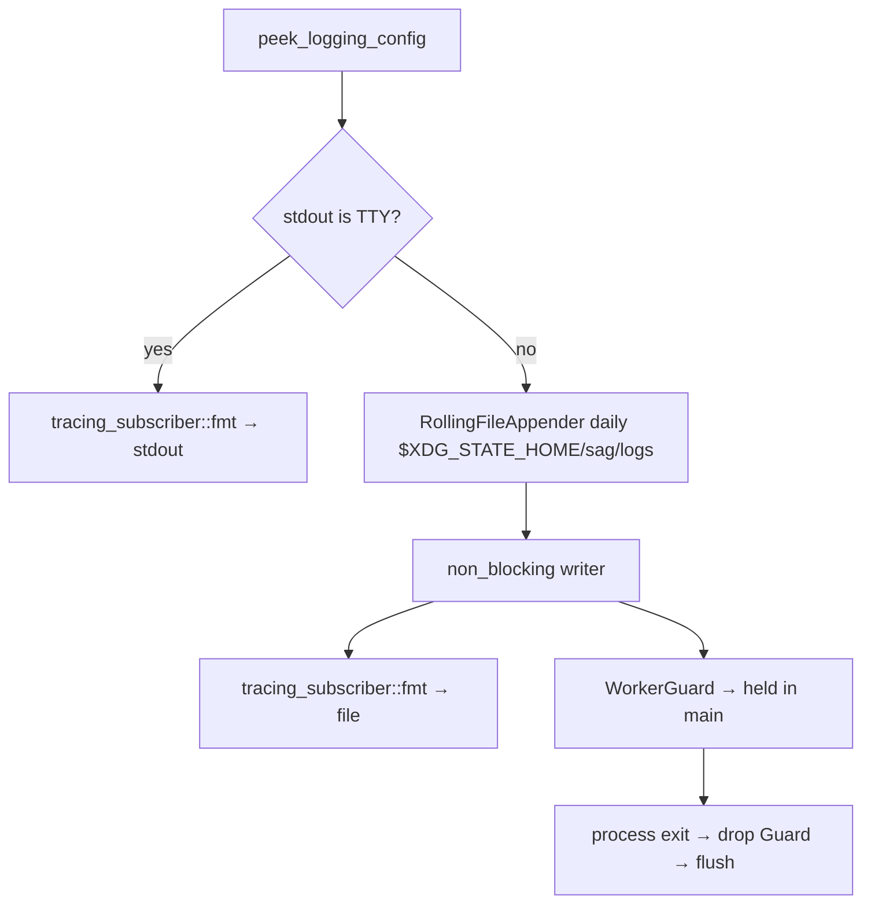

# 日志 — 规格

## 关键文件

- [sag-gateway/src/tracing_init.rs](../../../sag-gateway/src/tracing_init.rs) — tracing 初始化（TTY 检测 + 双重输出路径）
- [sag-gateway/src/main.rs](../../../sag-gateway/src/main.rs) — `cleanup_old_logs()` + `WorkerGuard` 生命周期
- [sag-router/src/middleware/trace.rs](../../../sag-router/src/middleware/trace.rs) — Trace ID 中间件
- [sag-router/src/middleware/http_log.rs](../../../sag-router/src/middleware/http_log.rs) — HTTP 请求体日志
- [sag-providers/src/util.rs](../../../sag-providers/src/util.rs) — `spawn_in_current_span()`（后台任务 span 继承）
- [sag-config/src/config.rs](../../../sag-config/src/config.rs) — `LoggingConfig`、`LogFormat` 枚举

## 核心设计

### 日志初始化数据流

## 关键决策

### tracing_appender vs Python 启动器重定向

之前日志通过 Python 启动器的 `subprocess.Popen(stdout=log_handle)` 写文件，现在由 Rust 二进制直接写轮转文件。

**Trade-off**:
- ✅ 日志生命周期归 Rust 进程管理，不依赖 Python 启动器
- ✅ 每日轮转和清理无需外部工具（logrotate）
- ✅ `non_blocking` 写入不阻塞请求处理
- ❌ 生产环境的 stdout/stderr 输出丢失（走 DEVNULL），但 panic 等非 tracing 输出的频率极低

### Non-blocking 写入

`tracing_appender::non_blocking()` 创建一个专用写入线程，应用线程通过 bounded channel 发送日志消息。

**Trade-off**:
- ✅ 应用线程从不等待 I/O
- ❌ 进程崩溃时可能丢失缓冲区中的最后几条日志（channel 容量 128）
- ❌ 多一个后台线程

对于网关场景，丢失几条尾部日志远不如请求延迟重要。non-blocking 是正确的选择。

### WorkerGuard 生命周期

Guard 在 `main()` 中作为第一个局部变量声明，利用 Rust 的反向 drop 顺序确保它在所有其它资源之后释放。

**Trade-off**: 依赖声明顺序的隐式行为 vs 显式的 `Drop` 顺序控制：
- 当前方案简洁，但敏感（如果有人将 `_log_guard` 声明移到后面，行为变化）
- 注释说明了依赖关系，降低误改风险

### 每日轮转 vs 大小轮转

选择 `Rotation::DAILY` 而非按文件大小轮转。

**Trade-off**:
- ✅ 日志文件命名直观（按日期），方便定位和清理
- ✅ 每日轮转的清理策略简单（7 天 = 7 个文件）
- ❌ 某天日志量特别大时文件可能很大（但 LLM API 的日志量不会到那个量级）

按大小轮转更适合高吞吐系统；每日轮转更适合 SAG 的场景。

### 启动时清理 vs 外部 logrotate

选择 Rust 代码清理旧日志，而非依赖外部工具。

**Trade-off**:
- ✅ 零部署依赖（不需要系统 logrotate 配置）
- ✅ 跨平台（macOS 开发、Linux 生产都一致）
- ❌ 仅在启动时清理，长期运行不重启不会清理
- ❌ 不如 logrotate 灵活（不能配置压缩、邮件通知等）

启动时清理覆盖了正常运维场景（部署 = 重启）。长期运行不重启的最坏情况是日志累积，不会导致功能问题。

### ANSI 颜色：TTY 自适应

`with_ansi(is_tty)` 自动决定是否启用 ANSI 颜色。

**Trade-off**:
- ✅ TTY 环境（开发）有颜色，便于阅读
- ✅ 文件输出无 ANSI 转义码，便于 grep/分析
- ❌ 如果有人 pipe 开发环境的输出到 `less -R`，颜色会丢失（因为 `is_terminal()` 返回 false）

### 请求关联信息的传递

请求内的日志靠 tracing span 链携带 `trace_id` / `provider` / `model`：根 span 由 `trace_middleware` 创建，handler 与 dispatch 都在其内。provider 的流读取任务在 `chat_stream` 返回后仍继续运行（body 由 hyper 在请求 span 之外 poll），因此**不能**依赖「当前 span」，必须显式传递。

采用 `tracing::Instrument`（`spawn_in_current_span`）而非 `Span::enter()`：`Entered` guard 不能跨 `.await` 持有，否则会把 span 泄漏到同一 worker 线程上被 poll 的无关任务。

**Trade-off**:
- ✅ 脱离生命周期的任务日志可关联到请求（provider / model / trace_id）
- ✅ `Instrument` 在 spawn 时刻捕获上下文，语义明确且无跨 await 风险
- ❌ 后台任务持有 span 会延长其 subscriber 侧生命周期（可忽略的成本）

### 大请求体的日志取舍

body > 512 KiB 时不缓冲（否则 413 与流式请求会被破坏），但响应行仍要记录 status / `elapsed_ms`（content-length 可用时附带 `body_size`）。

**Trade-off**:
- ✅ 大 prompt 请求（agent 场景的常态）不再出现「有请求行、无响应行」的黑洞
- ❌ 大 body 请求的响应没有 `body_size` / preview（无法在不消费 body 的前提下取得）

### 响应体的有界收集与帧链重组

响应预览需要读 body，而 `axum::body::to_bytes(body, MAX_BODY_READ)` 在超限时返回 `Err` 并**丢弃已收集数据**，body 消费后也无法重放 —— 直接用 `unwrap_or_default()` 会把 > 10 MB 的响应换成空 body 发回客户端（`content-length` 仍声明全长）。

因此下沉到帧级：自己从 `Body::into_data_stream()` 收集帧，累计到 `MAX_BODY_READ` 即停止。

- **未超限**：`Body::from(collected)`，与 `to_bytes` 路径字节级一致
- **超限**：`stream::iter(已收集帧).chain(剩余流)` 重组为 `Body::from_stream(...)`，headers 不动；日志打 512 B 预览 + `truncated=true` + `collected=<n>`
- **body `Err`**：不再折叠成空 body，记 WARN（`body_error=true`）并把错误重新注入重组后的流

**Trade-off**:
- ✅ 中间件对响应体字节透明，超限只牺牲日志完整性
- ✅ ≤ 10 MB 路径的日志字段集合与字节输出零变化
- ❌ 比 `to_bytes` 多一段帧链拼装代码，需要理解 `stream::iter(...).chain(...)` 的背压语义（`Body::from_stream` 仍是逐帧 poll，无额外缓冲）
- ❌ 超限路径只记录 `collected`，无法得知真实 body 总量（除非信任 `content-length`）

## 不变式

- `tracing_init::init()` 必须在 `info!("starting SAG gateway")` 之前调用
- `_log_guard` 必须在 `main()` 中第一个声明（保证最后 drop）
- `cleanup_old_logs()` 在首次日志写入前调用（保护当天文件）
- HTTP 请求日志在中间件层（先于 handler），确保所有请求都被记录
- 大 body（> 512 KiB）请求的响应日志只依赖响应头（status / content-length / content-type），不得消费 body
- 脱离请求生命周期的后台任务必须通过 `spawn_in_current_span` 启动，禁止裸 `tokio::spawn`
- 每个请求的终态必须至少有一条日志：成功/失败响应行、mid-stream error WARN、post-commit 断连 WARN 或 pre-commit 取消 WARN
- 中间件任何情况下不得改变或截断响应体；日志超限时只可省略日志内容，且必须打截断标记（`truncated=true`）
- body 流错误不得被吞成空 body：必须记 WARN（`body_error=true`）并向客户端传播

## 测试策略

- 手动测试 `just test-env` 验证日志轮转和清理
- 验证 TTY 环境行为不退化（直接 `just run` 等 TTY 直跑日志仍输出到终端；`just dev` 的 stdout 走管道属非 TTY，日志落 `.dev/xdg/state/sag/logs/`）
- 日志断言测试用 `tracing-subscriber` 的 `MakeWriter` 捕获到内存 buffer：
  - [sag-router/tests/http_log_large_body.rs](../../../sag-router/tests/http_log_large_body.rs) — 大 body 响应行（普通 + SSE）
  - `sag-providers/src/util.rs` 内联测试 — 后台任务 span 继承

## 变更记录
- [0001 初始化](changes/0001-initial.md)
- [0002 轮转与清理](changes/0002-rotation-and-cleanup.md)
- [0003 大请求响应日志与请求关联信息](changes/0003-request-correlation-and-large-body-response-log.md)
- [0004 响应体超限不再毁坏响应](changes/0004-response-body-truncation-fix.md)
