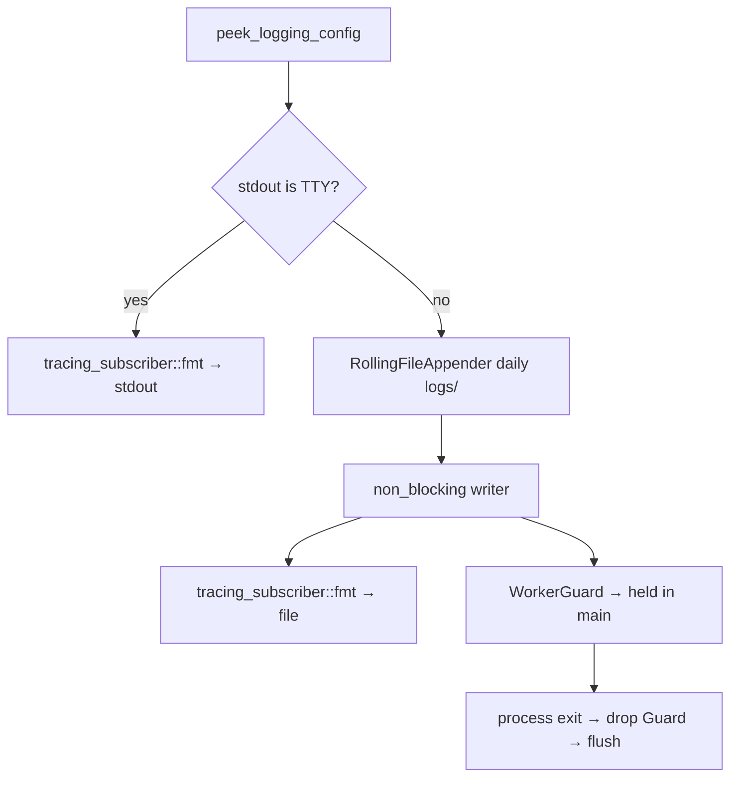

# 日志 — 规格

## 关键文件

- [sag-gateway/src/tracing_init.rs](https://github.com/rainbowatcher/sag/blob/main/sag-gateway/src/tracing_init.rs) — tracing 初始化（TTY 检测 + 双重输出路径）
- [sag-gateway/src/main.rs](https://github.com/rainbowatcher/sag/blob/main/sag-gateway/src/main.rs) — `cleanup_old_logs()` + `WorkerGuard` 生命周期
- [sag-router/src/middleware/trace.rs](https://github.com/rainbowatcher/sag/blob/main/sag-router/src/middleware/trace.rs) — Trace ID 中间件
- [sag-router/src/middleware/http_log.rs](https://github.com/rainbowatcher/sag/blob/main/sag-router/src/middleware/http_log.rs) — HTTP 请求体日志
- [sag-config/src/config.rs](https://github.com/rainbowatcher/sag/blob/main/sag-config/src/config.rs) — `LoggingConfig`、`LogFormat` 枚举

## 日志初始化数据流

## 关键决策

### tracing_appender vs Python 启动器重定向

之前日志通过 Python 启动器的 `subprocess.Popen(stdout=log_handle)` 写文件，现在由 Rust 二进制直接写轮转文件。

**Trade-off**:
- ✅ 日志生命周期归 Rust 进程管理，不依赖 Python 启动器
- ✅ 每日轮转和清理无需外部工具（logrotate）
- ✅ `non_blocking` 写入不阻塞请求处理
- ❌ 生产环境的 stdout/stderr 输出丢失（走 DEVNULL），但 panic 等非 tracing 输出的频率极低

### Non-blocking 写入

`tracing_appender::non_blocking()` 创建一个专用写入线程，应用线程通过 bounded channel 发送日志消息。

**Trade-off**:
- ✅ 应用线程从不等待 I/O
- ❌ 进程崩溃时可能丢失缓冲区中的最后几条日志（channel 容量 128）
- ❌ 多一个后台线程

对于网关场景，丢失几条尾部日志远不如请求延迟重要。non-blocking 是正确的选择。

### WorkerGuard 生命周期

Guard 在 `main()` 中作为第一个局部变量声明，利用 Rust 的反向 drop 顺序确保它在所有其它资源之后释放。

**Trade-off**: 依赖声明顺序的隐式行为 vs 显式的 `Drop` 顺序控制：
- 当前方案简洁，但敏感（如果有人将 `_log_guard` 声明移到后面，行为变化）
- 注释说明了依赖关系，降低误改风险

### 每日轮转 vs 大小轮转

选择 `Rotation::DAILY` 而非按文件大小轮转。

**Trade-off**:
- ✅ 日志文件命名直观（按日期），方便定位和清理
- ✅ 每日轮转的清理策略简单（7 天 = 7 个文件）
- ❌ 某天日志量特别大时文件可能很大（但 LLM API 的日志量不会到那个量级）

按大小轮转更适合高吞吐系统；每日轮转更适合 SAG 的场景。

### 启动时清理 vs 外部 logrotate

选择 Rust 代码清理旧日志，而非依赖外部工具。

**Trade-off**:
- ✅ 零部署依赖（不需要系统 logrotate 配置）
- ✅ 跨平台（macOS 开发、Linux 生产都一致）
- ❌ 仅在启动时清理，长期运行不重启不会清理
- ❌ 不如 logrotate 灵活（不能配置压缩、邮件通知等）

启动时清理覆盖了正常运维场景（部署 = 重启）。长期运行不重启的最坏情况是日志累积，不会导致功能问题。

### ANSI 颜色：TTY 自适应

`with_ansi(is_tty)` 自动决定是否启用 ANSI 颜色。

**Trade-off**:
- ✅ TTY 环境（开发）有颜色，便于阅读
- ✅ 文件输出无 ANSI 转义码，便于 grep/分析
- ❌ 如果有人 pipe 开发环境的输出到 `less -R`，颜色会丢失（因为 `is_terminal()` 返回 false）

## 不变式

- `tracing_init::init()` 必须在 `info!("starting SAG gateway")` 之前调用
- `_log_guard` 必须在 `main()` 中第一个声明（保证最后 drop）
- `cleanup_old_logs()` 在首次日志写入前调用（保护当天文件）
- HTTP 请求日志在中间件层（先于 handler），确保所有请求都被记录

## 测试策略

- 手动测试 `just test-env` 验证日志轮转和清理
- 验证 TTY 环境行为不退化（`just dev` 日志仍输出到终端）

## 变更记录
- [0001 初始化](changes/0001-initial.md)
- [0002 轮转与清理](changes/0002-rotation-and-cleanup.md)
