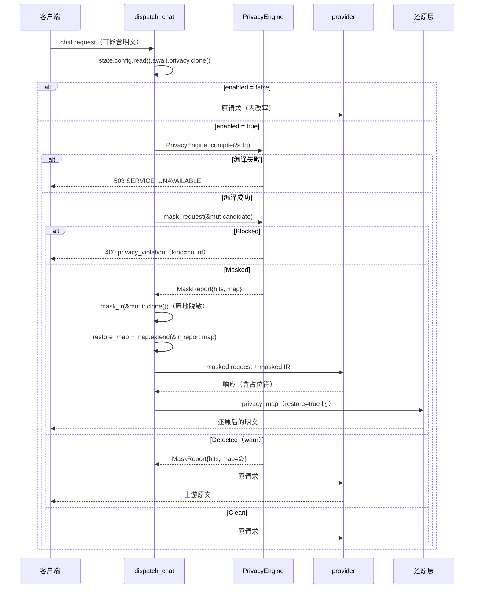
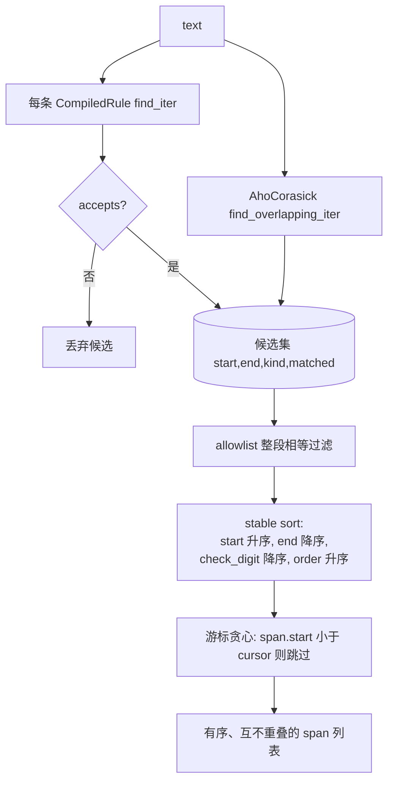
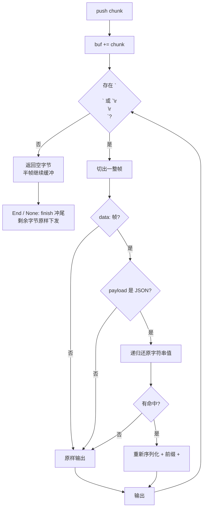
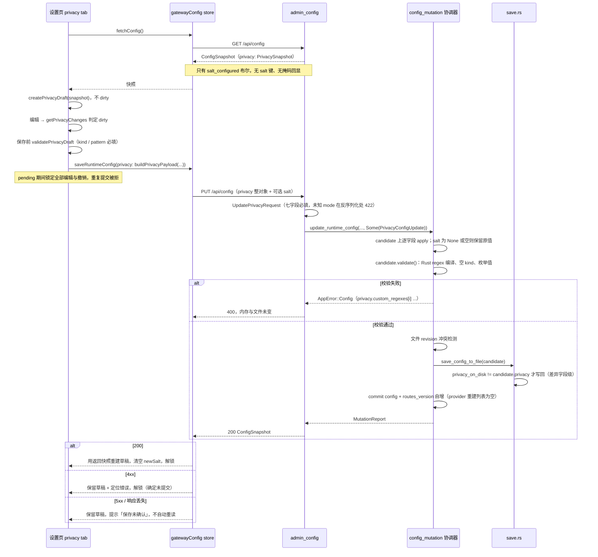
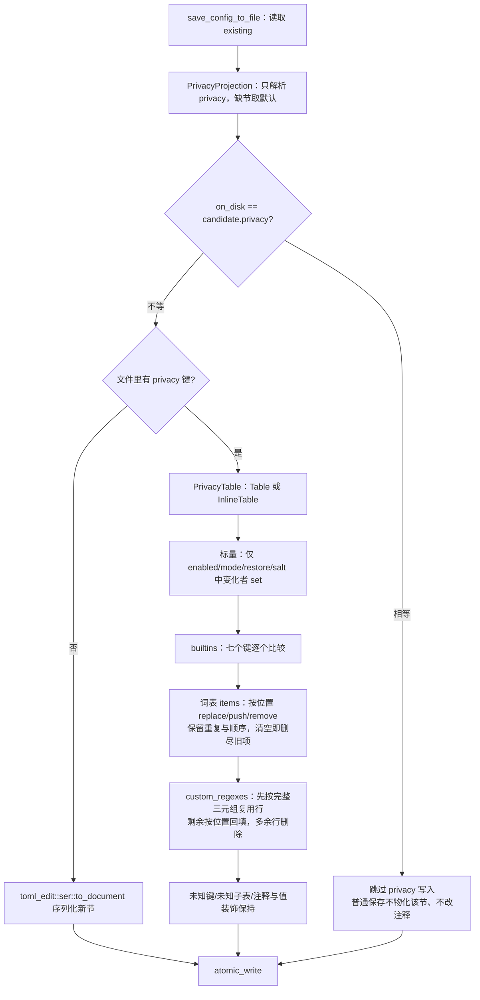
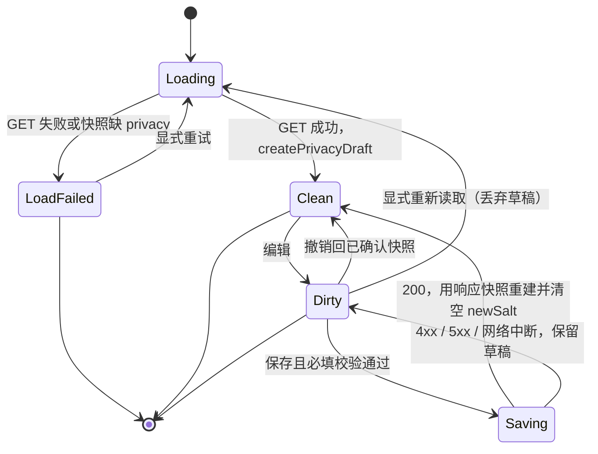

# 隐私过滤 — 规格

## 关键文件

按职责分组。

### 检测与脱敏（`sag-privacy` crate）

纯算法 crate，只依赖 `regex` / `aho-corasick` / `sha2` / `serde_json` 与 `sag-config` 的类型，不持有状态、不读配置。

- `sag-privacy/src/placeholder.rs` — `make`（确定性占位符）、`placeholder_len`（按 `kind.to_uppercase()` 的字节长度）、`PlaceholderMap`（占位符 → 明文反向索引，`extend` 合并、`replace_in` 单遍最长优先替换）
- `sag-privacy/src/rules.rs` — `CompiledRule { kind, re, adj, check }`、`Adjacency { Digits, Wordish, None }`、`Checksum { Luhn, IdCardCn, Iban }`（含 `verifies_check_digit`）、`boundary_ok`、`legacy_birth_date_ok` / `days_in_month`、7 条内置 pattern 常量
- `sag-privacy/src/engine.rs` — `PrivacyEngine::compile`（内置 + 自定义正则 + Aho-Corasick 词表）、`scan`（候选收集 + allowlist + 贪心非重叠解析，排序键 `(start 升序, end 降序, check_digit 降序, order 升序)`）、`mask_text`、`mask_request`（Chat 请求全字段）、`mask_ir`（IR 原地脱敏，遍历层 `scrub_blocks` / `scrub_json` / `scrub_map`）、`UNSCANNED_KEYS`、`Outcome`、`MaskReport`
- `sag-privacy/src/restore.rs` — `RestoreWriter`（SSE 逐帧还原，`FRAME_SEPS = ["\n\n", "\r\n\r\n"]`）
- `sag-privacy/src/lib.rs` — 公开再导出

### 配置

- `sag-config/src/config.rs` — `PrivacyConfig`（含 `Default`：`enabled=false` / `mode=Mask` / `restore=true` / 空 salt）、`PrivacyMode`（严格枚举）、`PrivacyBuiltins`（默认全 true）、`PrivacyCustomRegex`、`PrivacyWordList`、`GatewayConfig::validate_privacy`（自定义正则**无条件编译**，错误带 `privacy.custom_regexes[i]` 索引）
- `gateway.example.toml` — `[privacy]` 示例段（默认全注释）

### 管理面（`sag-admin` / `sag-state`）

- `sag-admin/src/admin_config.rs` — `ConfigSnapshot.privacy`（必有）、`PrivacySnapshot`（七个非 salt 字段 + `salt_configured`，由 `From<&PrivacyConfig>` 逐字段映射）、`UpdatePrivacyRequest`（七个字段必填、`salt: Option<String>`）、`UpdateConfigRequest.privacy: Option<UpdatePrivacyRequest>`、`update_config`（映射成命令后只调一次 coordinator，`AppError::Config` → `400`）、`get_config`
- `sag-state/src/config_mutation.rs` — `PrivacyConfigUpdate`（纯领域命令，无 serde、不 derive `Debug`）、`update_runtime_config` 的第五参数与 candidate 上的 salt 保持规则、`mutate` 的 apply → validate → 冲突检测 → 原子落盘 → commit 顺序（约 L292-390）；`sag-state/src/lib.rs` 重新导出该命令

### 持久化写回（`sag-config`）

- `sag-config/src/loader/save.rs` — `PrivacyProjection` / `privacy_on_disk`（L286-298，只解析 `[privacy]` 的投影，缺节取默认）、`write_privacy_section`（L312，差异写回入口）、`PrivacyTable`（L391，`Table` / `InlineTable` 两形态抽象）、`sync_privacy_word_list` / `sync_privacy_items`（L502-537，按位置重写数组）、`sync_privacy_regexes` / `sync_regex_inline_array` / `plan_regex_rows`（L539-700，行复用与顺序）、`new_regex_table`
- `sag-config/tests/privacy_persistence.rs` — 落盘与重载的集成覆盖（`tests/` 目录，不仿照旧内联文件系统测试）

### 设置页（`sag-ui`）

- `sag-ui/src/types/api.ts` — `PrivacyMode` / `PrivacyBuiltins` / `PrivacyCustomRegex` / `PrivacyWordList` / `PrivacyConfigFields` / `PrivacyConfigSnapshot`（+`salt_configured`）/ `UpdatePrivacyConfigPayload`（+`salt?`）；`GatewayConfigSnapshot.privacy` 必有，`UpdateGatewayConfigPayload.privacy?` 可选
- `sag-ui/src/lib/privacyConfig.ts` — 纯函数 `createPrivacyDraft` / `getPrivacyChanges` / `validatePrivacyDraft` / `buildPrivacyPayload` 与 `PrivacyDraft`（词表存 textarea 文本、正则行带页面内 `id`、`newSalt`）
- `sag-ui/src/lib/privacyConfig.test.ts` — 草稿 / 脏标记 / 校验 / payload 的纯逻辑覆盖（Node 原生 runner，文件级断言）
- `sag-ui/src/components/settings/PrivacyForm.vue` — 显式保存表单：初次读取、草稿、pending 锁定、错误与「保存未确认」提示
- `sag-ui/src/pages/SettingsPage.vue` — privacy tab 的 trigger / content，挂载表单，复用既有 fetch / store 错误边界，不复制布局壳
- `sag-ui/src/lib/settingsTabs.ts` + `settingsTabs.test.ts` — `privacy` 插在 `auth` 与 `backoff` 之间，默认 tab 仍为 `network`
- `sag-ui/src/stores/gatewayConfig.ts` — `fetchConfig` / `saveRuntimeConfig` 已泛型透传完整快照，本次不新增 store
- `sag-ui/src/lib/i18n/{en,zh}.ts` — `settings.tabs.privacy`、`settings.privacy.*`、`settings.toast.privacySaved` 成对新增

### 分发挂点（`sag-dispatch`）

- `sag-dispatch/src/dispatch/chat/mod.rs` — 请求入口的隐私闸门（约 L176-243，含一次性 config 快照）、masked IR 与 **两份 map 合并**（约 L224-243：`restore_map = report.map` + `restore_map.extend(&ir_report.map)`，`hits` 不合并）、非流式出口 `privacy_restored_response`（5 处调用，约 L1146-1158）、`restore_value`、`render_hits`、`privacy_violation_response`、`privacy_unavailable_response`
- `sag-dispatch/src/dispatch/stream.rs` — `build_streaming_response` 末参 `Option<RestoreWriter>`（约 L917）、`make_stream_state` 的同名字段、unfold 循环内 `writer.push`（约 L1010-1025）与终点 `writer.finish`（约 L985-1002）、`terminal_pending`（约 L977 / L1015：尾帧先下发，终态记账延到下一次 poll）
- `sag-dispatch/src/dispatch/chat/tests.rs` — 5 个隐私集成测试与 `build_state_with_privacy` fixture；`sag-dispatch/src/dispatch/stream.rs` 的 `mod tests` 内另有 2 个隐私尾帧测试

## 核心设计

### 请求与响应链路

### 检测流水线（`scan`）

规则顺序固定（`email` → `phone` → `id_card_cn` → `bank_card` → `iban` → `api_key` → `private_key` → 自定义正则），`custom_words` 在最后追加。排序的前两个键决定「起点最左、同起点最长」；第三键 `check_digit` 让**通过了真正校验位**的规则压过只过结构过滤的规则（Luhn 合法的 15 位卡号胜过无校验位的 15 位旧式身份证）；前三个键都相等时才由 `order`（候选收集顺序 = 配置顺序）决胜，因此 18 位身份证（有校验位）与 `bank_card` 同 span 时由配置顺序定胜负。

### 流式还原状态机

### 管理面读写链路

一次读取、一次保存都落在既有 `/api/config` 上：`privacy` 只是该快照 / 更新体的又一个 section，与 backoff、breaker、TTL 共用同一次 coordinator 事务（apply → validate → 冲突检测 → 原子落盘 → commit）。

提交后仍可能失败：`mutate` 在 commit 之后才做 analytics 身份同步（`config_mutation.rs` 的 Step 6b），该步骤报错时新配置已经生效。因此保存失败只有「已知校验 / 冲突 / 写入前失败」能断言未提交；其余情况由 UI 表述为未确认。

### privacy 差异写回

落盘路径不为 privacy 建立旁路，仍复用 `save_config_to_file` 的 DocumentMut 与 `atomic_write`；只在写入前插入一步「仅在语义差异时逐字段同步」。

### 表单状态机

## 关键决策

### 正则 + 邻接 + 校验和，而非 NER

内置检测器是「正则匹配 → 邻接字符校验 → 结构校验」三级，没有引入模型或词典。

**Trade-off**：放弃 NER 路线，因为网关要部署在用户自己的机器上：模型权重、推理延迟、误报后的可解释性都是新负担，且人名/地址类实体的误报会直接破坏 prompt 语义（比漏检更难排查）。代价是无固定形态的实体（人名、地址）不在覆盖范围，需求文档已明确列为边界，v2 通过 trait 扩展。

### 邻接与校验和守卫写在 Rust 侧，而非正则内

`Adjacency` 与 `Checksum` 是 `CompiledRule::accepts` 里的两次手工判定，pattern 本身不含断言。

**Trade-off**：Rust `regex` 不支持 lookaround，「两侧不紧邻数字」无法写进 pattern。放弃「换成支持 lookaround 的引擎（`fancy-regex`）」，因为那会引入回溯与性能不可控。代价是 18 位身份证、16 位卡号这类宽泛数字形态必须再叠一层校验和，否则订单号、时间戳会被大量误脱敏——误报比漏检更伤（会改坏正常对话内容）。

### 15 位旧式身份证以出生日期替代校验位

15 位旧式身份证没有校验位，只有「15 位数字」这一个形态约束，任何订单号 / 时间戳都能命中。`legacy_birth_date_ok` 把第 7-12 位当 `YYMMDD` 校验（年份读作 `19YY`，按月长与闰年规则），把结构过滤从「长度匹配」提升到「日期合法」。

**Trade-off**：放弃「15 位形态一律不算身份证」和「给旧式身份证发明一个假校验位」。前者会让 1999 年前签发的真实身份证漏检；后者会改变检测语义（用户看到的是自己没写的校验规则）。代价是 `19YYMMDD` 非法的真实旧身份证会漏检——但 15 位格式只覆盖 20 世纪，且年份固定读作 `19YY` 使闰年判定确定（`1900` 非闰年、`2000` 是）。同日 `Checksum::verifies_check_digit` 把「真校验位」与「结构过滤」分开，供 span 撞车时排序（见下）。

### 同 span 撞车：校验位优先于配置顺序

两个规则命中完全相同的区间时，先比较 `Candidate.check_digit`（由 `Checksum::verifies_check_digit` 得出：`Luhn` / `Iban` 恒 true，`IdCardCn` 仅 18 位 true），再退回配置顺序。

**Trade-off**：放弃「只靠配置顺序」。15 位旧式身份证与 15 位卡号可以完全重叠，而前者没有校验位——按配置顺序会让一个只过了日期过滤的猜测压过一个 Luhn 验证过的卡号。代价是同一串数字的 `kind` 可能随校验位结果变化（`110101900307003` 报 `bank_card`、`110101900307000` 报 `id_card_cn`），下游只能把它当「最可信的那个类别」而不是「唯一可能的类别」。

### 原地脱敏 IR，而非编解码往返

masked 请求需要同步到 IR（translated lane 的编码源），实现上是 `let mut masked_ir = original_ir.clone(); engine.mask_ir(&mut masked_ir)`：`mask_ir` 遍历 `IrRequest` 的每个字符串叶子（content 各 block 变体的 `text` / `ToolUse.name` / `ToolUse.arguments` / `ToolResult.content`、`IrMessage.name` / `raw` / `tool_calls[].arguments`、`tools[].description` / `input_schema` / `raw`、`tool_choice` / `response_format` / `metadata` / `stop` / `reasoning.thinking` / 顶层 `raw`），用与 `mask_request` **同一个** `scan` + `mask_text` + `PlaceholderMap` 替换，因此 messages 内外同文本得同一占位符。

**Trade-off**：放弃「用 `ChatCompletionsCodec::decode_request(&candidate)` 整包往返重建 IR」。`routes.rs` 对 Anthropic / Responses 请求体是直接解码的，用 Chat 编解码器整包往返会把 `IrContentBlock::Reasoning` 降级成 `Text`（Anthropic thinking 变成可见正文）、把 `ToolResult` 拆成独立 `role:"tool"` 消息、并让 `Raw` 块走 loss 路径——而且这些 loss 不会进 `ir.loss`（`..original.clone()` 保留原值），属静默结构丢弃。原地遍历保持 block 变体与 `ir.loss` 不变，代价是新增字段需要同步 `mask_ir` 的遍历（`mask_ir` 单测断言每个字段都被覆盖）。

**还原侧必须合并两份 map**（曾经的缺陷，已修）：IR 是**第二个**脱敏源而不是 Chat 请求的镜像——Anthropic / Responses ingress 的 IR 携带 Chat 副本没有的字段（未知顶层键存在 `ir.raw`、`Reasoning` 的 thinking 文本、`ToolResult` 内容），这些占位符只出现在 `mask_ir` 的 `MaskReport.map` 里。dispatcher 现在做 `restore_map = report.map` + `restore_map.extend(&ir_report.map)`，再据此构造 `privacy_map`；**只合并 map，不合并 `hits`**，因为两份扫描覆盖同一段消息文本，合并计数会重复。`PlaceholderMap::extend` 用 `or_insert`，冲突时保留既有条目（占位符确定性使冲突必为同一明文），因此合并顺序无关。

### `map = None` 的零开销路径

非流式出口是 `privacy_restored_response(body, map)`：`map == None` 时直接 `(StatusCode::OK, Json(body))`，与引入隐私过滤之前的代码路径逐字节一致。

**Trade-off**：放弃「统一走还原管线再判断是否有命中」。默认 `enabled = false` 是最常见状态，任何额外序列化/反序列化都会给所有用户加成本；同理 `restore = false`、`warn`/`block` 模式（`map` 恒为空）也走这条路径。

### 每请求编译引擎

`PrivacyEngine::compile` 在每个启用隐私的请求里执行一次（引擎不可变、不持有状态，编译后只服务于该请求）。

**Trade-off**：放弃「编译结果缓存 + 按配置版本失效」。每请求编译换来热重载零缓存失效逻辑、无需在 `AppState` 增加第五份共享状态；代价是每请求重新编译 7 条内置正则与用户规则（未做专门基准）。隐私过滤是 opt-in，且引擎只持有不可变数据，无跨请求一致性风险。

### 占位符确定性（kind + 文本 + salt）

`make` 是 `sha256("{kind_lower}:{text}:{salt}")` 前 12 hex，不做随机 nonce、不做递增序号。

**Trade-off**：放弃随机占位符，因为多轮对话里客户端每次重发明文，若占位符随机，上游看到的实体每次都是新标记，语义会漂移，prompt cache 也完全无法复用。代价是同一 salt 下同一明文产生同一摘要，等于给上游一个可跨请求关联的稳定假名——这是可接受的（摘要不可逆，salt 可配置成随机值）。

### 单遍最长优先的 span 解析

`scan` 收集**全部**候选后再做 stable sort + 游标贪心，而不是「按规则顺序，命中即屏蔽该区域」。

**Trade-off**：放弃短路式解析（先匹配的规则吃掉区域）。身份证必然内含手机号形状的数字，先到先得会把身份证切成「手机号 + 残渣」；`AhoCorasick::find_overlapping_iter` 同理不能提前去重，否则长词会被短词抢先。贪心 + 最长优先让「信息量更大的类别」胜出；完全同区间的候选再按 `check_digit` 与配置顺序分胜负（见上），避免无校验位的猜测压过有校验位的验证。

### 按 SSE 帧还原，而非缓冲整条流

`RestoreWriter` 只在凑齐帧终止符时处理一帧，未凑齐的尾巴留在 `buf`。终止符按 SSE 规范接受 `\n\n` 与 `\r\n\r\n` 两种（`FRAME_SEPS`），`find_sep` 取最早出现者并**整体**匹配，因此分隔符自身被 chunk 劈开（`\r\n\r` \| `\n`）时不会提前切帧；还原后的帧用**原**终止符收尾。

**Trade-off**：放弃「缓冲整个响应体后统一替换」。那会破坏流式语义（首字节延迟、内存随响应长度无界增长）。放弃「只认 `\n\n`」也是同一取舍的修正：只支持 LF 会让 CRLF 上游（部分 SSE 代理会规范化成 CRLF）整条流都走「无完整帧」路径，占位符一个都不还原。代价是被劈到两个帧里的占位符仍无法还原（两半都不构成含完整占位符的 JSON 文档）——占位符是加盐摘要、不含明文，因此属显示瑕疵而非泄露。

### 还原走 JSON 值遍历，而非字节替换

非流式 `restore_value` 与流式 `replace_strings` 都是「解析成 `Value` → 递归处理字符串值 → 命中才重新序列化」。

**Trade-off**：放弃「直接在字节流上 `str::replace`」。明文可能含 `"`、`\n`、`\`，字节替换会产出非法 JSON；交给序列化器重新转义才是正确做法。代价是命中帧的键顺序可能被重排（对 JSON 消费者无害），未命中帧必须走原字节透传以免无谓重排。

### 尾帧先下发，终态记账后收（`terminal_pending`）

流式终点（`End` / `None`，包括上游 `Error` 后直接结束）先 `writer.finish()` 把残余字节 yield 给客户端，并置 `state.terminal_pending = true`；`finish_stream_terminal`（写 `call_logs` / 终态 analytics）推迟到下一次 poll，此时 body 直接 `return None`。

**Trade-off**：放弃「在同一次 poll 里先 flush 尾帧再记账」。axum 的 `Body::from_stream` 一次 poll 只能产出一个帧，若在同一 poll 里先把尾字节交给 `state` 再把 `None` 返回，尾字节与终态记账的先后就不再由客户端可见的字节序决定。代价是终态记账晚一个 poll 周期（无实际延迟影响：下一次 poll 由同一 body 驱动，紧接着发生）；换来的是「客户端看到最后一个字节」不再晚于「请求已结束」的观测事实。

### 错误体只含类别计数

`privacy_violation_response` 的 message 由 `render_hits` 生成（`kind=count` 用 `,` 连接）；`privacy_unavailable_response` 的 message 是固定串。

**Trade-off**：放弃「回显命中的原文或具体正则」。400 体若带明文，拒绝本身就变成泄露通道；503 体若带 pattern，会把用户配置里的正则回吐给任何能发请求的人。细节只进 tracing（`error!` / `warn!`）。

### block / 503 早退不写 analytics

两条早退路径都在分发循环之前 `return`，此时 analytics 的 terminal guard 尚未创建。

**Trade-off**：现状是「被拒请求在统计里不可见」。好处是拒绝不会污染成功/失败率与供应商维度指标（没有 provider 被调用）；代价是运营方无法从 dashboard 看到「有多少请求被隐私策略挡掉」——已列入 v1.5 候选（补一条独立事件而非复用 `call_logs`）。

### 管理面：复用 `/api/config` + 第五参数，不新增端点

设置页读写的 `privacy` 只是既有运行时配置快照 / 更新体的一个新 section，写路径仍走 `update_runtime_config`，本次只给它追加一个 `Option<PrivacyConfigUpdate>` 参数。

**Trade-off**：放弃独立的 `/api/privacy` 端点与通用 `RuntimeConfigUpdate` / 全配置 REST 重构。独立端点会多出一条写路径（校验、锁序、冲突检测各一份），且与 backoff 同一次 PUT 时无法原子；通用命令则为本次一个 section 的增量付整代接口迁移成本。代价是 handler 与 state 命令之间要写一层显式映射（七个字段逐项），且 `update_runtime_config` 参数增到五个（含 `self` 六个）。

### 管理面：快照显式投影，不序列化 `PrivacyConfig`

`PrivacySnapshot` 由 `From<&PrivacyConfig>` 逐字段构造，七个非 salt 字段加 `salt_configured: !privacy.salt.is_empty()`；`PrivacyConfig` 自身的 `Serialize` 仍只服务 TOML。

**Trade-off**：放弃「直接序列化 `PrivacyConfig`、让 UI 自己不看 `salt`」。响应体里多一个 `salt` 键就是泄露事实，与 UI 是否渲染无关（`curl`、devtools、缓存都能看到）；也放弃「回显掩码后的 salt」，那仍能确认猜测。代价是每新增一个 privacy 字段要同步改两处（config 结构 + snapshot 映射），且有测试钉住两者一致。

### 管理面：salt 只在非空时替换，没有清空指令

`UpdatePrivacyRequest.salt: Option<String>` 里，未传 / `null` / `Some("")` 都保持原值；只有非空串按原始字节替换（不 trim、不规范化，纯空白也算非空）。UI 不在空输入时发 `salt` 键。

**Trade-off**：放弃「`None` = 保持不变、`Some("")` = 清空」的三态，也放弃单独的 `clear_salt` 标志。管理面不回显 salt，用户无法知道当前值；把「留空」解读成清空会让最常见的表单行为默默抹掉盐值，而盐值变更会让占位符全体漂移。代价是清空只能手改配置文件——已写入需求边界，不是遗漏。

### 管理面：显式保存 + pending 锁定，不做即时自动保存

表单把改动存在页面内草稿，一次 `PUT` 提交；保存中锁定全部编辑与撤销，重复提交被拒；只有 200 才用响应快照重建。

**Trade-off**：放弃逐项即时写与自动保存。词表 / 正则行在编辑中会短暂不合法（空 pattern），即时写会连续 400 或留下半生效配置；「撤销」与「保存未确认」也失去落点。代价是用户必须点保存，且未保存草稿没有离开拦截（需求已列为不包含）。

### 管理面失败：区分「确定未提交」与「保存未确认」

UI 对 4xx（`AppError::Config` / 冲突）提示具体错误并认为服务器仍为旧配置；对 5xx 与网络中断只说「保存未确认，草稿已保留」，不自动重读。

**Trade-off**：放弃「任何报错都说未保存」。`mutate` 的 Step 6b（analytics 身份同步）在 commit 之后运行，可能返回错误但新配置已生效；响应也可能在提交后丢失。笼统承诺会误导用户重试时覆盖刚生效的配置；严格化该事务语义又超出本模块边界。

### 持久化：差异字段级写回，不整节替换

`save_config_to_file` 先用 `PrivacyProjection`（仅 `#[serde(default)] privacy`）读盘上语义，与 candidate 不等时进入 `write_privacy_section`：已有节只写变化字段，`Table` 与 `InlineTable` 两种合法形态都就地更新。

**Trade-off**：放弃 `doc["privacy"] = to_document(&privacy)` 的整节覆盖。那会丢掉用户注释、未知键与手写排版，且每次保存都把默认值物化（`builtins` 七键、空 `items`）。代价是 writer 变长（`PrivacyTable` 双形态 + 逐字段比较），且必须自己处理数组清空与重复项。

### 持久化：语义相等就完全不碰 `[privacy]`

provider / auth / runtime 字段的保存若未改变 privacy，`write_privacy_section` 一次也不调用，文件里原本没有 `[privacy]` 的保持没有。

**Trade-off**：放弃「每次保存都补齐默认键」这种看似自愈的行为。补齐会把每个用户的配置文件变成写操作的目标，制造与本模块无关的 diff、破坏注释，并让「只改 base_url」也可能改动隐私节。

### 持久化：正则行按完整三元组复用 + 剩余按位置，不引入规则 ID

`plan_regex_rows` 先用完整 `(kind, pattern, case_insensitive)` 按盘上顺序消费行，剩余候选按位置回填、多余行删除，输出顺序恒等于候选顺序；重复 `kind` 不合并。

**Trade-off**：放弃给 `PrivacyCustomRegex` 加 `id` 字段，也放弃按 `kind` 作唯一键。前者要改配置 schema、校验与旧文件兼容；后者把「同名不同 pattern」的两条规则当一条，直接丢数据（配置层本就不限制 kind 唯一）。代价是编辑/删除/重排后行身份只能近似，被删行的注释随行消失——需求不承诺跨任意编辑保留行身份。

### 校验：Rust `validate_privacy` 是唯一裁决者，前端只判必填

前端 `validatePrivacyDraft` 只检查 `kind` / `pattern` 去空白后非空；正则是否可编译、`kind` 是否空白统一由 `GatewayConfig::validate_privacy` 在 coordinator 里判定（即使 `enabled=false`），错误带 `privacy.custom_regexes[i]`。

**Trade-off**：放弃用 JS `RegExp` 做前端预校验。两套方言不同（lookaround、反向引用、`\d` 的 Unicode 语义等），前端判合法而后端拒绝（或反之）几乎必现，且会让「表单提示通过、保存 400」成为常态。代价是非法正则要等一次往返才能定位，且 `pattern` 永远不能被 trim（前后空白是 pattern 语义的一部分）。

### 前端：草稿只在初次读取 / 撤销 / 保存成功时由快照重建

`createPrivacyDraft` 是唯一入口，Form 不 watch store 自动覆盖草稿；每次重建都深拷贝，`newSalt` 总从空开始。

**Trade-off**：放弃「store 一变就刷新表单」的省事写法。热重载、其它 tab 保存、后台轮询都会改 store，自动覆盖会在用户输入时静默丢掉草稿；放弃「草稿直接引用 store 对象」，因为那会把 `salt_configured` 与正则行 UI id 混进请求体。

### 掩码边界是上游出口，`session_registry` 是已批准的例外

本模块只承诺「发往上游的内容」不含明文：掩码作用于 Chat 请求副本与 IR，还原作用于回客户端的响应；两者都是**请求链路**上的动作。网关本地管理面另有一张 `session_registry` 表（[analytics 0009](../analytics/changes/0009-session-registry-and-logs-session-envelope.md)），按用户裁定存**掩码前**的 `conversation_id`（≤128，仅 `meta` / `top` 来源）与首条用户消息预览（≤160，被截断时追加 `…`），供日志页会话信息卡经 `GET /api/logs?session=` 读取。

- **写入点在掩码之前**：`dispatch_chat` 在 `candidate = request.clone()` + `engine.mask_request(&mut candidate)` 之后、`privacy_request.unwrap_or(request)` 之前取 `registry_request` / `registry_ir`，因此开启 `mask` 不会把 `[[KIND_h12]]` 占位符写进注册表，也不会让注册表影响上游编码。
- **保留期独立**：`[analytics] session_retention_days`，默认 7 天，`0` = 永久；超期直接删行不归档，不参与 `call_logs` 轮转。
- **范围不外溢**：原始值仍不得进入 `CallLog`、会话亲和 map 或 admin 快照——这是 `sag_core::session.rs` 「No PII ever leaves this type unhashed」不变式的唯一文档化例外，覆盖范围仅为 `session_registry` 一张表。

**Trade-off**：放弃「注册表也存占位符」——哈希是不可读的，卡片存在的意义就是给人看的会话身份；存占位符等于把卡片降级成另一种哈希。放弃「不存首条预览」——只给 `conversation_id` 无法回答「这段对话开头问的是什么」。代价是本地磁盘上有一段有期限的明文，靠独立保留期与「仅管理面可读」收束。

## 不变式

- `PrivacyEngine::compile` **不读** `cfg.enabled`：是否构建引擎由调用方（`dispatch_chat`）判定
- 占位符格式恒为 `[[{KIND}_{12 hex}]]`，hex 为小写；`make` 对 `kind` 大小写不敏感（摘要用小写、渲染用大写）
- `make` 的摘要输入恒为 `"{kind_lower}:{text}:{salt}"`，截断长度恒为 `HASH_HEX_LEN = 12`
- `placeholder_len(kind)` 以 `kind.to_uppercase()` 的**字节长度**计算（等于 `make(..).len()`），不得用 `kind.len()`：大写可能改变字节长度（`ß` → `SS`、`工号` 6 字节）
- `PlaceholderMap::extend` 逐条 `or_insert`：冲突保留既有条目、空 map 两向无副作用、合并结果与顺序无关
- `PlaceholderMap::replace_in` 单遍扫描、长 key 优先，替换进去的明文不会被再次扫描
- allowlist 是**整段精确相等**匹配（`allowed.as_str() == matched.as_str()`），不是子串/前缀
- `scan` 输出按 `start` 严格升序且区间互不重叠；同起点取最长；同区间按 `(check_digit 降序, order 升序)` 决胜——通过校验位的规则恒胜于只过结构过滤的规则
- 15 位旧式身份证必须第 7-12 位为合法 `19YYMMDD`（按月长与闰年规则）；18 位身份证只校 GB 11643 校验位，不重校日期
- 内置规则注册顺序固定为 `email`、`phone`、`id_card_cn`、`bank_card`、`iban`、`api_key`、`private_key`，自定义正则追加在后
- `custom_words` 空串在编译期被丢弃（空 pattern 会在每个偏移命中）；`allowlist` 同样丢弃空串
- 只有 `PrivacyMode::Mask` 会改写请求；`warn` / `block` 的 `MaskReport.map` 恒为空
- `mask_request` 扫描请求的每个字符串叶子：`messages[].content`（字符串或内容块里的文本叶子）、`messages[].name`、`messages[].extra`、`stop`、`metadata`、`tools`、`tool_choice`、`response_format`、`logit_bias`、`prediction`、`moderation`、`web_search_options` 等顶层字段与 `extra` 兜底字段；除 `UNSCANNED_KEYS`（`model` / `role` / `type` / id 类键、`data` / `file_data` / `url` 不透明载荷）外，其余字段必须逐字节不变；对象键名恒不扫描
- `mask_ir` 原地遍历 `IrRequest` 全部字符串叶子，**不** 走任何编解码往返：block 变体（`Reasoning` / `ToolResult` / `Raw`）与 `ir.loss` 恒不变，`model` 与 `tool_call_id` / `id` 恒不改写
- `mask_request` 与 `mask_ir` 共用同一 `PlaceholderMap` 语义：同 `(kind, text, salt)` 恒得同一占位符
- `privacy_map` 仅在 `privacy_cfg.restore && !restore_map.is_empty()` 时被填充；`restore_map` = `mask_request` 的 map 合并 `mask_ir` 的 map（`extend`），而 `hits` 只取 `mask_request` 的计数
- `privacy_restored_response` 在 `map == None` 时走 `(StatusCode::OK, Json(body))`，不得插入任何序列化往返
- `RestoreWriter` 只改写 `data:` 帧里的 JSON **字符串值**（不含对象键）；非 `data:` 帧、非 JSON payload、无命中的帧一律原样返回
- `RestoreWriter` 的帧终止符集合恒为 `{\n\n, \r\n\r\n}`，分隔符整体匹配（半截分隔符不切帧），还原帧用原终止符收尾
- `RestoreWriter::push` 返回空字节表示「尚无完整帧」，流式循环必须 `continue` 且不得据此 stamp TTFT（TTFT 以实际下发字节为准）
- 流式终点（`End` / `None` / `Error` 后无显式 `End`）必须调用 `finish()` 并下发残余字节，否则尾部帧会被丢弃；若尾缓冲非空，必须先置 `terminal_pending` 并 yield 尾字节，`finish_stream_terminal` 只能在下一次 poll 执行
- `block` 的 400 与 `503` 的 body 不得包含明文、正则 pattern 或引擎错误详情
- 掩码边界恒为「上游出口」：`mask_request` / `mask_ir` 产出的占位符只能出现在上游请求里，回客户端的响应只做还原；本地持久化面（`session_registry`）取的是掩码**前**的请求与 IR，不得写入占位符
- 管理面响应恒不含 salt：`PrivacySnapshot` 的字段集为 `{enabled, mode, restore, builtins, custom_regexes, custom_words, allowlist, salt_configured}`，序列化结果中 `salt` 只能以 `salt_configured` 出现（不得出现独立的 `salt` 键，也不得回显其值或掩码值）
- 管理面 DTO 不得直接嵌套 `PrivacyConfig`：`PrivacySnapshot::from` 与 `UpdatePrivacyRequest::into_update` 逐字段赋值；`PrivacyConfigUpdate` 不 derive `Debug`，`UpdatePrivacyRequest` / `UpdateConfigRequest` 也不 derive `Debug`
- `UpdatePrivacyRequest` 的七个非 salt 字段无 `#[serde(default)]`（缺失即 422），`salt` 恒为 `#[serde(default)] Option<String>`
- `update_runtime_config` 只在 `privacy.salt` 为 `Some(s)` 且 `!s.is_empty()` 时替换 `candidate.privacy.salt`；`None` / `Some("")` 保持旧值（`salt` 永不被管理面清空）
- 一次 `PUT /api/config` 只调用一次 `update_runtime_config`；`privacy` 链路提交成功后 `MutationReport.providers_rebuilt` 为空
- 持久化写回只在 `privacy_on_disk(&existing)? != config.privacy` 时发生；privacy 无变化的保存不得创建 `[privacy]` 节、不得重写其注释或未知键
- `write_privacy_section` 对已有节只 `set` 值发生变化的字段；未变化字段与未知兄弟键 / 未知子表 / 值装饰保持原样
- `custom_regexes` 不以 `kind` 作唯一键：`plan_regex_rows` 输出顺序恒等于候选顺序，重复 `kind` 不被合并或去重
- 词表 `items` 按位置重写（`sync_privacy_items`）：重复项与候选顺序精确 round-trip，候选清空时旧项全部移除而不是保留
- 前端 `newSalt === ""` 时 `getPrivacyChanges` 不含 `"salt"`，`buildPrivacyPayload` 不带 `salt` 键；非空 `salt` 原样上送（不 trim）
- 前端 `pattern` 的 trim 只用于 `validatePrivacyDraft` 的必填判断，`buildPrivacyPayload` 回写的 `kind` / `pattern` 与草稿逐字节一致
- 前端行 id 与 `salt_configured` 只存在于草稿 / 快照，不得出现在 `UpdatePrivacyConfigPayload` 中；`buildPrivacyPayload` 不得修改入参

## 测试策略

`cargo test -p sag-privacy` — 57 个单元测试：

| 文件 | 数量 | 覆盖 |
|---|---|---|
| `sag-privacy/src/placeholder.rs` | 10 | 确定性 / salt 区分 / kind 大小写 / 12 hex 形态 / 已知摘要前缀 / 长度一致 / **非 ASCII kind 的长度（按大写后字节数）** / 多命中与相邻 / 不重扫明文 / **`extend` 合并与冲突保留** |
| `sag-privacy/src/rules.rs` | 9 | Luhn 正反例与长度窗口 / 身份证校验位与 15 位旧式 / **15 位旧式出生日期（月/日越界、2 月 30、1900 非闰年）** / **`verifies_check_digit` 区分校验位与结构过滤** / IBAN mod-97 / `boundary_ok` 三档邻接 / 内置 pattern 形态 / `accepts` 组合 / 坏 pattern 报错 |
| `sag-privacy/src/engine.rs` | 22 | 7 个内置检测器正反例 / 关闭后不命中 / 重叠取最长 / 同区间取具体规则 / **Luhn 合法 15 位卡号压过 15 位旧式身份证** / allowlist / 自定义词字面与大小写 / 自定义正则大小写 / 坏正则报错 / 占位符确定性复用 / `mask_request` 字段覆盖（含 name / extra / 顶层字段）/ `mask_ir` 全字段覆盖与 block 变体保持 / 四模式语义 |
| `sag-privacy/src/restore.rs` | 16 | 嵌套还原与转义 / 数组与对象 / 单帧与多帧 / 半帧缓冲 / 分隔符后立即下发 / `finish` 冲尾 / 非 JSON 与非 `data:` 透传 / 无命中字节透传 / 空 map / 跨帧占位符不还原 / **`\r\n\r\n` 帧还原与透传** / **LF+CRLF 混排** / **半截分隔符跨 chunk 不提前切** |

`cargo test -p sag-dispatch` — 277 个测试，其中 7 个隐私相关（`sag-dispatch/src/dispatch/chat/tests.rs` 5 个，`build_state_with_privacy` fixture；`sag-dispatch/src/dispatch/stream.rs` 的 `mod tests` 2 个）：

| 用例 | 断言 |
|---|---|
| `dispatch_chat_masks_request_and_restores_response` | provider 收到占位符且不含明文；客户端响应含明文、不含占位符 |
| `dispatch_chat_restores_placeholders_in_stream` | 流式 SSE 帧内占位符被还原，客户端看到明文 |
| `dispatch_chat_blocks_request_in_block_mode` | `400` + `error.code = "privacy_violation"` + message 含 `email=1` 且不含明文；`mock.chat_calls() == 0` |
| `dispatch_chat_masks_fields_outside_messages` | `metadata` / 顶层未知字段（`extra`）/ `messages[].name` 中的 PII 在 provider 侧已是占位符，序列化后的请求不含明文 |
| `dispatch_chat_restores_ir_only_placeholders` | Anthropic ingress 的 `x-trace-note` 与 `thinking` 块在 provider 侧已是占位符、`type` 仍为 `thinking`（`Reasoning` 不降级）；两个 IR-only 占位符在客户端都还原（证明 map 已合并） |
| `privacy_tail_flushes_before_terminal_bookkeeping` | 完整帧先还原下发 → 尾缓冲原样下发 → 此时 `call_logs == 0` → 下一次 poll body 结束且 `call_logs == 1` |
| `privacy_tail_flushes_when_upstream_errors_out` | `Raw` + `Error`（无显式 `End`）也先 flush 尾缓冲，再走终态记账 |

`cargo test -p sag-config privacy` — 8 个配置测试（`config::tests`）：`empty_privacy_table_yields_defaults`、`missing_privacy_section_yields_defaults`、`full_privacy_section_round_trips`、`unknown_privacy_mode_is_rejected`、`unknown_privacy_fields_are_tolerated`、`invalid_custom_regex_is_rejected`、`empty_custom_regex_kind_is_rejected`、`valid_custom_regex_passes_validation`。

管理面（后端）：

| 位置 | 覆盖 |
|---|---|
| `sag-admin/src/admin_config.rs`（`mod tests`） | `PrivacySnapshot` 全字段映射且无 `salt` 键（只 `salt_configured`）；`salt_configured` 仅对非空 salt 为 true（纯空白算非空）；七个字段缺失即反序列化失败；salt 未传 / `null` / `""` / `" new-salt "` 原样透传；未知字段容忍、未知 `mode` 拒绝；`privacy` 缺省 / `null` / 仅 runtime 字段时不改该节；DTO 逐字段映射到命令 |
| `sag-admin/tests/privacy_config.rs`（HTTP 集成） | GET 默认与自定义取值、响应体无 salt 键与盐值；PUT 后 GET 不回显新旧盐；salt omit / null / empty 保持、非空精确替换；非法 regex 与空 `kind` → 400 且 message 含 `privacy.custom_regexes[i]`；未知 `mode`、partial privacy → 422；`backoff` + 非法 privacy 混合时整体不提交 |
| `sag-state/tests/privacy_config_mutation.rs` | file-backed：合法更新后内存与文件一致；校验失败无改动；外部修改返回 `Conflict`；纯 privacy 更新不重建 provider |
| `sag-config/tests/privacy_persistence.rs` | `full_privacy_config_round_trips_and_reloads` / `clearing_rules_and_word_lists_removes_old_entries` / `duplicate_kinds_and_item_order_round_trip` / `inline_privacy_form_is_updated_in_place` / `table_form_preserves_comments_and_unknown_fields` / `unrelated_save_does_not_materialise_privacy` / `unrelated_save_leaves_existing_privacy_untouched` |

设置页（前端）：

| 位置 | 覆盖 |
|---|---|
| `sag-ui/src/lib/privacyConfig.test.ts` | 首次读取 clean；草稿与快照双向深拷贝隔离；每字段独立 dirty 与撤销；未编辑词表原样保留（含重复与含换行项）；编辑后按行 trim / 去空、保留顺序与重复；`pattern` 前后空白不当成编辑也不被 trim；空 salt 不 dirty / 不发，非空原样上送；payload 不含行 id 与 `salt_configured`；helper 不改入参 |
| `sag-ui/src/lib/settingsTabs.test.ts` | `privacy` 位于 `auth` 与 `backoff` 之间、`?tab=privacy` 可解析、默认 tab 仍为 `network` |
| `PrivacyForm.vue` 浏览器验收（隔离 fixture） | GET 失败 / 快照缺 `privacy` 时显示错误与重试而非「已关闭」；保存中不能编辑、不能撤销、双击保存被拒；4xx 保留草稿并展示字段错误；5xx / 网络中断提示保存未确认且不自动重读；成功后用响应快照重建并清空 `newSalt`；页面与请求载荷中无 salt 回显 |

本节列出的是验收目标；具体执行结果以门禁与浏览器验收记录为准。

关键场景清单：

- 规则正反例（校验和失败、邻接字符失败、前缀长度不足）
- 身份证两种形态的边界（15 位旧式出生日期、18 位校验位、同 span 与卡号的优先级）
- 占位符确定性（同文本同 salt → 同标记；换 salt 变化）与长度精确性（非 ASCII kind）
- 流式切分（一帧跨多 chunk、多帧在一个 chunk、尾部不完整帧、LF / CRLF 混排、半截分隔符）
- 端到端五条路径（mask 非流式还原 / mask 流式还原 / mask 覆盖 messages 之外的字段 / **mask 还原 IR-only 字段** / block 早退不调 provider）
- 流式终态顺序（尾帧先下发、`call_logs` 后写；`Error` 后无显式 `End` 同样）
- 配置校验（未知 `mode` 拒绝、未知字段容忍、坏正则与空 `kind` 在 `enabled=false` 下仍被拒）
- 管理面读写（GET 无 `salt` 键、只 `salt_configured`；PUT 的 salt omit / null / empty 均保持、非空按字节替换）
- 管理面失败（非法 regex / 空 `kind` → 400 带 `privacy.custom_regexes[i]`；未知 `mode` / partial privacy → 422；`backoff` + 非法 privacy 混合时整体不提交）
- 持久化差异（无关保存不物化 / 不改写已有 privacy；清空词表与规则后无旧项残留；重复 `kind` 与顺序 round-trip；table 与 inline 两形态都保留未知键与注释）
- 前端草稿（首次读取 clean、未编辑词表原样、`pattern` 不被 trim、空 salt 不发、4xx / 5xx 均保留草稿与锁定释放）

## 变更记录

- [0001 隐私过滤初始化](changes/0001-initial.md)
- [0002 隐私过滤 Minor 项收敛](changes/0002-minor-fixes.md)
- [0003 隐私边界与 `session_registry` PII 例外](changes/0003-pii-carve-out-boundary.md)
- [0004 隐私设置管理面读写](changes/0004-admin-settings.md)
