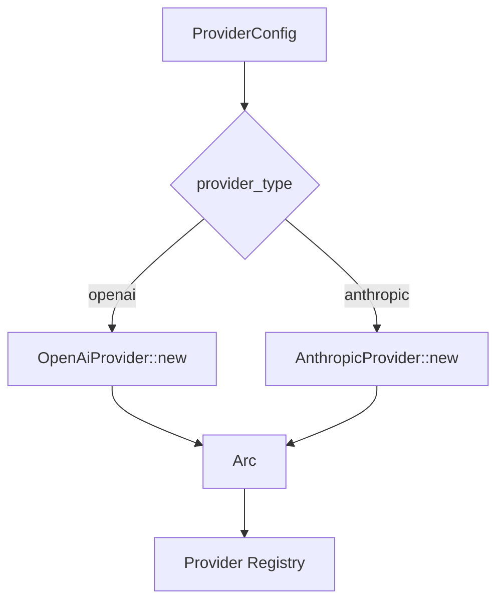

# 供应商 — 规格

## 关键文件

- [sag-providers/src/traits.rs](../../../sag-providers/src/traits.rs) — `LlmProvider` trait 定义
- [sag-providers/src/base.rs](../../../sag-providers/src/base.rs) — 共享构建逻辑（HTTP client、headers、body_overrides 合并）
- [sag-providers/src/openai.rs](../../../sag-providers/src/openai.rs) — OpenAI 适配器
- [sag-providers/src/anthropic.rs](../../../sag-providers/src/anthropic.rs) — Anthropic 适配器（请求/响应翻译 + 缓存控制注入）
- [sag-providers/src/util.rs](../../../sag-providers/src/util.rs) — 共享工具函数
- [sag-providers/src/lib.rs](../../../sag-providers/src/lib.rs) — `create_provider()` 工厂函数
- [sag-core/src/types.rs](../../../sag-core/src/types.rs) — `normalize_reasoning_effort()` 方法
- [sag-router/src/routes.rs](../../../sag-router/src/routes.rs) — 请求入口归一化调用点

## 核心设计

### Provider 创建数据流



### Trait 设计

```rust
#[async_trait]
pub trait LlmProvider: Send + Sync {
    fn name(&self) -> &str;

    async fn chat(
        &self,
        request: &ChatCompletionRequest,
        real_model: &str,
        api_endpoint: &str,
        target_extra: &HashMap<String, serde_json::Value>,
        timeout_secs: u64,
    ) -> sag_core::Result<ChatCompletionResponse>;

    async fn chat_stream(
        &self,
        request: &ChatCompletionRequest,
        real_model: &str,
        api_endpoint: &str,
        target_extra: &HashMap<String, serde_json::Value>,
        timeout_secs: u64,
    ) -> sag_core::Result<Pin<Box<dyn Stream<Item = StreamChunk> + Send>>>;

    async fn chat_image(
        &self,
        _request: &ImageGenerationRequest,
        _real_model: &str,
        _target_extra: &HashMap<String, serde_json::Value>,
        _timeout_secs: u64,
    ) -> sag_core::Result<ImageGenerationResponse>; // 默认 BadRequest

    // 可选原生扩展（均有默认「不支持」实现）：
    // anthropic_messages / anthropic_messages_stream
    // responses_native / responses_stream_native
}
```

核心三方法 `chat` / `chat_stream` / `chat_image` 接收 OpenAI 格式 request，返回 OpenAI 格式 response；`chat` / `chat_stream` 必须实现，`chat_image` 默认返回 BadRequest。翻译逻辑内聚在各实现中。另提供可选原生扩展方法（`anthropic_messages`、`anthropic_messages_stream`、`responses_native`、`responses_stream_native`），默认「不支持」，由对应适配器覆盖。

## 关键决策

### 统一 trait vs 每个供应商独立接口

选择统一 `LlmProvider` trait：核心三方法（`chat` / `chat_stream` / `chat_image`）保证统一调用面，另有可选原生扩展方法供需要原生协议的适配器覆盖。

**Trade-off**:
- ✅ 调用方（dispatch）不需要知道供应商类型，统一调用
- ✅ 添加新供应商只需实现 trait，dispatch 代码零改动
- ❌ 不是所有供应商都支持所有端点（如图像生成、原生协议），不支持的方法走默认实现并返回 `AppError::BadRequest`
- ❌ 翻译逻辑完全内聚，跨供应商的共享逻辑（如 body_overrides 合并）需要提取到 base.rs 中

### Anthropic 翻译的复杂度

Anthropic Messages API 与 OpenAI Chat Completions API 存在结构性差异：

| 差异点 | 处理方式 |
|--------|---------|
| System prompt | Anthropic 独立 `system` 字段，OpenAI 在 messages 中。翻译时提取所有 system 消息合并后移除 |
| Content blocks | Anthropic 使用 content blocks 数组，OpenAI 使用 content string。翻译时互转 |
| Tool calls | Anthropic `tool_use` ↔ OpenAI `tool_calls` |
| Developer role | Anthropic 不支持。通过 role_mappings 处理 |
| Cache control | Anthropic 原生支持 ephemeral cache。自动注入，OpenAI 忽略 |

**Trade-off**: 人工翻译 vs 使用中间格式：
- 人工翻译（当前方案）：代码量更大，但完全控制翻译质量，可以处理边界情况
- 中间格式：需要定义同时兼容两种 API 的中间格式，增加一层抽象，但翻译逻辑可以更通用

选择人工翻译是因为 Anthropic 和 OpenAI 的差异是**结构性**的（不只是命名差异），中间格式无法消除复杂度，反而增加理解成本。

### API Key 策略：FillFirst vs RoundRobin

`fill_first` 始终使用第一个 key，失败后才尝试下一个。`round_robin` 在每次请求时轮转 key。

**Trade-off**:
- FillFirst 实现简单，大多数部署只有 1 个 key，无额外开销
- RoundRobin 适合有多个 key 需要负载均衡的场景，但需要跨请求维护计数器

RoundRobin 计数器通过 `DispatchRuntime` 中的 `Arc<AtomicUsize>` 维护，与 `fill_first` 共享同一 `key_strategy` 选择路径。

### Body Overrides 合并顺序

客户端请求体 → provider `body_overrides` → `model_overrides[real_model]` → target `extra` → strip（`strip_fields` / `model_strip_fields` 最终净化），后覆盖前；strip 为硬性移除，优先于一切 override。

**Trade-off**: 这个顺序允许 provider 设置默认参数，target 可以覆盖特定目标。但也意味着 target 无法"恢复"被 provider overrides 覆盖的客户端字段；若字段被 strip 列出，则无论哪层 override 写入都会被移除。

### Anthropic reasoning_effort → thinking 翻译

客户端 `reasoning_effort` 经 7 档映射表 + 递归降级算法翻译为 Anthropic `thinking.budget_tokens`。

**设计决策**：

| 决策 | 内容 |
|------|------|
| 映射表 | 固定 7 档 `(none/minimal/low/medium/high/xhigh/max)` → 绝对值 `(0/1024/2048/4096/8192/16384/32768)` |
| 递归降级 | 从目标档位向下搜索第一个满足 `budget ≤ max_tokens - 1024` 的档位 |
| 不自增 max_tokens | 若 `max_tokens=1024`（默认），所有档位均无法启用 thinking——用户需显式设大 `max_tokens` |
| 未知档位 | 不 panic、不启用 thinking，与网关设计原则一致 |

**Trade-off**:
- ✅ 固定映射表简单、可预测，不会因模型或请求上下文产生意外行为
- ✅ 递归降级保证 `budget_tokens` 始终有效，不会因档位过高而放弃 thinking
- ❌ 绝对值映射无法适配所有模型上下文（如超长 context 时适当降低 budget 更合理）
- ❌ 不自增 `max_tokens` 意味着默认配置下 thinking 不生效——需文档引导用户显式设置

### Anthropic 缓存控制注入

在 system prompt、tools、conversation history 中插入 `cache_control: {"type": "ephemeral"}` 断点。默认启用。

**Trade-off**:
- ✅ 对用户透明，显著降低重复请求的成本
- ❌ 改变了请求内容，可能影响某些边缘场景（如用户精确控制 prompt）
- 通过 `anthropic_cache_control = false` 可关闭

## 不变式

- `create_provider()` 是创建 provider 的唯一入口
- 所有 provider 实现 `Send + Sync`，可在线程间安全共享
- Anthropic 适配器仅接受单条 system message（多条会合并或丢弃）
- `base_url` 必须以 `://` 结尾（validator 检查）

## 测试策略

- `sag-providers/src/openai.rs` — OpenAI 适配器单元测试
- `sag-providers/src/anthropic.rs` — Anthropic 翻译测试（请求构造、响应解析、reasoning_effort → thinking 翻译、reasoning_tokens 捕获）
- `sag-providers/src/base.rs` — body_overrides 合并测试
- `sag-core/src/types.rs` — `normalize_reasoning_effort` 单元测试

## 变更记录
- [0002 Anthropic reasoning_effort 翻译](changes/0002-anthropic-reasoning-effort.md)
- [0001 初始化](changes/0001-initial.md)
