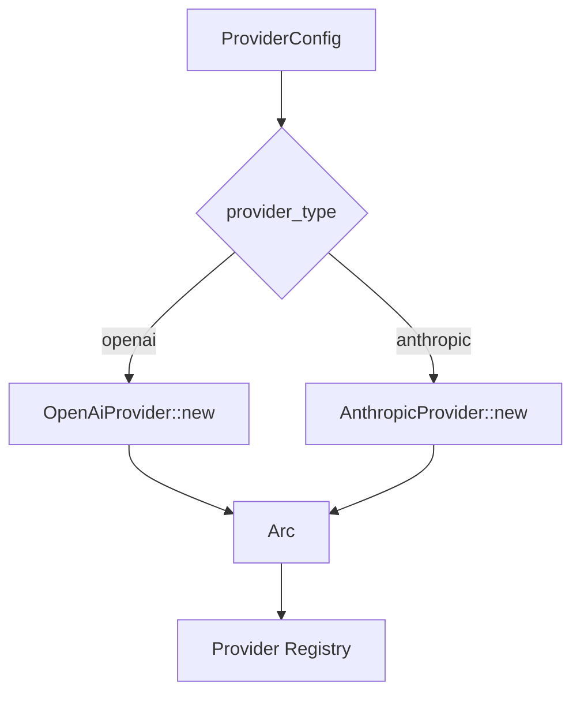

# 供应商 — 规格

## 关键文件

- [sag-providers/src/traits.rs](../../../sag-providers/src/traits.rs) — `LlmProvider` trait 定义
- [sag-providers/src/base.rs](../../../sag-providers/src/base.rs) — 共享构建逻辑（HTTP client、headers、body_overrides 合并）
- [sag-providers/src/openai.rs](../../../sag-providers/src/openai.rs) — OpenAI 适配器
- [sag-providers/src/anthropic.rs](../../../sag-providers/src/anthropic.rs) — Anthropic 适配器（请求/响应翻译 + 缓存控制注入）
- [sag-providers/src/util.rs](../../../sag-providers/src/util.rs) — 共享工具函数
- [sag-providers/src/codec/tool_raw.rs](../../../sag-providers/src/codec/tool_raw.rs) — `IrTool.raw` 双轨约定的唯一实现点（双轨读取 + 展开写入）
- [sag-providers/src/lib.rs](../../../sag-providers/src/lib.rs) — `create_provider()` 工厂函数
- [sag-core/src/types.rs](../../../sag-core/src/types.rs) — `normalize_reasoning_effort()` 方法
- [sag-core/src/api/mod.rs](../../../sag-core/src/api/mod.rs) — 上游协议 wire DTO 的模块入口（`anthropic` / `responses`）
- [sag-core/src/api/anthropic.rs](../../../sag-core/src/api/anthropic.rs) — Anthropic Messages API typed DTO（75 个公开类型，`extra` 透传 + `Unknown(Value)` 联合兜底）
- [sag-core/src/api/responses.rs](../../../sag-core/src/api/responses.rs) — OpenAI Responses API typed DTO（145 个公开类型，`type_tagged_union!` 按 tag 分派）
- [sag-core/src/http_client.rs](../../../sag-core/src/http_client.rs) — 共享 `build_http_client()`：proxy 策略 + 连接池 idle 调优（`POOL_IDLE_TIMEOUT` / `POOL_MAX_IDLE_PER_HOST`）
- [sag-router/src/routes.rs](../../../sag-router/src/routes.rs) — 请求入口归一化调用点

## 核心设计

### Provider 创建数据流



### Trait 设计

```rust
#[async_trait]
pub trait LlmProvider: Send + Sync {
    fn name(&self) -> &str;

    async fn chat(
        &self,
        request: &ChatCompletionRequest,
        real_model: &str,
        api_endpoint: &str,
        target_extra: &HashMap<String, serde_json::Value>,
        timeout_secs: u64,
    ) -> sag_core::Result<ChatCompletionResponse>;

    async fn chat_stream(
        &self,
        request: &ChatCompletionRequest,
        real_model: &str,
        api_endpoint: &str,
        target_extra: &HashMap<String, serde_json::Value>,
        timeout_secs: u64,
    ) -> sag_core::Result<Pin<Box<dyn Stream<Item = StreamChunk> + Send>>>;

    async fn chat_image(
        &self,
        _request: &ImageGenerationRequest,
        _real_model: &str,
        _target_extra: &HashMap<String, serde_json::Value>,
        _timeout_secs: u64,
    ) -> sag_core::Result<ImageGenerationResponse>; // 默认 BadRequest

    // 可选原生扩展（均有默认「不支持」实现）：
    // anthropic_messages / anthropic_messages_stream
    // responses_native / responses_stream_native
}
```

核心三方法 `chat` / `chat_stream` / `chat_image` 接收 OpenAI 格式 request，返回 OpenAI 格式 response；`chat` / `chat_stream` 必须实现，`chat_image` 默认返回 BadRequest。翻译逻辑内聚在各实现中。另提供可选原生扩展方法（`anthropic_messages`、`anthropic_messages_stream`、`responses_native`、`responses_stream_native`），默认「不支持」，由对应适配器覆盖。

## 关键决策

### 统一 trait vs 每个供应商独立接口

选择统一 `LlmProvider` trait：核心三方法（`chat` / `chat_stream` / `chat_image`）保证统一调用面，另有可选原生扩展方法供需要原生协议的适配器覆盖。

**Trade-off**:
- ✅ 调用方（dispatch）不需要知道供应商类型，统一调用
- ✅ 添加新供应商只需实现 trait，dispatch 代码零改动
- ❌ 不是所有供应商都支持所有端点（如图像生成、原生协议），不支持的方法走默认实现并返回 `AppError::BadRequest`
- ❌ 翻译逻辑完全内聚，跨供应商的共享逻辑（如 body_overrides 合并）需要提取到 base.rs 中

### Anthropic 翻译的复杂度

Anthropic Messages API 与 OpenAI Chat Completions API 存在结构性差异：

| 差异点 | 处理方式 |
|--------|---------|
| System prompt | Anthropic 独立 `system` 字段，OpenAI 在 messages 中。翻译时提取所有 system 消息合并后移除 |
| Content blocks | Anthropic 使用 content blocks 数组，OpenAI 使用 content string。翻译时互转 |
| Tool calls | Anthropic `tool_use` ↔ OpenAI `tool_calls` |
| Developer role | Anthropic 不支持。通过 role_mappings 处理 |
| Cache control | Anthropic 原生支持 ephemeral cache。自动注入，OpenAI 忽略 |

**Trade-off**: 人工翻译 vs 使用中间格式：
- 人工翻译（当前方案）：代码量更大，但完全控制翻译质量，可以处理边界情况
- 中间格式：需要定义同时兼容两种 API 的中间格式，增加一层抽象，但翻译逻辑可以更通用

选择人工翻译是因为 Anthropic 和 OpenAI 的差异是**结构性**的（不只是命名差异），中间格式无法消除复杂度，反而增加理解成本。

### API Key 策略：FillFirst vs RoundRobin

`fill_first` 始终使用第一个 key，失败后才尝试下一个。`round_robin` 在每次请求时轮转 key。

**Trade-off**:
- FillFirst 实现简单，大多数部署只有 1 个 key，无额外开销
- RoundRobin 适合有多个 key 需要负载均衡的场景，但需要跨请求维护计数器

RoundRobin 计数器通过 `DispatchRuntime` 中的 `Arc<AtomicUsize>` 维护，与 `fill_first` 共享同一 `key_strategy` 选择路径。

### Body Overrides 合并顺序

客户端请求体 → provider `body_overrides` → `model_overrides[real_model]` → target `extra` → strip（`strip_fields` / `model_strip_fields` 最终净化），后覆盖前；strip 为硬性移除，优先于一切 override。

**Trade-off**: 这个顺序允许 provider 设置默认参数，target 可以覆盖特定目标。但也意味着 target 无法"恢复"被 provider overrides 覆盖的客户端字段；若字段被 strip 列出，则无论哪层 override 写入都会被移除。

### Provider 表单 role_mappings 编辑入口

Provider 新增/编辑表单（`ProviderAddForm.vue` / `ProviderEditForm.vue`）在 Advanced tab 通过 `KvEditor` 暴露 `role_mappings`（`Record<string, string>`）编辑入口。管理 API 的 PUT 对缺省字段采用「保留旧值」语义，故编辑表单不能无条件发送解析结果：保存时对解析出的映射与服务端 `provider.role_mappings` 做 `JSON.stringify` 脏检查，仅在变化时携带该字段——未变化不发送（保留旧值），主动清空发送 `{}`（清空映射）。新增表单无旧值，仅当映射非空时放入 POST payload。

**Trade-off**:
- ✅ 同时满足「未触碰不覆盖」与「主动清空」两种用户意图
- ❌ 以字符串比较判断语义变化，等价但键序不同的映射会被视为脏（编辑器内键序稳定，影响可忽略）

### Anthropic reasoning_effort → thinking 翻译

客户端 `reasoning_effort` 经 7 档映射表 + 递归降级算法翻译为 Anthropic `thinking.budget_tokens`。

**设计决策**：

| 决策 | 内容 |
|------|------|
| 映射表 | 固定 7 档 `(none/minimal/low/medium/high/xhigh/max)` → 绝对值 `(0/1024/2048/4096/8192/16384/32768)` |
| 递归降级 | 从目标档位向下搜索第一个满足 `budget ≤ max_tokens - 1024` 的档位 |
| 不自增 max_tokens | 若 `max_tokens=1024`（默认），所有档位均无法启用 thinking——用户需显式设大 `max_tokens` |
| 未知档位 | 不 panic、不启用 thinking，与网关设计原则一致 |

**Trade-off**:
- ✅ 固定映射表简单、可预测，不会因模型或请求上下文产生意外行为
- ✅ 递归降级保证 `budget_tokens` 始终有效，不会因档位过高而放弃 thinking
- ❌ 绝对值映射无法适配所有模型上下文（如超长 context 时适当降低 budget 更合理）
- ❌ 不自增 `max_tokens` 意味着默认配置下 thinking 不生效——需文档引导用户显式设置

### Anthropic 缓存控制注入

在 system prompt、tools、conversation history 中插入 `cache_control: {"type": "ephemeral"}` 断点。默认启用。

**Trade-off**:
- ✅ 对用户透明，显著降低重复请求的成本
- ❌ 改变了请求内容，可能影响某些边缘场景（如用户精确控制 prompt）
- 通过 `anthropic_cache_control = false` 可关闭

### `IrTool.raw` 双轨约定与共享 helper

三个 codec 对 `IrTool.raw` 各持一套布局（chat 双层 / Responses、Anthropic 扁平），布局差异曾导致四个跨 codec 缺陷（丢 `type`、丢 `strict`、泄漏内部伪字段、hosted 工具压成假 function 形状）。修复采用 D′：**不动 decode 布局，在 encode 侧兼容读取两种布局**，实现收敛到 `sag-providers/src/codec/tool_raw.rs`。

| 决策 | 内容 |
|------|------|
| 判别式 | 「chat 来源」= `raw` 中 `__tool_extra` 键的存在性（`is_dual_layer`，结构标记，非业务字段；空对象 `{}` 也算双层） |
| 双轨读取 | `tool_extras`：有 `__tool_extra` → 工具级字段取自它、`function` 级取自 `__function_extra`；无 → `raw` 自身即工具级字段，其中 `strict` 提升到 function 级（OpenAI 语义） |
| 展开写入 | `merge_extras` 把两层展开到目标协议的工具根部（`or_insert`：调用方已写的 `name` / `description` / `parameters` / `type` 优先），`is_reserved_key` 保证内部伪字段永不出现在 wire 上 |
| 同协议零合成 | chat → chat 仍走原路径，`type` 只从 `__tool_extra` 还原，不凭空发明 |
| 跨协议合成默认值 | chat 出站对外来扁平 IR 在 `type` 缺失或为 `""` 时补 `"type": "function"`；Anthropic 出站**按值**省略 `type`（`"function"` 与 `""` 一律省略，对所有来源一致），其余值（`"custom"`、`web_search*`）逐字保留，缺失维持缺失 |
| hosted 丢弃记 loss | hosted `web_search*` 落 chat 目标时丢弃并记 `LossReason::UnsupportedByTarget`，经 `encode_losses` 通道进 `CallLog` |

**Trade-off**:
- ✅ 四个同根因缺陷同修；chat ↔ chat 字节不变，回归面收敛在跨协议编码
- ✅ 约定只有一个实现点，新增 codec 接 helper 即可，避免再次漂移
- ❌ IR 仍存在两种布局，未做一次性迁移；helper 需长期维护双轨读取分支
- ❌ 改 decode 布局（统一为双层）看似更整齐，但会重写三个 codec 的 pinned round-trip 断言与 hosted 形状测试，收益不抵风险

### 上游协议请求/响应体 typed 化

`codec/{anthropic,responses}.rs` 的 decode / encode 吃 typed DTO（与 `codec/chat.rs` 对齐），DTO 位于 `sag-core/src/api/`，三方共享：`sag-router` 在 handler 边界反序列化请求体，`sag-providers` 的 codec 做映射，`sag-dispatch` 在 `LlmProvider` 原生方法边界序列化回 `Value`。

| 决策 | 内容 |
|------|------|
| DTO 放 `sag-core` 而非 `sag-providers` | router 不依赖 providers 的 codec 内部类型；放 core 后三个 crate 共享同一份类型，无需在 router 复制结构 |
| 无 `deny_unknown_fields` + 每结构体 `#[serde(flatten)] extra` | 未知**字段**必须透传（严格性只留给配置枚举）；`extra` 同时取代旧实现里「`KNOWN` 白名单 + 逐字段特判拷贝」的两处维护 |
| 多态联合：untagged 序列化 + 按 `type` 反序列化 + `Unknown(Value)` | 变体都保留不校验的 `kind: String` 且字段多可省，纯 `untagged` 会被「全可选」变体吞掉；改为读原始 `type` 精确分派，未知 tag / 不可解析载荷落 `Unknown` |
| 弃用字段不建模（例外：Anthropic 采样三件套） | `truncation` / `user` / `prompt_cache_retention` / `reasoning.generate_summary` / `tools[].connector_id` 靠 `extra` 透传；`temperature` / `top_p` / `top_k` 是 `chat ingress → IR sampling → anthropic upstream` 的活跃输入，保留 typed 并加弃用注释 |
| 边界仍保留 `Value` | `LlmProvider` 原生方法（`anthropic_messages` / `responses_native` 及 stream）签名不变，转换收敛在 dispatch 的 `body_to_value`；SSE 帧继续用 `Value` |
| 上游响应 lenient 降级（降级也必须无损） | typed 解析失败时不报错：读字符串信封 + 逐块/逐项 `Unknown`，并显式还原 `stop_details` / `container`、把整包 body 收进 `extra`（降级恰是 body 携带 DTO 表达不了形状时触发，不得成为丢字段的路径）；保持旧 `decode_response(&Value)` 永不失败且不把非规范上游体变成空响应。`sag-providers/src/anthropic.rs::parse_anthropic_response` 与 `sag-dispatch` 的 `decode_anthropic_response` 互指 NOTE 维持同步 |
| usage 按字段降级 | `responses_usage` / `anthropic_usage` 服务流式帧，typed 解析失败时退回逐字段直读（计数器 + cache / reasoning 明细各自独立），一个坏子对象不得把整包 usage 归零（否则「坏一个字段」被放大成「整次调用计数丢失」） |
| `parse_faithful` round-trip 守护（两 codec 同源） | `#[serde(default)]` 字段会被朴素 `from_value` 合成调用方没发的键（Responses 侧 `tool_choice.allowed_tools` / `file_search.vector_store_ids`）；解析后回序列化必须与原值逐字相同才收 typed，否则保留 `Unknown(Value)`。Anthropic 侧 `ToolUseBlock.input` / `ServerToolUseBlock.input` 用 `Option<Map<String, Value>>`（`skip_serializing_if = "Option::is_none"`）表达三态：缺 `input` → `None` → 不长键；显式 `"input": {}` → `Some(空 map)` → 逐字回 `"input": {}`；非空 → 原样回。三态在 DTO 上就成立，所以 `decode_response` 的 Raw 臂（直接序列化 typed block、不经桥接）也保真，不再需要靠 round-trip 不等值绕路。IR 没有「参数缺席」状态，故 `tool_use` 的 `input` 在 IR 侧物化为 `arguments = {}`，egress 恒回 `input: {}`（与 Chat 侧 `arguments: "{}"` 同源）。Responses 侧（`tool_choice` / `tools` / `input` / `output`）与 Anthropic 侧四个桥接共用同一判据 |
| 容错输入：`role` 缺失或非字符串都按 `"user"` | typed `MessageItem.role` 必填，但旧 `Value` 解码器容忍非规范输入（`as_str().unwrap_or("user")`）；守卫因此放宽为「缺失**或非字符串**」都补 `"user"` 后重走 typed 分派，避免整条丢弃用户内容 |
| 422 顺序与消息不动 | Responses 的 stateful / background 预检查在 raw `Value` 上先跑（body 连 typed 都过不去时仍报「不支持该能力」），typed 解析在其后；`reject_unsupported(_mode)` 保持 `&Value` 与原文消息 |

**Trade-off**：

- ✅ 字段访问有编译期约束，新增字段只需改 DTO 一处，不再同步维护白名单与特判拷贝
- ✅ 未建模字段 / 未知联合变体无损往返，native 透传链不再依赖「记得改白名单」
- ✅ 请求体形状错误从静默 loss 变成 handler 边界的 422（与 chat 的 typed 拒绝语义一致）
- ❌ DTO 体量大（Anthropic 75 / Responses 145 个公开类型），与官方 schema 同步是长期维护成本；官方新增字段在补 DTO 前仍只能经 `extra` 透传
- ❌ 多态联合的序列化（`untagged` 派生）与反序列化（宏按 tag 分派）不是同一套逻辑，读代码需对照变体列表
- ❌ 上游响应多一条 lenient 降级分支，属「typed 化不损失健壮性」的额外成本

### 共享 HTTP client 连接池 idle 调优

`build_http_client`（`sag-core/src/http_client.rs`，provider + admin 共享）在模块级写死连接池常量，用于降低 stale 连接复用导致的流中途 `peer closed connection without sending TLS close_notify`：

| 常量 | 取值 | reqwest 默认 |
|------|------|--------------|
| `POOL_IDLE_TIMEOUT` | `30s` | `90s` |
| `POOL_MAX_IDLE_PER_HOST` | `4` | `usize::MAX` |

**设计决策**：

| 决策 | 内容 |
|------|------|
| 写死而非配置化 | 连接层需快速实测迭代；上游 idle 差异按部署而变，配置化收益低、误配风险高 |
| 只调 idle 池 | 两个常量只约束空闲池中可被复用的连接，**不截断在途流**——与 client 级 total timeout 截断长流有本质区别 |
| 禁回退 total timeout | 成功流式响应不受 client 级总 deadline 约束（非流式 request-level `timeout`，流式 TTFB + 可选 chunk idle）；给 `build_http_client` 加回 `.timeout(...)` 会重新掐断健康长流 |
| 调参顺序 | 若 TLS 握手率升高，优先上调 `POOL_MAX_IDLE_PER_HOST`，不优先降低 idle；若上游/proxy idle 更短，再下调 idle 并保留 10–15s 余量 |

**Trade-off**:
- ✅ 改动面小、见效快，不触碰 failover / 流式超时语义
- ✅ 与 0006 流式超时边界兼容（0006 负责「已开始的流不被总超时掐断」；本变更负责「减少拿到已死连接」）
- ❌ 只能降低 stale 复用概率，**不修**「已断的流」（那是方案 C′ 的范围）
- ❌ 取值写死，极端上游 idle 更短的部署需实测后手工调整
- ❌ admin 临时测试客户端经共享 builder 获得相同池默认（短探测请求可接受）

## 不变式

- `create_provider()` 是创建 provider 的唯一入口
- `IrTool.raw` 存在两种布局：chat 来源为双层 `{"__tool_extra", "__function_extra"}`，Responses / Anthropic 来源为扁平平铺；`__tool_extra` 键的**存在性**是「chat 来源」的唯一判别式
- 同协议（chat ↔ chat）工具往返零合成：源工具无 `type` 时出站也不得出现 `type`，源 `type` 为 `""` 时逐字往返为 `""`
- 跨协议编码边界允许合成目标协议必填默认值（chat 出站对缺失或 `""` 的 `type` 补 `"type": "function"`；Responses 出站保留/补 `"type": "function"`；Anthropic 出站按值省略 `"function"` / `""`，对所有来源一致）
- `strict` 位置由目标协议决定：chat 为 `function.strict`，Responses 为工具根部
- 任何出站 JSON 不得包含 `__tool_extra` / `__function_extra` 内部伪字段
- hosted `web_search*` 工具无法映射到目标协议时必须丢弃并记 `LossReason::UnsupportedByTarget`，禁止静默丢弃或压成假 function 形状
- 所有 provider 实现 `Send + Sync`，可在线程间安全共享
- Anthropic 适配器仅接受单条 system message（多条会合并或丢弃）
- `base_url` 必须以 `://` 结尾（validator 检查）
- `build_http_client` 在 proxy 与 direct 两分支均应用 `POOL_IDLE_TIMEOUT` / `POOL_MAX_IDLE_PER_HOST`；这两个常量由单元测试钉住，静默改值会失败
- `build_http_client` 的 pool 选项只约束 idle 池，不截断在途 stream body
- 上游协议 DTO 不得使用 `deny_unknown_fields`；未建模字段必须经 `extra` 往返
- 每个 `type` 判别联合必须有 `Unknown(Value)` 兜底变体，未知 tag / 不可解析载荷逐字透传
- `ir.raw` 双向承载「typed 但 IR 无归宿」的字段：decode 侧写入，encode 侧回填 typed 槽位（已合成值优先，`or_insert` 不覆盖）
- 上游响应 lenient 降级必须无损：`stop_details` / `container` 显式还原，`extra` 收下整包 body，未建模字段与未知顶层键一个不丢
- usage 解析按字段降级：typed 解析失败时逐字段直读，单个坏子对象（`input_tokens_details` / `cache_creation` 等）不得把整包计数归零
- 联合桥接必须过 `parse_faithful` round-trip：回序列化与原值逐字相同才收 typed，否则保留 `Unknown(Value)`，禁止凭空合成 `"input": {}` 一类默认值；不经桥接的路径（`decode_response` 的 Raw 臂序列化 typed block）靠 DTO 上「缺省不序列化」的 `Option` 属性兜底（`ToolUseBlock.input` / `ServerToolUseBlock.input` 即此三态：缺 → 不长键，显式 `{}` → 回 `{}`，非空 → 原样）
- input message 的 `role` 缺失或非字符串一律按 `"user"` 兜底，不得丢弃消息内容
- `reject_unsupported` / `reject_unsupported_mode` 保持 `&Value` 签名与 422 消息文本不变
- SSE 流式路径不做 typed 化
- provider 路径调用 `build_http_client` 时 `timeout: None`（无 client 级 total deadline）；**禁止**为 pool 调优回退 total `.timeout()`

## 测试策略

- `sag-providers/src/openai.rs` — OpenAI 适配器单元测试
- `sag-providers/src/anthropic.rs` — Anthropic 翻译测试（请求构造、响应解析、lenient 降级不丢字段（`parse_anthropic_response_lenient_path_keeps_unmodelled_fields`）、reasoning_effort → thinking 翻译、reasoning_tokens 捕获）
- `sag-providers/src/base.rs` — body_overrides 合并测试
- `sag-providers/src/codec/tool_raw.rs` — 双轨读取 / 展开写入 / `is_dual_layer` 判别式单元测试
- `sag-providers/src/codec/{chat,responses,anthropic}.rs` — 跨 codec 工具字段保真（外来 IR 补/省 `type`、`strict` 落位、出站无伪字段、hosted 丢弃记 loss）；Anthropic 侧断言 `"function"` / `""` 按值省略（含 `function_tool_named_web_search_is_not_hosted` 的扁平 `raw` 期望值）
- `sag-core/src/api/anthropic.rs` / `sag-core/src/api/responses.rs` — DTO 往返（`json!` ↔ typed）、未知字段经 `extra` 保留、未知联合 tag 落 `Unknown`、弃用字段仍可透传
- `sag-providers/src/codec/{anthropic,responses}.rs` — typed 化后的 wire 形状断言；无 IR 归宿的 typed 字段经 `decode → ir.raw → encode` 存活（`request_typed_fields_without_ir_home_roundtrip` / `request_typed_echo_fields_roundtrip_through_raw` / `input_message_typed_extras_roundtrip` / `response_typed_fields_without_ir_home_roundtrip`）；`reject_unsupported_keeps_value_layer_messages` 钉住 422 消息与顺序；`tool_choice_allowed_tools_shape_preserved`、`message_item_without_role_defaults_to_user` / `message_item_with_non_string_role_defaults_to_user`、`malformed_values_are_parse_errors_but_unknown_fields_pass`；usage 降级（`usage_degrades_per_field_when_subobject_is_malformed` / `usage_degraded_path_keeps_old_defaults` / `usage_degrades_per_field_when_details_are_ill_typed` / `stream_completed_keeps_usage_when_details_are_ill_typed`）；`parse_faithful` 守护（`tool_use_block_without_input_keeps_wire_shape` / `response_raw_block_without_input_keeps_wire_shape` / `faithful_guard_keeps_well_formed_unions_typed`）
- `sag-dispatch/src/dispatch/chat/tests.rs` — typed happy path、Anthropic / Responses 两处 schema mismatch 的 lenient 降级（含 `decode_anthropic_response_lenient_path_keeps_unmodelled_fields` 钉住降级不丢字段）、200 送达的上游错误体保留在 `raw`
- `sag-providers/src/codec/responses.rs` — translated 合成终点帧按 finish reason 分档（`stream_finish_length_emits_incomplete_with_max_output_tokens` / `stream_finish_content_filter_emits_incomplete_with_content_filter` / `stream_finish_stop_emits_completed_without_incomplete_details`），`stream_finish_terminal_frame_is_shared_by_both_entry_points` 钉两入口（`encode_stream_event` / `stream_encoder`）终点帧字节一致
- `sag-router/tests/{anthropic_messages_ingress,responses_ingress}.rs` — typed 形状不匹配 422（各自信封）、stateful 预检查先于 typed 解析；`responses_ingress_chat_upstream_stream_length_emits_response_incomplete` 钉 translated 整链终点帧（`length` → `response.incomplete` + `incomplete_details.reason = max_output_tokens`）
- `sag-core/src/types.rs` — `normalize_reasoning_effort` 单元测试
- `sag-core/src/http_client.rs` — `pool_connection_constants_match_plan`（钉住 pool 常量）、`pool_options_coexist_with_proxy_and_timeout`（pool 与 proxy/timeout 共存）

## 变更记录
- [0009 Responses 流式终点帧按 finish reason 区分 `response.incomplete`](changes/0009-responses-incomplete-terminal-event.md)
- [0008 Responses / Anthropic 请求响应体 typed 化（无损透传）](changes/0008-typed-wire-dtos-responses-anthropic.md)
- [0007 跨 codec 工具字段保真（统一 `IrTool.raw` 双层约定）](changes/0007-tool-raw-cross-codec-fidelity.md)
- [0005 共享 HTTP client 连接池 idle 调优（降低 stale 连接复用）](changes/0005-http-client-pool-idle-tuning.md)
- [0004 供应商 role_mappings 编辑入口](changes/0004-role-mappings-editor.md)
- [0002 Anthropic reasoning_effort 翻译](changes/0002-anthropic-reasoning-effort.md)
- [0001 初始化](changes/0001-initial.md)
