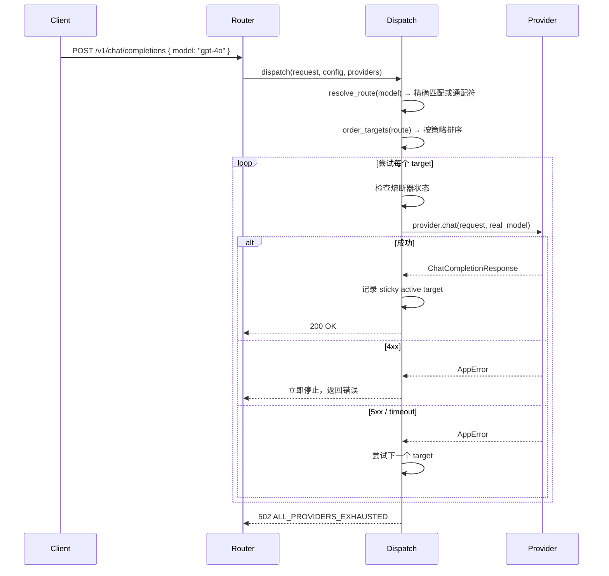

# 路由 — 规格

## 关键文件

- [sag-config/src/config.rs](../../../sag-config/src/config.rs) — `RouteConfig`, `RouteTarget`, `Strategy` 类型
- [sag-dispatch/src/order.rs](../../../sag-dispatch/src/order.rs) — 目标排序、shuffle 缓存、stickiness
- [sag-dispatch/src/dispatch/resolve.rs](../../../sag-dispatch/src/dispatch/resolve.rs) — 路由匹配、目标选择、重试循环
- [sag-core/src/circuit_breaker.rs](../../../sag-core/src/circuit_breaker.rs) — 熔断器状态管理（三态机与周期探测）
- [sag-dispatch/src/state.rs](../../../sag-dispatch/src/state.rs) — `DispatchRuntime`（持有 shuffle 缓存、sticky active targets、round-robin 计数器）

## 核心设计

### 路由匹配数据流

## 关键决策

### StickyFailover vs FillFirst

两者核心区别在于**跨请求的记忆**：

- `FillFirst`：每次都严格按缓存顺序尝试，无跨请求记忆。适合"始终优先主供应商"的场景。
- `StickyFailover`：额外维护 `active_targets: HashMap<model_name, target_key>`。一旦某个 target 成功，后续同模型请求会优先尝试它。

**Trade-off**:
- StickyFailover 最大化上游缓存命中率（重复请求打到同一供应商），但可能长期不尝试主供应商恢复
- FillFirst 在备份供应商成功后不会"粘滞"，下次请求仍会先试主供应商，适合希望尽快恢复主供应商的场景

**选择 StickyFailover 为默认**：LLM API 的延迟主要由模型推理决定，切换供应商意味着新的冷启动。保持粘性比"尽快恢复"更重要。

### Shuffle 缓存 Key 设计

缓存 key 包含路由的完整 target 列表信息（provider + real_model + priority + extra + retries）的哈希。任何 target 字段变更都会导致缓存失效。

**Trade-off**: 包含 `extra` 和 `retries` 在 key 中意味着即使这些字段变更也会清零 shuffle。这会短暂降低缓存命中率，但避免了"配置变了但行为没变"的 confusing 状态。

### 三级回落 vs 扁平配置

重试和超时都采用三级回落（target → route → global），而不是要求所有层级都显式配置。

**Trade-off**: 
- ✅ 大多数场景只需配全局默认，少数特例可以逐路由、逐 target 覆盖
- ❌ 三级回落增加了代码复杂度（需要写 `resolve_retries()` / `resolve_timeout()` 辅助函数）

选择三级回落是 pragmatic 的选择——配置简单是用户价值，代码复杂度是可控的内部实现代价。

### 4xx 立即停止

4xx 错误（400、401、404）是客户端错误，换供应商不会解决。立即停止重试避免浪费时间。

**Trade-off**: 如果用户配错了某个 target 的 `real_model` 而上游返回 404，不会自动尝试下一个 target。这比默默 fallthrough 然后返回一个不相关的错误更好，因为错误信息直接指向问题所在。

## 不变式

- 同一路由内 `(provider, real_model)` 组合必须唯一（validator 在启动时检查）
- `priority = 0` 是合法值，不是"未配置"（与 `retries = 0` 不同，后者被 validator 拒绝）
- 通配符路由只能有一个（validator 未强制，但行为上只有第一个被使用）
- `api_endpoint` 必须以 `/` 开头

## 测试策略

- `sag-dispatch/src/testing.rs` — DispatchRuntime 集成测试
- `sag-config/src/config.rs` tests — 配置解析和 validator 单元测试
- `sag-router/tests/auth_regression.rs` — 端到端
- 关键场景：故障转移顺序、StickyFailover 粘滞行为、shuffle 缓存失效、熔断器交互

## 变更记录
- [0001 初始化](changes/0001-initial.md)
