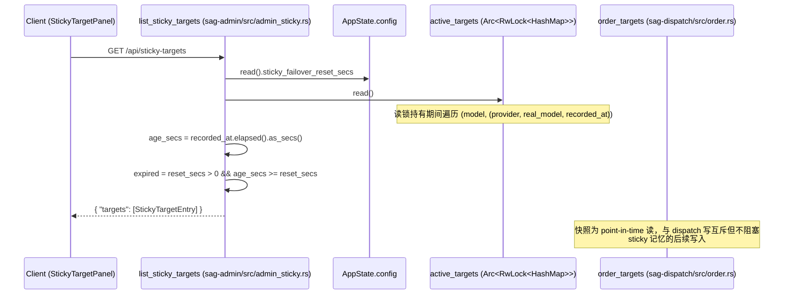

# Sticky Targets 可观测性 — 规格

StickyFailover 策略在某个 target 成功后，把 `(provider, real_model)` 记入
`AppState.active_targets`，后续请求 `order_targets` 把记忆的 target 顶到排序首位。
该机制此前完全不可见、不可手动操作。本次改造只做**可观测性**：新增 admin API
（`GET|DELETE /api/sticky-targets`）+ 前端独立面板，让 sticky 状态可见可手动清除；
不改 sticky 失败/熔断逻辑。

## 关键文件

按职责分组。

### 入口/路由注册
- `sag-admin/src/admin.rs` — `build_admin_routes` 注册 `GET|DELETE /api/sticky-targets`，由 `gateway_auth` 中间件保护
- `sag-admin/src/admin_sticky.rs` — `list_sticky_targets` / `delete_sticky_target` handler 与内联测试

### 共享状态
- `sag-state/src/lib.rs` — `AppState.active_targets: ActiveTargets`（`Arc<RwLock<HashMap<String, (String, String, Instant)>>>`，L26-29），与 `DispatchRuntime` 共享同一 `Arc`

### 排序逻辑（只读引用）
- `sag-dispatch/src/order.rs` — `order_targets` 读 `active_targets` 把 sticky target 顶到首位（L24-83）；本次不修改

### 配置
- `sag-config/src/config.rs` — `GatewayConfig.sticky_failover_reset_secs`（默认 7200，`0` 表示永不过期），GET handler 用它计算 `expired`

### 前端
- `sag-ui/src/types/api.ts` — `StickyTargetEntry` 接口（snake_case，仿 `CircuitBreakerEntry`）
- `sag-ui/src/stores/stickyTarget.ts` — Pinia store：`fetchStickyTargets` / `clearStickyTarget`，401 处理
- `sag-ui/src/components/circuit/StickyTargetPanel.vue` — 独立面板，仿 `CircuitBreakerPanel.vue` Card 结构
- `sag-ui/src/pages/DashboardPage.vue` — 挂载 `StickyTargetPanel` 于 `CircuitBreakerPanel` 之后

## 核心设计

### 数据流

`GET /api/sticky-targets` 请求链路：



`DELETE /api/sticky-targets` 流程：

```mermaid
flowchart TD
    A[Client: DELETE /api/sticky-targets<br/>body { model }] --> B[delete_sticky_target handler]
    B --> C[active_targets.write]
    C --> D{HashMap::remove(model)}
    D -->|entry 存在| E[移除该 model 的 sticky pin]
    D -->|entry 不存在| F[no-op 幂等]
    E --> G[返回 { ok: true }]
    F --> G
    G --> H[下次请求按优先级路由重排<br/>不再 pinned 到 failover target]
    G -.不触碰.-> CB[circuit_breaker 状态保持不变]
```

## 关键决策

### 端点设计

#### 独立 `sticky-targets` 端点 vs 复用 `circuit-breaker`

背景：`POST /api/circuit-breaker/close` 已顺带清除 `active_targets[model]`（"target 已恢复，重新竞争"信号），曾被考虑把 sticky 读写并进熔断器端点。

**Trade-off**:
- ✅ 熔断器与 sticky 记忆是两个正交状态（熔断器记失败、sticky 记成功），独立端点避免语义混淆；面板也独立，职责清晰
- ❌ 复用 circuit-breaker/close：两个正交状态混在一个面板/端点，语义混淆；且 close 语义是"关闭熔断器"，让用户用它清除 sticky 说不通
- 现有 `circuit-breaker/close` 顺带删 sticky 的行为**保留**——那是"target 已恢复，重新竞争"的信号，与手动清除是不同意图

#### `age_secs` vs `recorded_at_secs`

背景：GET 需要向用户呈现 sticky 记忆的"新旧程度"。

**Trade-off**:
- ✅ `age_secs`（`recorded_at.elapsed().as_secs()`，相对秒数）：`Instant` 是单调时钟，直接可算，无时区问题
- ❌ `recorded_at_secs`（UNIX 秒）：`std::time::Instant` 不支持转 UNIX 秒，强转会引入 wall-clock 依赖（`SystemTime`）和时区/时钟跳变问题

#### DELETE 只删 sticky，不碰熔断器

背景：`circuit-breaker/close` 是"删熔断器 + 顺带删 sticky"，新 DELETE 若复制该模式会连带影响熔断状态。

**Trade-off**:
- ✅ 职责分离：清除 sticky 记忆只影响排序，不隐式改变熔断判定；方向与 `circuit-breaker/close` 相反但互补
- ❌ 复用 close 的模式（顺手关熔断器）：用户只想重置路由竞争，却可能意外关闭一个 open 的熔断器，造成目标立即被打

## 不变式

### 后端 API
- `DELETE /api/sticky-targets` 只删 `active_targets`，不触碰 `circuit_breaker` 状态（grep: `active_targets.write().await.remove` 且无 `circuit_breaker` 引用）
- `active_targets` 的 key 是 model，value 是 `(provider, real_model, Instant)`；entry 的 `age_secs = recorded_at.elapsed().as_secs()`（grep: `recorded_at.elapsed().as_secs()`）
- `expired = sticky_failover_reset_secs > 0 && elapsed >= sticky_failover_reset_secs`；`reset_secs == 0` 时恒 false（grep: `reset_secs > 0 && elapsed >= reset_secs`）
- `DELETE /api/sticky-targets` 幂等：`HashMap::remove` 对不存在 key 是 no-op，仍返回 200 `{ "ok": true }`
- GET 响应格式固定为 `{ "targets": [StickyTargetEntry] }`，空记忆返回空数组（非 null）

### 前端
- `StickyTargetEntry` 字段与后端 serde 输出一致（snake_case：`age_secs` / `expired`），仿 `CircuitBreakerEntry` 风格
- 401 一律走 `useConnectionStore().handle401()`（与 `circuitBreaker.ts` 一致）

## 测试策略

### 后端 `sag-admin/src/admin_sticky.rs`（内联 `#[cfg(test)] mod tests`）

- `empty_active_targets_returns_empty_array` — 空记忆返回 200 与 `targets: []`
- `inserted_target_appears_in_snapshot` — 手动写入 active_targets 后 GET 可见，`age_secs == 0`、`expired == false`
- `stale_target_is_reported_expired` — 记录 8000s 前的 target 超过默认 reset（7200）标记 `expired`；age_secs 用范围断言（`8000..=8001`）防秒边界 flaky
- `delete_removes_target_and_is_idempotent` — 首次 DELETE 移除，重复 DELETE 仍 200
- `zero_reset_secs_never_expires` — `sticky_failover_reset_secs == 0` 时 99999s 的旧 target 仍 `expired == false`

### 前端
- `vue-tsc` typecheck 通过（`pnpm typecheck`）
- `oxlint` 通过（`pnpm lint`）

## 变更记录

- [NNNN sticky targets 可观测化](changes/NNNN-sticky-targets-observability.md)
