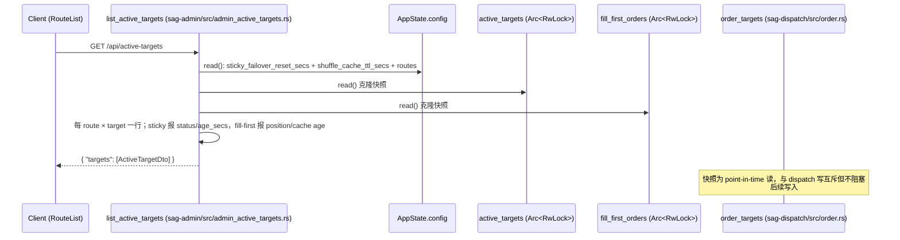

# Sticky Targets 可观测性 — 规格

StickyFailover 策略在某个 target 成功后，把 `(provider, real_model)` 记入
`AppState.active_targets`，后续请求 `order_targets` 把记忆的 target 顶到排序首位。
FillFirst 策略不写 `active_targets`，它的粘性是 `fill_first_orders` 缓存的洗牌顺序
（index 0 吸收所有流量直到不可用）。

本模块的端点让两种策略的生效状态可见可手动操作：
`GET|DELETE /api/active-targets` 对 StickyFailover 报 pin 状态、对 FillFirst 报
缓存顺序位置；DELETE 对 StickyFailover 解除 pin、对 FillFirst 丢弃缓存顺序
（下次请求重新洗牌）。不改 sticky 失败/熔断逻辑。

## 关键文件

按职责分组。

### 入口/路由注册

- `sag-admin/src/admin.rs` — `build_admin_routes` 注册 `GET|DELETE /api/active-targets`，由 `gateway_auth` 中间件保护
- `sag-admin/src/admin_active_targets.rs` — `list_active_targets` / `delete_active_target` handler 与内联测试

### 共享状态

- `sag-state/src/lib.rs` — `AppState.active_targets: ActiveTargets`（`Arc<RwLock<ActiveTargetsInner>>`），与 `DispatchRuntime` 共享同一 `Arc`
- `sag-state/src/lib.rs` — `CachedOrder`（从 `sag-dispatch` 下沉）+ `FillFirstOrders` type alias；`AppState.fill_first_orders` 与 `DispatchRuntime` 共享同一 `Arc`

### 排序逻辑（共享状态的使用方）

- `sag-dispatch/src/order.rs` — `order_targets` 读 `active_targets` 把 sticky target 顶到首位；`order_fill_first` 读写 `fill_first_orders` 缓存（两种策略共用）
- `sag-dispatch/src/state.rs` — `DispatchRuntime` 持有 `fill_first_orders`；`with_shared_state` 注入与 `AppState` 共享的 `Arc`

### 配置

- `sag-config/src/config.rs` — `GatewayConfig.sticky_failover_reset_secs`（默认 7200，`0` 表示永不过期），GET handler 用它计算 `expired`

### 前端

- `sag-ui/src/types/api.ts` — `ActiveTargetEntry` 接口（snake_case，仿 `CircuitBreakerEntry` 风格）
- `sag-ui/src/stores/activeTarget.ts` — Pinia store：`fetchActiveTargets` / `clearActiveTarget`，401 处理
- `sag-ui/src/components/routes/RouteList.vue` — Routes 页表格内嵌「Active Target」列：StickyFailover 显示 pin（Active/Expired 徽标 + 清除）、FillFirst 显示当前 fill target（Fill 徽标 + 重置）；状态圆点颜色调 `activeTargetDotColor`
- `sag-ui/src/lib/activeTarget.ts` — active-target 纯函数：`selectActiveTarget`（按 `entry.strategy` 过滤 sticky）/ `selectFillFirstTarget`（自 RouteList 内联迁移）、`isActiveFirstTarget`（按后端 `target_index == 0` 判定首 target）、`activeTargetDotColor`（统一圆点着色）
- `sag-ui/src/lib/activeTarget.test.ts` — 前端边界测试（`node --experimental-strip-types` 直接运行）

## 核心设计

### 数据流

`GET /api/active-targets` 请求链路：



`DELETE /api/active-targets` 流程（按 route strategy 分发）：

```mermaid
flowchart TD
    A[Client: DELETE /api/active-targets<br/>body { model }] --> B[delete_active_target handler]
    B --> R[resolve_model_route: 该 model 的路由 strategy?]
    R -->|FillFirst| FF[active_targets.clear(model) + fill_first_orders.remove(model)<br/>清残留 pin + 下次请求重新洗牌 = 手动 TTL 过期]
    R -->|StickyFailover / RR / 无路由| SF[active_targets.clear(model)<br/>解除 pin + bump generation/epoch]
    FF --> G[返回 { ok: true }]
    SF --> G
    G -.不触碰.-> CB[circuit_breaker 状态保持不变]
```

## 关键决策

### 端点设计

#### 独立 `sticky-targets` 端点 vs 复用 `circuit-breaker`

背景：`POST /api/circuit-breaker/close` 已顺带清除 `active_targets[model]`（"target 已恢复，重新竞争"信号），曾被考虑把 sticky 读写并进熔断器端点。

**Trade-off**:

- ✅ 熔断器与 sticky 记忆是两个正交状态（熔断器记失败、sticky 记成功），独立端点避免语义混淆；面板也独立，职责清晰
- ❌ 复用 circuit-breaker/close：两个正交状态混在一个面板/端点，语义混淆；且 close 语义是"关闭熔断器"，让用户用它清除 sticky 说不通
- 现有 `circuit-breaker/close` 顺带删 sticky 的行为**保留**——那是"target 已恢复，重新竞争"的信号，与手动清除是不同意图

#### `age_secs` vs `recorded_at_secs`

背景：GET 需要向用户呈现 sticky 记忆的"新旧程度"。

**Trade-off**:

- ✅ `age_secs`（`recorded_at.elapsed().as_secs()`，相对秒数）：`Instant` 是单调时钟，直接可算，无时区问题
- ❌ `recorded_at_secs`（UNIX 秒）：`std::time::Instant` 不支持转 UNIX 秒，强转会引入 wall-clock 依赖（`SystemTime`）和时区/时钟跳变问题

#### DELETE 只删 sticky/order cache，不碰熔断器

背景：`circuit-breaker/close` 是"删熔断器 + 顺带删 sticky"，新 DELETE 若复制该模式会连带影响熔断状态。

**Trade-off**:

- ✅ 职责分离：清除 sticky 记忆 / fill-first 顺序只影响排序，不隐式改变熔断判定；方向与 `circuit-breaker/close` 相反但互补
- ❌ 复用 close 的模式（顺手关熔断器）：用户只想重置路由竞争，却可能意外关闭一个 open 的熔断器，造成目标立即被打

#### FillFirst 的手动重置语义 = 重新洗牌（TTL 等价物）

背景：FillFirst 的粘性在 `fill_first_orders` 缓存的洗牌顺序（index 0 吸收全部流量），不在
`active_targets`（FillFirst 从不写它）。此前只有 `shuffle_cache_ttl_secs`（默认 7200s）自动
过期一条重置路径；手动重置补齐与 StickyFailover（`sticky_failover_reset_secs` 过期 + 手动
DELETE）的对称性。

**决策**：DELETE 对 FillFirst 路由 = `fill_first_orders.remove(model)`，下次请求重新洗牌。

- ✅ 与自动 TTL 过期语义完全一致、可预期、无新状态；与 sticky 的 `clear` + generation/epoch 机制正交（FillFirst 决策不读它们，也无需 token 写回保护）
- ❌ 候选方案"强制轮换（保证换模型）"被否：需要新逻辑/新状态，且与 TTL 过期的纯重新洗牌语义不一致
- ⚠️ **重置 ≠ 保证换模型**：重新洗牌后 index 0 有概率仍是原 target（2 target 时 50%）；文档/UI 措辞必须避免"保证切换"暗示

#### FillFirst 可观测字段放现有端点 vs 独立端点

背景：GET 对 FillFirst 路由此前恒报 `idle`（误导——流量实际全灌到缓存顺序首位）。

**决策**：扩展现有 `/api/active-targets`，新增 `strategy` / `fill_first_position` /
`fill_first_cache_age_secs` / `fill_first_cache_ttl_secs` 字段，只对 FillFirst 路由填充。

- ✅ 复用现有 GET/DELETE 与 UI 入口；"sticky" 一词本就涵盖 fill-first 的粘性；改动集中在 `admin_active_targets.rs` + `RouteList.vue` 一处
- ❌ 独立 `/api/fill-first` 端点：职责更正交，但 UI 需新增入口，且两处共享 `fill_first_orders` 的状态要重复解释
- 注意：StickyFailover 内部也走 `order_fill_first`（共享同一缓存），但 GET 只对 FillFirst 路由报缓存字段——sticky 的可观测主角是 pin，混报会模糊两个概念

#### 状态圆点颜色语义

背景：此前圆点只有三态——FillFirst 恒 emerald、sticky `expired` 用 amber、sticky `pinned` 恒
green。`expired` 的 amber 与 `pinned` 的 green 视觉区分度低，且颜色无法反映 pin 落在 route 的
哪个 target（首项 vs fallback）。

**决策**（`activeTargetDotColor`，按此顺序短路）：

1. `fill_first`（`fill` 存在且无 sticky）→ `bg-emerald-500`（保持）
2. 其余按首项判定分流（先判 `isActiveFirstTarget`，再按状态取色）：
   - 命中 route 最高优先级（primary）target → `expired` 用 `bg-green-500/40`（灰绿）、`pinned` 用 `bg-green-500`
   - 非首项 → `expired` 用 `bg-orange-500/40`（灰橙）、`pinned` 用 `bg-orange-500`

首项判定 `isActiveFirstTarget` 用后端 `ActiveTargetDto.target_index`：DTO 每 route.targets 一个，
`target_index` 是该 target 在 route 优先级降序排序中的秩（stable sort by `priority` 降序，同
优先级保持原始数组顺序，rank 0 = 最高优先级 target），`target_index === 0` 即命中 route 的
最高优先级（primary）target。权威来源在后端——前端不依赖响应顺序、对象身份或
`real_model` 字符串。

- ✅ 语义清晰：绿 = 首选目标在吸收流量、橙 = 已落到 fallback、灰绿/灰橙 = pin 已过期（muted 保留
  配置位置色系，首项 vs 非首项）、emerald = fill-first
- ✅ `expired` 只表示 pin 超过 `sticky_failover_reset_secs` 未更新，**不等同于当前实际承载流量**；
  灰绿/灰橙的 muted 色既表达「过期」又保留「配置位置」信息，比统一灰更可读
- ✅ 为什么不比 `real_model` 字段：passthrough 与显式 target 可能解析出相同 `real_model`（如 exact
  route passthrough 解析为 route 名），字段比较无法区分；`target_index` 由后端按优先级降序秩直接
  给出，天然精确
- ✅ 信任字段：`target_index === 0` 即首项绿，非 0 即 fallback 橙（前后端同版本，字段恒有）
- ❌ 备选「按 real_model 字符串比较」被否：会在 passthrough 解析与显式 target 同名时误报首项绿
- ❌ 备选「前端按响应顺序 + 对象身份判定」（早期实现）被否：依赖 store 保持响应顺序与 DTO 对象
  身份，脆弱且无法跨请求比对；改由后端 DTO 直接携带 `target_index`（优先级降序秩，rank 0 =
  最高优先级 target）作为权威来源

#### 非 StickyFailover 路由不展示 sticky 残留 pin

背景：路由从 StickyFailover 切到 FillFirst / RoundRobin 后，`active_targets` 里的旧 pin 不再
被新策略写入或清除，会一直残留到下次 prune。

**决策**：GET 只对 `Strategy::StickyFailover` 路由匹配 `active_targets`（`list_active_targets`
按 `route.strategy == Strategy::StickyFailover` 分支）；FillFirst / RoundRobin 路由的残留 pin
一律报 `idle`，不显示为 pinned/expired。

- ✅ 残留 pin 不代表当前流量方向（新策略不再写 pin），展示为 pinned/expired 会误导运维；与前端
  `selectActiveTarget` 按 `entry.strategy` 过滤的语义对齐（entry.strategy 即后端读到的 route strategy）
- ❌ 展示残留 pin（旧行为）：切换策略后 UI 仍显示旧 pin，用户无法区分「当前生效」与「历史残留」
- 注意：这只是 GET 展示层过滤，`active_targets` 内存与 dispatch 语义不变；残留由 proactive prune
  或下一 dispatch prune 清除

#### DELETE 对每种策略都清 active_targets，FillFirst 额外清 order cache

背景：路由从 StickyFailover 切到 FillFirst 后，旧 pin 残留且 GET 已不展示（见上节），用户需要
一个手动清理入口。

**决策**：`DELETE /api/active-targets` 对**所有**策略都执行 `active_targets.clear(model)`（清除
跨策略残留 pin + bump generation/epoch），FillFirst 路由额外 `fill_first_orders.remove(model)`
（下次请求重新洗牌）。

- ✅ 一个 DELETE 同时覆盖「解除当前 pin」与「清理策略切换残留」，语义完整；fill-first 分支的行为
  与 TTL 过期的纯重新洗牌语义一致，幂等（无 entry 时 clear/remove 是 no-op，仍 200）
- ❌ 只按当前 strategy 分发（旧行为）：切到 FillFirst 后旧 pin 无入口可清，只能等 prune

#### proactive prune：route CRUD 与 hot-reload 成功后立即清理

背景：`prune_stale_entries` 原本只在下一 dispatch 请求发现 `routes_version` 变化时执行；策略
切换 / 删路由后残留 pin 会一直可见到下一次请求。

**决策**：route CRUD（create/update/delete，`sag-admin/src/admin_routes.rs`）与 gateway 主
hot-reload（`sag-gateway/src/main.rs` `GatewayReloadHandler`，含 unstable-file fallback retry
成功路径）成功后立即 prune——`active_targets` 用策略感知的 `retain_sticky_routes`，
`fill_first_orders` / `route_counters` 用 key 重新解析。

- ✅ 运维操作完成后内存即刻与 config 一致，GET 不再展示已切换/已删除策略的残留状态
- ❌ 等待下一 dispatch（旧行为）：低流量路由的残留 pin 可能长时间可见
- 注意：fill_first_orders / route_counters 按请求 model key 解析，wildcard key 只要仍解析到
  任意路由就保留（下次请求会按新 config 重新洗牌/计数）；只有 active_targets 是策略感知的

## 不变式

### 后端 API

- `DELETE /api/active-targets` 按 model 解析 route strategy：**所有策略**都执行 `active_targets.clear(model)`（清除跨策略残留 pin + bump generation/epoch），FillFirst 路由额外 `fill_first_orders.remove(model)`（下次请求重新洗牌）；两者都不触碰 `circuit_breaker`（grep: 无 `circuit_breaker` 引用）
- GET 只对 `Strategy::StickyFailover` 路由匹配 `active_targets`：FillFirst / RoundRobin 路由的残留 pin 报 `idle`（不展示 pinned/expired），见 `list_active_targets` 的 strategy 分支（测试 `fill_first_route_ignores_stale_active_targets_entry` 断言）
- 每 route × target 一个 DTO，`target_index` 为该 target 在 route 优先级降序排序中的秩（stable sort by `priority` 降序，同优先级保持原始数组顺序，rank 0 = 最高优先级 target）；响应 `targets` 数组本身保持原始 config 顺序不变，GET/DELETE 语义不依赖它（仅前端判首项用）
- FillFirst 的 DELETE 与 sticky 的 DELETE 互不干扰：fill-first 分支额外清 order cache，sticky 分支不动 `fill_first_orders`（测试 `delete_fill_first_resets_order_cache_and_clears_stale_pin` / `delete_sticky_does_not_touch_fill_first_cache` 断言隔离）
- route CRUD（create/update/delete）与 gateway hot-reload（含 unstable-file fallback retry 成功路径）成功后立即 prune：`admin_routes.rs` 调 `retain_sticky_routes`，`main.rs` `GatewayReloadHandler` 调 `prune_stale_entries`；不等待下一 dispatch 的 `routes_version` 检查
- `active_targets` 的 key 是 model，value 是 `(provider, real_model, Instant)`；entry 的 `age_secs = recorded_at.elapsed().as_secs()`（grep: `recorded_at.elapsed().as_secs()`）
- `expired = sticky_failover_reset_secs > 0 && elapsed >= sticky_failover_reset_secs`；`reset_secs == 0` 时恒 false（grep: `reset_secs > 0 && elapsed >= reset_secs`）
- `DELETE /api/active-targets` 幂等：`remove` / `clear` 对不存在 key 是 no-op，仍返回 200 `{ "ok": true }`
- GET 响应格式固定为 `{ "targets": [ActiveTargetDto] }`，空记忆返回空数组（非 null）
- fill-first 缓存字段只对 `Strategy::FillFirst` 路由填充：`strategy` 恒有值，`fill_first_position` / `fill_first_cache_age_secs` / `fill_first_cache_ttl_secs` 无缓存时 null，`ttl == 0` 报 0（永不过期）而非 null（grep: `route.strategy == Strategy::FillFirst` 分支）
- fill-first 的缓存 key 是 route `model_name`（wildcard 为 `"*"`），与 DELETE 的 model 参数同源；`fill_first_position` 按 provider + `real_model` spec 匹配缓存顺序（position 0 = 当前 fill target）

### 前端

- `ActiveTargetEntry` 字段与后端 serde 输出一致（snake_case：`age_secs` / `status`），仿 `CircuitBreakerEntry` 风格
- 401 一律走 `useConnectionStore().handle401()`（与 `circuitBreaker.ts` 一致）
- 状态圆点着色（`activeTargetDotColor`）：fill_first 恒 emerald；sticky `expired` 按配置位置 muted（首项 `bg-green-500/40`、非首项 `bg-orange-500/40`）——`expired` 只表示过期 pin 的配置位置，不等同于当前实际承载流量；sticky `pinned` 命中首项 green、非首项 orange；无 active 时返回 `null` 不渲染圆点
- `isActiveFirstTarget` 用后端 `target_index === 0` 判首项（权威来源在 DTO，`target_index` 是优先级降序秩，0 = 最高优先级 target）

## 测试策略

### 后端 `sag-admin/src/admin_active_targets.rs`（内联 `#[cfg(test)] mod tests`）

- `no_routes_returns_empty_array` / `all_route_targets_are_idle_when_active_map_empty` — 空态返回 200 与 `targets: []`、全 idle
- `target_index_follows_priority_order` — `target_index` 是优先级降序秩（priorities [10,20,0] → target_index [1,0,2]，rank 0 = 最高优先级 target），pin 后仍报其优先级秩
- `target_index_stable_for_equal_priorities` — 全部默认优先级 0 时 stable sort 保持数组顺序，`target_index` 等于数组位置（行为与旧语义一致）
- `pinned_and_expired_statuses` — 手动写入 active_targets 后 GET 报 `pinned`/`expired`，`age_secs` 用范围断言防秒边界 flaky
- `orphan_active_entries_without_route_target_are_not_listed` — 无对应 route target 的孤儿 entry 不进响应（响应以 config routes 为纲）
- `delete_removes_target_and_bumps_generation_idempotently` — 首次 DELETE 移除 + bump generation；无 entry 的 DELETE bump 全局 epoch；重复 DELETE 仍 200
- `zero_reset_secs_never_flags_expired` — `sticky_failover_reset_secs == 0` 时旧 target 仍 `pinned`
- `wildcard_*` 系列 — wildcard 路由按 route_model + resolve 归属，不跨路由误报；`key` 字段对 wildcard 报具体请求模型
- `fill_first_route_ignores_stale_active_targets_entry` — 切到 FillFirst 后残留 sticky pin（含 expired）报 `idle`、无 key、age 0
- `fill_first_route_reports_strategy_and_null_cache_fields_when_absent` — FillFirst 无缓存时 `strategy: "fill_first"`、缓存字段 null、status 仍 idle
- `fill_first_route_reports_cached_order_position_and_age` — 注入确定顺序缓存后 position 0/1 正确、cache age 范围断言、TTL 报默认 7200
- `fill_first_cache_reports_zero_ttl_as_never_expire` — `shuffle_cache_ttl_secs = 0` 时 TTL 字段报 0（非 null）
- `delete_fill_first_resets_order_cache_and_clears_stale_pin` — DELETE 清 order cache + 清策略切换残留 pin、重复 DELETE 仍 200
- `delete_sticky_does_not_touch_fill_first_cache` — sticky DELETE 只清 pin，不碰 fill-first 缓存
- `delete_fill_first_on_wildcard_route_resets_by_route_name` — wildcard FillFirst 按 `"*"` key 清缓存

### 其他 crate 的清理/判定测试

- `sag-admin/src/admin_routes.rs` — `update_route_strategy_switch_prunes_stale_active_target`：admin API 把 StickyFailover 路由改成 FillFirst 后立即清残留 pin（不等待下一 dispatch）
- `sag-dispatch/src/state.rs` — `prune_stale_entries_drops_active_pin_after_strategy_switch_to_fill_first`：prune 策略感知，fill_first_orders / route_counters 对仍解析的 key 保留
- `sag-state/src/lib.rs` — `retain_sticky_routes_drops_entries_for_non_sticky_routes`：keep 规则（key 仍解析到记录的 route 且该 route 仍为 StickyFailover）

### 前端

- `sag-ui/src/lib/activeTarget.test.ts`（`node --experimental-strip-types` 直接运行）— 边界测试：
  `target_index` 0/1+ 判首项、expired 首项灰绿 / 非首项灰橙（expired 表示过期 pin 的配置位置而非当前流量）、fill 保持 emerald 且与 sticky
  共存时 sticky 优先、`selectActiveTarget` 按 `entry.strategy` 过滤（仅 sticky_failover entry 是 pin）、fill_first 无缓存 order 不算 active（sorting 不误判）、多 route entries 按
  `model` 作用域不串扰、wildcard 多 pin 按 `age_secs` 取最新
- `vue-tsc` typecheck 通过（`pnpm typecheck`）
- `oxlint` 通过（`pnpm lint`）

## 变更记录

- [0006 target_index 改为优先级降序秩](changes/0006-target-index-priority-rank.md)

- [0005 target_index 权威首项判定与策略切换残留清理](changes/0005-target-index-and-strategy-switch-cleanup.md)

- [0004 expired 圆点改 muted 灰绿/灰橙](changes/0004-expired-dot-muted-hue.md)

- [0003 Routes 页 Active Target 状态圆点颜色](changes/0003-routes-active-target-status-colors.md)

- [0002 端点重命名 /api/active-targets](changes/0002-rename-active-targets.md)

- [0001 FillFirst 手动重置与可观测性](changes/0001-fill-first.md)
