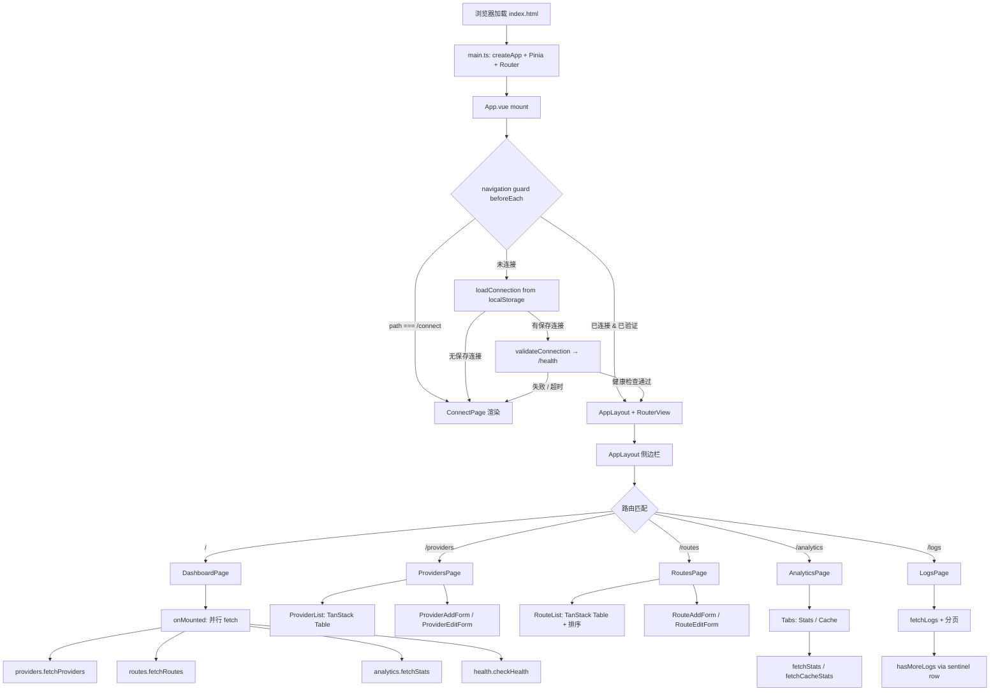

# UI 管理面板 — 规格

## 关键文件

### 入口与路由

- [sag-ui/src/main.ts](../../../sag-ui/src/main.ts) — Vue 应用入口：createPinia + createRouter + mount
- [sag-ui/src/App.vue](../../../sag-ui/src/App.vue) — 根组件：TooltipProvider、连接验证 loading overlay、Toaster、RouterView
- [sag-ui/src/router/index.ts](../../../sag-ui/src/router/index.ts) — 路由定义（懒加载 6 个路由）+ `beforeEach` 导航守卫

### 构建

- [sag-ui/vite.config.ts](../../../sag-ui/vite.config.ts) — Vite 构建配置：`codeSplitting.groups` 将 `chart.js` / `vue-chartjs` 拆为 `vendor-chart`（懒加载 chunk）
- [sag-ui/index.html](../../../sag-ui/index.html) — SPA 入口模板（主题预置脚本 + `#app` 挂载点；不引用任何不存在的静态资源）

### 状态管理

- [sag-ui/src/stores/connection.ts](../../../sag-ui/src/stores/connection.ts) — 连接生命周期：localStorage 持久化、Bearer token 同步、健康检查验证、TTL 30 天过期、401 全局拦截
- [sag-ui/src/stores/health.ts](../../../sag-ui/src/stores/health.ts) — 网关版本号和在线状态轮询
- [sag-ui/src/stores/providers.ts](../../../sag-ui/src/stores/providers.ts) — Provider CRUD + 上游模型拉取 + 乐观删除+回滚
- [sag-ui/src/stores/routes.ts](../../../sag-ui/src/stores/routes.ts) — Route CRUD + provider models 懒加载
- [sag-ui/src/stores/analytics.ts](../../../sag-ui/src/stores/analytics.ts) — Stats、Logs、Cache、Trend、Distribution 查询 + 分页状态管理
- [sag-ui/src/stores/sessionAffinity.ts](../../../sag-ui/src/stores/sessionAffinity.ts) — 会话亲和 pin 的查询（`GET /api/session-affinity`）与清除（按 `key` / 按 `model`）；查询带单调 `generation` 竞态 token，成功路径经 `mergeSessionEntries` 按 model 换桶（`{ model }` 只替换该 model 的桶，全量拉取整体替换），失败路径保留上一次成功数据、只写该次 fetch 作用域的 `error`（`{ scope?: string; message: string } | null`，`scope` 为 `params.model`，全量拉取为 `undefined`；启动 / 成功只清除同 scope）；删除自身不 refetch
- [sag-ui/src/stores/inflight.ts](../../../sag-ui/src/stores/inflight.ts) — 实时在途计数 store（`GET /api/inflight` SSE）：`snapshot` / `connected` / `stale` + 派生 `activeRoutes` / `total` / `hasTraffic`；`start()` 组装头（axios 默认头 + `x-api-key`）并只消费 `event === "inflight"` 帧，401/403 → `handle401()` 且停止重连；`stop()` 关闭流但保留快照；SSE client 存在闭包中（不进 reactive state）

### 页面

- [sag-ui/src/pages/DashboardPage.vue](../../../sag-ui/src/pages/DashboardPage.vue) — 仪表板：统计卡片 + Token/Calls 趋势折线图 + 调用分布饼图
- [sag-ui/src/pages/ProvidersPage.vue](../../../sag-ui/src/pages/ProvidersPage.vue) — Provider 列表页（组合 ProviderList + ProviderAddForm）
- [sag-ui/src/pages/RoutesPage.vue](../../../sag-ui/src/pages/RoutesPage.vue) — Route 列表页（组合 RouteActivityBar + RouteList + RouteAddForm；挂载时 `inflightStore.start()`、卸载时 `stop()`）
- [sag-ui/src/pages/AnalyticsPage.vue](../../../sag-ui/src/pages/AnalyticsPage.vue) — 用量统计（Stats + Cache 双 Tab）
- [sag-ui/src/pages/LogsPage.vue](../../../sag-ui/src/pages/LogsPage.vue) — 请求日志（表格 + 筛选 + 分页；Client 列之后为 Session 列，点击单元格即套用会话筛选；应用会话过滤时在筛选栏与表格之间渲染 `SessionInfoCard`）
- [sag-ui/src/pages/ConnectPage.vue](../../../sag-ui/src/pages/ConnectPage.vue) — 连接配置页面

### 核心组件

- [sag-ui/src/components/AppLayout.vue](../../../sag-ui/src/components/AppLayout.vue) — 侧边栏 + 主内容区布局，响应式断点控制内容宽度和侧边栏宽度
- [sag-ui/src/components/providers/ProviderList.vue](../../../sag-ui/src/components/providers/ProviderList.vue) — Provider 列表（TanStack Table）
- [sag-ui/src/components/providers/ProviderAddForm.vue](../../../sag-ui/src/components/providers/ProviderAddForm.vue) — Provider 添加表单
- [sag-ui/src/components/providers/ProviderEditForm.vue](../../../sag-ui/src/components/providers/ProviderEditForm.vue) — Provider 编辑表单（Dialog/Drawer 双轨，由 useResponsiveModal 驱动）
- [sag-ui/src/components/routes/RouteActivityBar.vue](../../../sag-ui/src/components/routes/RouteActivityBar.vue) — 表格上方的实时活动徽章行：`◉ 处理中 N` + 标题内联 Info Tooltip、逐 route 徽章（脉冲绿点 + 等宽 `model_name` 截断 + `×count`）、`stale` 置灰 + 「连接断开，重连中…」、全零时「空闲」占位、无快照时整行不渲染
- [sag-ui/src/components/routes/RouteList.vue](../../../sag-ui/src/components/routes/RouteList.vue) — Route 列表（TanStack Table + 排序）；active target 单元格在 session_sticky 行无 active target 时不再渲染 `-` 占位，只返回该行的 pin 浮层（非 session_sticky 行无 active target 时仍渲染 `-`，其 pin 浮层为 `null`）
- [sag-ui/src/components/routes/RouteEditForm.vue](../../../sag-ui/src/components/routes/RouteEditForm.vue) — Route 编辑表单
- [sag-ui/src/components/routes/TargetEditor.vue](../../../sag-ui/src/components/routes/TargetEditor.vue) — Target 编辑器（provider + real_model + priority + retries；新增走浮窗批量选择）
- [sag-ui/src/components/routes/TargetPickerDialog.vue](../../../sag-ui/src/components/routes/TargetPickerDialog.vue) — Target 浮窗选择器（搜索 + 分组多选 + 差异化确认；Dialog/Drawer 双轨，由 useResponsiveModal 驱动）
- [sag-ui/src/components/routes/SessionAffinityPopover.vue](../../../sag-ui/src/components/routes/SessionAffinityPopover.vue) — 会话 pin 浮层（props `model`，emit `changed`）：展示某请求模型空间的 pin（provider/real_model、key 前 8 位、source、age、剩余 TTL）+ 逐条清除 + 按模型两步确认清空；钥匙 icon 另包一层 `Tooltip :disabled="open"`（`@mouseenter="ensureFresh" @focus="ensureFresh"`）做只读 hover/聚焦预览（`side="left"`，无清除入口），两份列表共用 `sortedRows`（活跃顶置、过期置灰），hover/聚焦拉取受 `HOVER_REFRESH_MS = 3000` 节流；错误态按 scope 取值（`errorForModel(store.error, props.model)`）且 **rows 优先渲染**：`rows.length > 0` 时始终出列表，同 scope 错误降级为列表下方非阻塞小字提示，`rows` 为空才走 loading → 同 scope error → 空态
- [sag-ui/src/components/SessionInfoCard.vue](../../../sag-ui/src/components/SessionInfoCard.vue) — 会话信息卡（props `session` / `sessionKey`）：会话键 + 来源徽标 + 会话 ID + 首条消息，首末时间在来源 tooltip；`session === null` 时降级为「只有会话键 + 降级文案」
- [sag-ui/src/lib/sessionInfo.ts](../../../sag-ui/src/lib/sessionInfo.ts) — 会话卡的展示纯函数：来源收窄、空值占位（`—`）、preview 折叠与截断、时间格式化
- [sag-ui/src/lib/sse.ts](../../../sag-ui/src/lib/sse.ts) — 通用 SSE 客户端（`fetch` + `ReadableStream`）：`createSseParser`（跨 chunk 分帧、`: ping` 注释、多行 `data`、flush 尾帧）、`nextRetryDelay`（指数退避 + 封顶）、`headersFromDefaults`、`SseHttpError` / `isAuthFailure`（401/403）、`createSseClient`（单飞循环 + `stop()` abort + `running` 闸保证 stop 后零投递）
- [sag-ui/src/lib/inflight.ts](../../../sag-ui/src/lib/inflight.ts) — 在途计数的纯函数：`emptyInflightState`、`parseInflightSnapshot`（容错解析 + 本地降序）、`applySnapshot`（整体替换 + 清 `stale`）、`markConnected` / `markDisconnected`（保留快照标 `stale`）、`activeRouteCounts`（仅 `count > 0`）、`resolveSseUrl`
- [sag-ui/src/components/Combobox.vue](../../../sag-ui/src/components/Combobox.vue) — 通用模糊搜索下拉框

### 工具函数与类型

- [sag-ui/src/lib/client.ts](../../../sag-ui/src/lib/client.ts) — 共享 axios 实例（Authorization header 由 connection store 同步）
- [sag-ui/src/lib/utils.ts](../../../sag-ui/src/lib/utils.ts) — `cn()`、`getErrorMessage()`、`formatDuration()`、`successRateColor()`
- [sag-ui/src/lib/targetPicker.ts](../../../sag-ui/src/lib/targetPicker.ts) — Target 浮窗的纯选择逻辑：`provider+model` 集合键、分组构建（含禁用/orphan）、搜索过滤、勾选集合 ↔ target 行的 diff 与合并（type-only import，可被 node test runner 直接加载）
- [sag-ui/src/lib/sessionAffinity.ts](../../../sag-ui/src/lib/sessionAffinity.ts) — 会话 pin 的纯函数：`shortSessionKey(key, length = 8)`（展示前缀，删除仍用全量 key）、`isPinActive(entry)`（`expires_in_secs === null || > 0` 为活跃）、`sortPins(entries)`（活跃组在前、组内 stable，返回新数组不改入参）、`mergeSessionEntries(prev, incoming, model?)`（共享 store 的换桶语义：`model` 未指定时整体替换、给定则只替换该 model 的桶并保留其他行数据，返回新数组不改入参）、`errorForModel(error, model)`（按 fetch 作用域取值：`error.scope === model` 时返回文案、否则 `null`——全量拉取的 `undefined` scope 不匹配任何单行视图）；同 targetPicker 一样可被 node test runner 直接加载
- [sag-ui/src/types/api.ts](../../../sag-ui/src/types/api.ts) — 所有 API 类型定义（Provider、RouteConfig、CallLog、StatsRow 等）
- [sag-ui/src/composables/useTheme.ts](../../../sag-ui/src/composables/useTheme.ts) — 亮/暗主题切换（基于 `@vueuse/core` 的 `useDark`）
- [sag-ui/src/composables/useChartTheme.ts](../../../sag-ui/src/composables/useChartTheme.ts) — Chart.js 配色跟随主题（通过 DOM probe element 解析 CSS 变量）
- [sag-ui/src/composables/useResponsiveModal.ts](../../../sag-ui/src/composables/useResponsiveModal.ts) — Dialog/Drawer 双轨弹框：`MODAL_DESKTOP_QUERY`（768px）+ `Modal` 八槽位组件映射（Root/Content/Header/Title/Description/Footer/Close/Trigger）

### 多语言（i18n）

- [sag-ui/src/lib/i18n/index.ts](../../../sag-ui/src/lib/i18n/index.ts) — DIY i18n 核心：`t()` / `setLocale()` / `useI18n()` / `installI18n()`、locale 持久化与白名单校验、`<html lang>` 同步
- [sag-ui/src/lib/i18n/en.ts](../../../sag-ui/src/lib/i18n/en.ts) — canonical 英文字典（`as const`，607 key），key 为稳定英文标识符
- [sag-ui/src/lib/i18n/zh.ts](../../../sag-ui/src/lib/i18n/zh.ts) — 中文译文（`Record<keyof typeof en, string>`，编译期与 en 齐平）
- [sag-ui/src/types/i18n.d.ts](../../../sag-ui/src/types/i18n.d.ts) — 声明 `ComponentCustomProperties.$t`，为模板中的 `$t()` 提供类型
- [sag-ui/scripts/check-i18n.mjs](../../../sag-ui/scripts/check-i18n.mjs) — 防回潮门禁：键/占位符齐平、花括号合法性、CJK 字面量扫描、dead-key 报告
- [sag-ui/src/lib/i18n/i18n.test.ts](../../../sag-ui/src/lib/i18n/i18n.test.ts) / [sag-ui/src/lib/i18n/i18n-form.test.ts](../../../sag-ui/src/lib/i18n/i18n-form.test.ts) — 边界测试与表单校验消息的 locale 切换回归

## 核心设计

### SPA 生命周期数据流



### 固定高度布局渲染数据流

```mermaid
flowchart TD
    subgraph AppLayout[AppLayout.vue — 根布局容器]
        direction LR
        ASIDE[aside: 侧边栏<br/>flex-col / w-60 xl:w-64 2xl:w-72<br/>nav: flex-1 占满高度]
        MAIN[main: flex-1 overflow-hidden<br/>主内容区不整体滚动]
    end

    MAIN --> PAGE{路由匹配 → 页面组件}

    subgraph Dashboard[DashboardPage]
        D_FIXED[shrink-0: 标题 + 4 张统计卡片<br/>+ 时间范围切换 + provider 筛选]
        D_SCROLL[flex-1 overflow-y-auto<br/>图表网格: 饼图 / Token趋势 / Calls趋势]
    end

    subgraph Providers[ProvidersPage → ProviderList]
        P_FIXED[shrink-0: 标题 + Add/Refresh 按钮<br/>+ 筛选栏 Model/Type/Sort]
        P_SCROLL[flex-1 → [&>div]:h-full → Table wrapper overflow-auto<br/>Provider 表格 TanStack Table: sticky 表头]
    end

    subgraph Routes[RoutesPage → RouteList]
        R_FIXED[shrink-0: 标题 + Add Route 按钮]
        R_SCROLL[flex-1 → [&>div]:h-full → Table wrapper overflow-auto<br/>Route 表格 TanStack Table: sticky 表头]
    end

    subgraph Analytics[AnalyticsPage]
        A_FIXED[shrink-0: 标题 + Tabs 标签栏<br/>+ 4 张统计卡片 + 筛选栏]
        A_SCROLL[flex-1 → [&>div]:h-full → Table wrapper overflow-auto<br/>Stats 表格 / Cache 表格: sticky 表头 + backdrop-blur]
    end

    subgraph Logs[LogsPage]
        L_FIXED1[shrink-0: 标题 + 筛选栏]
        L_SCROLL[flex-1 → [&>div]:h-full → Table wrapper overflow-auto<br/>日志表格 15 列（Client 后为 Session）: sticky 表头 + backdrop-blur]
        L_FIXED2[shrink-0: 分页控件]
    end

    PAGE -->|\/| Dashboard
    PAGE -->|\/providers| Providers
    PAGE -->|\/routes| Routes
    PAGE -->|\/analytics| Analytics
    PAGE -->|\/logs| Logs
```

## 关键决策

### DIY i18n 层 vs vue-i18n

`t()` / `useI18n()` / `installI18n()` 自行实现（`sag-ui/src/lib/i18n/`），不引入 `vue-i18n`。

**Trade-off**:
- ✅ 只需 2 个语言、无 ICU MessageFormat / 复数 / 日期格式化需求——`vue-i18n` 的 SFC block、legacy API、locale fallback 配置、`@intlify` 编译链等能力完全用不上，引入后净增体积与认知成本
- ✅ 大量文案位于 script 侧渲染函数（TanStack 列定义、toast、Zod 校验、标签映射），直接用 `t()` 比 `$t()` 模板指令 + `useI18n()` 组合更直接，也避免 `vue-i18n` 的 `globalInjection` / `legacy` 模式选择
- ✅ 解析语义完全可控：`{param}` 命名插值 + `active → en → key` 三段回退，行为可用 20 行代码讲清
- ✅ `t(key, params?)` 的 API 形状与 `vue-i18n` 兼容，日后真需要复数/日期能力时迁移成本可控
- ❌ 缺少社区生态：复数、日期、数字格式化、`<i18n-t>` 组件等需自行实现
- ❌ 无 `vue-i18n` 的 SFC `<i18n>` block 与构建期提取，key 只能手工维护（由 `check-i18n.mjs` 的 dead-key 报告部分补偿）

### 默认语言 zh 与 en 作 canonical 源

`DEFAULT_LOCALE = "zh"`（既有用户是中文用户，升级后界面不得无故变英文）；字典的 canonical 源却是 `en.ts`——key 用稳定英文标识符（`common.save`、`providerList.columns.apis`），`zh.ts` 声明为 `Record<keyof typeof en, string>`。

**Trade-off**:
- ✅ key 与展示文案解耦：改英文措辞不动 key，改中文译文不动代码
- ✅ `zh.ts` 的类型绑定使漏译在 `vue-tsc` 阶段即失败，不会拖到运行时
- ✅ 默认 zh 保证存量用户升级后无感
- ❌ 默认语言与 canonical 源不同语言，新增文案时必须先写英文 key + 英文值，再补中文（步骤略绕，但换来了编译期齐平保证）

### 迁移期 `rawFallback` 阀值 vs 一次性替换

逐文件迁移期间（P1–P3），`t()` 曾带一个 `rawFallback` 参数：命中字典前先回退到原中文字面量，保证未迁移文件不出现语言退化。P4 拆除该参数，现签名为 `t(key, params?)`。

**Trade-off**:
- ✅ 迁移可分批落地，中间每个 commit 的界面都是完整的（不会出现「一半中文一半英文」的退化态）
- ✅ 拆除后 API 面收窄，`rawFallback` 不再是「永不触发」的死代码
- ❌ 迁移期间多一个参数与一条回退分支，且需要一次专门的拆除变更（P4）

### 防回潮门禁（check-i18n.mjs）vs 仅靠 code review

`just ui-i18n-check` 在 `verify-ui` 链路中强制检查：a) en/zh 键集合一致；b) 每 key 的 `{param}` 占位符集合一致；c) 花括号合法；d) `src/**/*.{ts,vue}` 无 CJK 字面量（`src/lib/i18n/` 整目录与注释行跳过）；e) dead key 仅报告不失败。

**Trade-off**:
- ✅ 「新增硬编码中文」这一最常见的回潮被机械拦住，不依赖 review 注意力
- ✅ 占位符齐平能拦住「`{name}` 在 zh 里写成 `{n}`」这类只在特定语言下崩的 bug
- ✅ 无依赖、纯 node 脚本（`node --experimental-strip-types`），与前端测试同一运行器
- ❌ CJK 扫描依赖「注释行」启发式（trim 后以 `//`、`/*`、`*`、`<!--` 开头），非标准格式的注释会误报，只能改写注释
- ❌ dead-key 只报告不失败，未使用的 key 仍可能积累（刻意保守，避免误删仍被动态拼 key 引用的条目）

### 401 集中处理 vs 逐请求拦截

`connection.ts` 的 `handle401()` 由各 store 在 catch 块中主动调用，而非通过 axios interceptor 全局拦截。

**Trade-off**:
- ✅ 各 store 在 catch 路径显式调用 `handle401()`，调用点明确、可追踪
- ✅ 避免了 axios interceptor 在 `connect()` 流程中误触发（连接阶段本身就是验证 API key）
- ❌ 每个 store 的每个 catch 分支都需要写 `if (e.response?.status === 401) handle401()`，存在遗漏风险

### localStorage 连接 TTL 30 天 vs 永久/会话存储

**Trade-off**:
- ✅ 30 天过期避免了"永远记住但 API key 已失效"的静默失效——过期后用户重新连接到 `/connect` 页面
- ✅ `savedAt` 时间戳精确控制 TTL，跨会话不变
- ❌ 高频使用场景下每 30 天需要重新输入连接信息

### 乐观删除 + 回滚 vs 等待服务端确认

`deleteProvider()` 先将 provider 从列表中移除，API 调用失败后再恢复 `oldProviders`。

**Trade-off**:
- ✅ 删除操作即时响应，UI 不会因网络延迟卡顿
- ✅ 失败时回滚到旧列表，用户无感
- ❌ 删除期间如果 API 成功但列表未刷新（其他数据变更），回滚逻辑只会恢复本地快照（实际上 `fetchRoutes()` 在成功后触发刷新，副作用可控）

### 路由策略字段：只有格式校验 + 两条组合规则，其余留给后端

（本节为 0009 修订后的实态；原口径「组合规则完全留给后端」见 [0009 changefile](changes/0009-session-affinity-pins-and-log-session-column.md) 与 requirements.md 里保留的旧条目。）

`RouteAddForm` / `RouteEditForm` 校验两个会话参数的**格式**（TTL `^\d+$`、容量 `^[1-9]\d*$`），且仅当 `strategy === "session_sticky"` 时生效；另加两条对象级 `.refine`，与后端 `sag-config/src/config.rs` 的 `validate_routes` 等价：

| 组合 | 错误挂载字段 | i18n key | 通配判定来源 |
|------|-------------|----------|-------------|
| `model_name = "*"` × `session_sticky` | `strategy` | `routes.form.wildcardSessionStickyUnsupported` | 新建：`model_name`，空时回退到首个 target 的 `real_model`；编辑：`props.route.model_name` |
| `session_sticky` × `pipeline = "image"` | `pipeline` | `routes.form.imageSessionStickyUnsupported` | — |

其余组合规则（容量为 `0` 等）仍不在前端复现，提交后由 `GatewayConfig::validate` → `validate_routes` 拒绝，400 消息经表单顶部错误条原文展示。

**Trade-off**:
- ✅ 两条最容易踩、且**无法从配置上修复**的组合（通配路由的 space 键域无界、image 管线不做会话写回）在表单里就地拦住，不再多一次 400 往返
- ✅ 前端文案能说清「该换成什么」：通配提示改为「为每个模型单独配置路由，或改用其他策略」，image 提示列出可用策略（后端 400 只报违规事实）
- ✅ 仍只镜像两条规则：其余约束仍单源于后端，不会因前端漏同步而产生「前端放过/后端拒绝」以外的两套真相
- ❌ 规则有了两个实现（Rust + Zod refine）：后端放宽或收紧时前端必须同步修改，否则会出现「前端拒绝、后端已放宽」——缓解手段是两句 `.refine` 旁写死对应的后端出处注释
- ❌ 通配判定未做 `trim()`：`model_name = " * "` 这类首尾空白的值前端会放过（后端仍会拒），已作为已知 minor 记在 0009 的评审结论里
- ❌ 两个表单的错误渲染风格不一致：新建表单用 `FieldError`（与其它字段一致），编辑表单的 pipeline 字段用内联 `<p class="text-destructive">`，也是已知 minor
- ✅ 前端仍只拦「输入框里根本打不出合法值」的形态（非整数、负容量）与上述两条组合，其余不插手
- ❌ 其余组合（容量为 `0` 等）仍然要提交后才知道非法，错误消息为后端原文（英文、带配置路径），比本两条的前端文案生硬；由 session-sticky 的说明行（hint）部分补偿上下文

### 会话 pin 浮层：共享 store + 客户端按 model 过滤 vs 每行独立 state

`sessionAffinity` store 是单例：浮层打开时 `fetchEntries({ model })` **只替换 store 的 `entries` 里该 model 的桶**（`mergeSessionEntries`），组件再按 `model === props.model` 过滤出自己那一行要显示的条目（`rows`）。同时用单调 `generation` token 保证「后发请求先返回」不会把旧的 entries 写回。

0012 把「看」与「改」拆开后，hover 预览复用**同一个**共享 store 快照：`ensureFresh()` 只在 `store.loading` 为假且距上次拉取完成满 `HOVER_REFRESH_MS`（3000ms）时才 `refresh()`，点击打开浮层则无条件重新拉取。

**Trade-off**:
- ✅ 一个请求面、一个错误面/loading 面，不需要为每一行路由创建一个 store 实例或用 `provide/inject` 做作用域
- ✅ `generation` token 同时覆盖 `entries` 与 `loading` 的清零：慢的旧请求既写不进 entries，也不会把新请求的 loading 提前关掉
- ✅ 单 model 拉取只换自己那一桶：「A 行刷新把 B 行刷成空」不会发生。0012 返工前的整体覆盖会让 hover 相邻行即可复现——行 B 的响应把行 A 的条目刷掉，A 假「无 pin」、已打开的浮层被清空且不自愈
- ✅ 失败不清空：拉取失败只写该作用域的 `error`，行上仍显示上一次成功的 pin 列表（失败 ≠ 空列表）
- ✅ 错误面也按作用域收窄：`error` 带 `scope`（= 该次 fetch 的 `params.model`），组件用 `errorForModel()` 只取自己 scope 的那条，因此「行 B 失败」不会让行 A 的预览变成 B 的错误文案（初版是全局单槽 + error 优先于 rows，属同一失效类别）
- ✅ hover 预览不引入第二个数据面：指针沿一列路由扫过只会在节流窗口外发请求，破坏性动作仍只在点击后的浮层里（预览不含清除入口）
- ❌ 过滤是客户端兜底而非作用域隔离：若将来允许同时打开多个浮层，必须改成 per-model 的 state 映射（或给 popover 传 `key` 强制重建）
- ❌ 跨模型空间会瞬时陈旧：按 `key` 删除会连带删除其它空间里的同 key pin（`DELETE { key }` 不区分 space），但其它浮层已加载的条目要等下次打开才更新
- ❌ 节流窗口内看到的可能是 ≤3 秒前的数据：hover 预览是「顺手看一眼」的近似值，需要当下状态时点击打开浮层（后者总是重新拉取）；代价换指针扫过整列时不按行发请求

### 实时在途计数：`fetch` + `ReadableStream` 自读 SSE vs `EventSource`

`EventSource` 无法附加请求头，而 `/api/*` 需要 `Authorization: Bearer`。`lib/sse.ts` 用 `fetch`
自读字节流并自己做分帧与重连，因此认证、退避、停止语义全部可控。

**Trade-off**:
- ✅ 能带认证头（`Authorization` 来自 axios 默认头，`x-api-key` 来自 connection store）
- ✅ 401/403 可结构化地交给共享 `handle401()` 并**停止重连**；`EventSource` 只会不透明地自动重连，刷错的 key 会让页面永远停在「重连中」
- ✅ `stop()` 能真正 abort 在飞请求与待触发的重试定时器，不留下僵尸连接
- ✅ 分帧器可单测（node test runner 不需要浏览器）：跨 chunk 的 CRLF、`flush()` 尾帧、多行 `data` 都能钉住
- ❌ 得自己实现规范里的一小块（分帧 + 退避），且 `Accept` 必须写在请求头 spread **之后**——axios 默认头里的 `Accept: application/json` 会盖掉 SSE 握手头（已由测试钉住）
- ❌ 无浏览器原生「自动重连 + Last-Event-ID」语义，本端点每帧都是全量快照，因此刻意不使用 `Last-Event-ID`

### 全量快照替换 vs 增量合并

后端每帧都推完整快照，store 只做整体替换（`applySnapshot`），并在同一处清除 `stale`。

**Trade-off**:
- ✅ 丢帧、乱序、重连都不需要补偿逻辑，快照幂等
- ✅ `stale` 的清除点只有一个（收到新快照 = 界面与网关重新一致的唯一证据），不会出现「连上了但还标着旧数据」
- ✅ 断线时保留快照而不清零：重连中的面板显示 `0` 会误报「没有在途请求」
- ❌ 每帧的渲染开销随活跃 route 数增长（数十条量级可忽略）
- ❌ 无法用 `seq` 做局部更新，未来若改成增量事件需要同时维护两套消费路径

### TanStack Table vs shadcn-vue Table

ProviderList 和 RouteList 使用 TanStack Table，LogsPage 和 AnalyticsPage 使用 shadcn-vue Table 组件。

**Trade-off**:
- ✅ TanStack Table：需要排序、复杂列定义（如 Status Switch、Actions 按钮组）、动态 cell render 的场景，TanStack 的 `createColumnHelper` + `h()` render 函数更灵活
- ✅ shadcn-vue Table：纯展示型表格（Logs 15 列、Analytics Stats/Cache），用 Vue 模板 `<Table>` → `<TableHeader>` → `<TableBody>` 更直观、更少 boilerplate
- ❌ 两套表格系统增加了认知负担——需要知道什么时候用哪个。但决策规则简单：需要排序或复杂交互 → TanStack；纯展示 → shadcn-vue

### Chart.js CSS 变量解析 via DOM Probe Element

`useChartTheme` 通过创建隐藏 `<span>` 元素、设置 `style.color = var(--chart-N)`、读取 `getComputedStyle()` 来解析 CSS 变量为 `rgb()` 字符串，供 Chart.js 使用。

**Trade-off**:
- ✅ Chart.js 原生不支持 CSS 变量引用，probe element 是最小侵入的桥接方案
- ✅ 主题切换时通过 `watch(isDark)` + `requestAnimationFrame` 自动重新解析，图表配色跟随主题
- ❌ 每次主题切换时创建和销毁 8 个 DOM 元素（一次性开销，可忽略）

### 分页 sentinel row（limit+1）vs 总数计数

`fetchLogs` 请求 `limit + 1` 行，若返回行数 > limit 则 `hasMoreLogs = true`，多余行裁剪。

**Trade-off**:
- ✅ 避免"恰好满页时误显示 Next 按钮，点击后空结果"的 bug——sentinel row 精确判断下一页是否存在
- ✅ 无需后端额外提供 `total_count` 字段
- ❌ 每页多请求 1 行，网络开销可忽略

### 纯 Tailwind CSS 响应式 vs JavaScript 媒体查询

大屏幕优化计划中的全部响应式效果通过 Tailwind 的 `xl:` 和 `2xl:` 前缀实现，不使用 `window.matchMedia()` 或 `useMediaQuery`。

**Trade-off**:
- ✅ 零 JavaScript 开销，样式在构建时确定
- ✅ Tailwind 断点与框架无关，无需在 Vue 组件中管理媒体查询生命周期
- ❌ 无法根据视口动态切换组件行为（如移动端折叠侧边栏）——这类场景统一交给 `useResponsiveModal`（弹框形态）与 `AppLayout` 的 `useMediaQuery`（侧边栏），两者共用 768px 断点

### Dialog/Drawer 双轨弹框（useResponsiveModal）vs 纯 Dialog

移动端（<768px）的弹框一律渲染为底部抽屉，桌面端保持 Dialog。映射集中在 `useResponsiveModal` composable，组件只写 `<component :is="Modal.Root">`。

**Trade-off**:
- ✅ 移动端获得全宽、内部可滚动、可下拉关闭的容器，长表单不再被软键盘挤到只剩半个屏幕
- ✅ 断点与组件映射单点定义；新增弹框只需一行 `const { Modal } = useResponsiveModal()`
- ✅ `sag-ui/src/components/ui/` 原语零修改，`shadcn-vue add --overwrite` 不会冲掉定制
- ❌ `<component :is>` 下 vue-tsc 失去 props/emits 类型检查，`@update:open` 回调必须提取为显式 `(v: boolean)` 具名函数
- ❌ 引入 vaul-vue 到共享 chunk：`useResponsiveModal` 被路由页导入后，Drawer 不再只随 Provider 表单按需加载（构建产物中该 chunk 约 211 kB / gzip 55 kB）
- ❌ 移动端会出现抽屉套抽屉（Provider 弹框内点 Create route），vaul 支持嵌套，但手势层级变多

### cnfast vs clsx + tailwind-merge

使用 `cnfast` 作为 `cn()` 工具函数，而非社区常见的 `clsx` + `tailwind-merge` 组合。

**Trade-off**:
- ✅ 编译时优化，零运行时开销
- ✅ 与 Tailwind CSS v4 深度集成
- ❌ 社区生态较小，遇到问题时参考资料少于 `clsx`/`tailwind-merge`

### 固定高度布局 vs 整体页面滚动

`<main>` 从 `overflow-y-auto`（整体滚动）改为 `overflow-hidden`（页面固定高度，容器内滚动）。

**Trade-off**:
- ✅ 页面标题、筛选栏、统计卡片始终可见，用户滚动表格时不会丢失上下文
- ✅ 侧边栏导航和底部状态栏始终可交互，无需滚回顶部
- ✅ Logs 分页控件固定在表格下方，翻页操作无需滚到底部
- ❌ 每个页面需要显式管理固定区域和滚动区域的分割（`shrink-0` / `flex-1 overflow-y-auto`），增加模板复杂度
- ❌ 嵌套 flex 容器在极端内容量下可能有性能开销（但 SAG UI 的数据规模下可忽略）

选择固定高度布局是 pragmatic 的选择——SAG 管理面板的核心场景是浏览大量 Provider/Route/Log 数据，保持筛选条件可见比更简单的实现更重要。

### Table.vue 包裹 div 的 overflow-auto：作为滚动容器 vs 放在 tbody

shadcn-vue 的 `<Table>` 组件渲染结构为 `<div class="overflow-auto">` 包裹 `<table>`。这个 `<div>` 是表格内容的滚动容器，`position: sticky` 相对于此容器定位。

**设计选择**：将 `overflow-auto` 保留在 `<Table>` 的包裹 div 上，外层容器仅提供高度约束（`h-full` / `min-h-0 flex-1`），不设 overflow。滚动发生在 Table 包裹 div 内部，sticky 表头相对于此容器固定。

**Trade-off**:
- ✅ `<thead>` 的 `position: sticky; top: 0` 天然相对于 Table 包裹 div 的滚动视口，无需额外 DOM 层级
- ✅ 列宽由原生 `<table>` 布局自动同步（`<thead>` 和 `<tbody>` 处于同一 `<table>` 内），不破坏列对齐
- ✅ 滚动条出现在表格容器内部，表头在视觉上位于滚动区域上方
- ❌ Table 包裹 div 的 `overflow-auto` 会成为 sticky 的 nearest scrolling ancestor——若外层容器也设 `overflow`，sticky 会被外层拦截，表头无法固定
- ❌ 不能将 `overflow-y-auto` 直接放在 `<tbody>` 上——这会迫使 `<tbody>` 变成 `display: block`，破坏 `<thead>`/`<tbody>` 之间的原生列宽计算，需要手动对齐每列宽度

**核心约束**：外层容器（`rounded-lg border` div）必须**仅**提供高度约束，**不得**设置 `overflow-auto`。若外层有 overflow，它会创建新的滚动上下文，Table 包裹 div 的 `overflow-auto` 将不再成为 sticky 的参照点——表头随内容一起滚动。

## 不变式

- **路由守卫链路**：`/connect` 始终可以直接访问；其他路由必须通过 `loadConnection()` → `validateConnection()` 验证链。导航守卫中 `RouterView` 永不卸载（Loading overlay 用 `v-if` 叠加，而非 `v-if/v-else` 切换）
- **axios Authorization header**：全局 `api.defaults.headers.common.Authorization` 由 `setBearer()` 唯一写入，各 store 不自行设置。`connection.ts` 的 `loadConnection()`、`connect()`、`disconnect()`、`handle401()` 是仅有的四个调用点
- **日志分页 offset 不变式**：`logsOffset` 仅在 `fetchLogs` 成功后由传入的 `filter.offset` 更新；失败时 `logsOffset` 保持不变（调用方无需回滚）
- **shadcn-vue 组件**：`sag-ui/src/components/ui/` 目录由 shadcn-vue CLI 生成，手动修改会在下次 `npx shadcn-vue@latest add` 时被覆盖
- **Pinia store 懒加载**：`connection.ts` 的 `connect()` 中使用 `await import("./health")` 和 `await import("./routes")` 动态导入，避免循环依赖
- **Chart.js 注册**：`ChartJS.register()` 在 `DashboardPage.vue` 的 `<script setup>` 顶层执行（模块加载时），非 `onMounted` 内
- **固定高度布局根约束**：`<main>` 必须为 `overflow-hidden`，不得出现 `overflow-y-auto`。若不遵守，整个页面将整体滚动，固定区域失效
- **页面 flex 列布局**：每个页面组件（Connect 除外）必须使用 `flex flex-col h-full` 作为根元素。固定区域用 `shrink-0`，滚动区域用 `flex-1 overflow-y-auto`。若忘记 `h-full`，flex-1 无法计算剩余高度
- **滚动容器内边距**：滚动容器内的 `space-y-*` 或 `gap-*` 间距必须在滚动容器内部生效，而非外部——否则间距会参与 flex 高度计算导致溢出
- **Logs 三区结构**：LogsPage 是唯一有三个区域的页面：固定头（筛选栏）+ 滚动体（表格）+ 固定尾（分页）。分页必须用 `shrink-0`，不能放在 `flex-1` 滚动区内
- **侧边栏 flex 分配**：侧边栏 `<nav class="flex-1">` 自动占满 header 和 footer 之间的剩余高度，不需显式高度计算
- **表格滚动容器层级**：表格所在的外层 `<div class="rounded-lg border">` 只能设置高度约束（`h-full`）+ `[&>div]:h-full`，不得设置 `overflow-auto` 或 `overflow-hidden`。overflow 必须由 `<Table>` 组件的包裹 div 处理。若外层也有 overflow，sticky 表头将相对于外层容器定位，而 Table 包裹 div 的 `overflow-auto` 会创建中间滚动上下文导致 sticky 失效。`<tbody>` 上不得设置 `overflow-auto` —— 会使 `<tbody>` 变为 `display: block`，破坏 `<thead>`/`<tbody>` 之间的原生列宽同步
- **sticky 表头**：所有使用 `<Table>` 的页面必须在 `<TableHeader>` 上设置 `class="bg-background/90 sticky top-0 z-10 backdrop-blur-xs"`。`bg-background/90` + `backdrop-blur-xs` 提供玻璃拟态效果，确保滚动时表头覆盖下方行内容且视觉层次清晰
- **弹框形态**：应用层模态必须经 `useResponsiveModal()`，不得在组件里直接引入 `Dialog*` / `Drawer*` 原语；断点固定 768px（`md`），且必须与 `AppLayout.vue` 的 `isMobile`、`SidebarProvider` 内部断点保持一致。Popover 类浮层（Combobox / SearchSelect / DateRangePicker）不适用该规则
- **抽屉内边距**：`DrawerContent` 无默认 padding，而 `DialogContent` 有 `p-6`。需要左右内边距的正文区写成 `px-4 sm:px-0`；若写成 `px-4 sm:px-6`，仅在它不属于 `DialogContent` 直接子元素时才不会与 `p-6` 叠成双重内边距
- **[&>div]:h-full 高度传递**：表格的外层 `<div class="rounded-lg border">` 使用 `[&>div]:h-full` 将高度约束传递给 `<Table>` 组件的包裹 div（`overflow-auto`），使其成为 sticky 表头的滚动参照点。不使用此模式时外层 div 不得设置 overflow，否则会创建多余滚动上下文导致 sticky 失效
- **Target 选择单位是 provider+model 对**：同一模型名在两个 provider 下是两个选项，集合键固定为 `provider\0model`（`optionKey`），不得用裸模型名作键。浮窗无法表示的行（provider 或 model 为空）必须原样保留，不得因未勾选而被删除
- **`providerModelsLoading` 由在途计数派生**：`routes` store 的 loading 标志是 `computed(() => providerModelsPending > 0)`，不得改回单一 boolean——浮窗会并发探测所有 provider，单一 boolean 会被先完成的请求提前清零
- **i18n 文案单一来源**：`src/**/*.{ts,vue}` 中不得出现中文字面量（`src/lib/i18n/zh.ts` 除外）。文案一律经 `t(key)` 获取，key 必须同时存在于 `en.ts` 与 `zh.ts`——由 `just ui-i18n-check` 在 `verify-ui` 链路强制
- **i18n 响应式绑定**：所有随语言变化的字符串必须在渲染/求值时重新调用 `t()`，不得在模块加载或组件 setup 时求值一次后缓存。具体形态：TanStack 列定义的表头一律写 `header: () => t(...)`（字符串头会在语言切换时冻结）；标签映射（如 `strategyLabels`）用 `computed`；TanStack Form 的 `validators` 用 `get validators()` getter 使 Zod schema 与其 `t()` 消息在校验时重建
- **locale 白名单**：`localStorage` 的 `sag-ui-lang` 值必须经 `normalizeLocale` 校验（仅 `en` / `zh`），脏值写回默认语言。`t()` 不得因持久化值异常而抛错
- **i18n 模块可在无 DOM 环境加载**：`index.ts` 不得在模块顶层触碰 `window` / `document` / `localStorage`——locale ref 懒建、`<html lang>` 同步放在 `installI18n` 的 `watchEffect` 内并对 `document === undefined` 提前返回，保证 node test runner 可直接导入
- **`analytics.v2.scopeTarget` / `logs.tooltip.ttft` 为刻意 verbatim 的技术 token**：zh 视图在迁移前也渲染同样的英文 token，两处字典值保持英文并在 `en.ts` 内注释说明，不视为漏译
- **图表库单独分包**：`chart.js` / `vue-chartjs` 必须落在 `vendor-chart` 组且 `includeDependenciesRecursively: false`。若后者保持默认 `true`，vue runtime 会被拖进该组、入口静态依赖它，chart.js 反而进首屏 preload，分包目标失效
- **`index.html` 不得引用不存在的静态资源**：`sag-ui/public/` 不存在，任何 `/xxx.svg` / `/xxx.ico` 式引用都会变成每次加载一个 404（内嵌服务下是 `text/plain` 的 404）
- **会话 pin 只展示前缀，删除用全量 key**：浮层与 Session 列展示 `shortSessionKey()` 的前 8 位，但 `title` 与 `DELETE /api/session-affinity` 的 body 必须用完整 32 位哈希。不得把截断值回传给删除接口（会静默删不到或删错）
- **`sessionAffinity` store 的 generation token**：`fetchEntries` 只有最新在飞的请求可以写 `entries` / `error`，也只能由它清 `loading`。修改时不得把 token 判定只加在 `entries` 上而漏掉 `finally` 里的 `loading` 清零
- **`fetchEntries` 只换自己那一桶，失败不清空**：成功路径必须走 `mergeSessionEntries(entries, data.entries, params.model)`——`model` 给定只替换该 model 的桶，`undefined` 才整体替换；失败路径只写 `error`，不得把 `entries` 置空。理由：store 被所有行共享，整体覆盖会让 hover 过的行 B 把行 A 的数据刷掉（A 假「无 pin」、打开中的浮层被清空且不自愈），而把「请求失败」当成「没有 pin」同样会清掉仍然有效的展示
- **错误状态按 fetch 作用域记账，他行失败不得盖住本行数据（rows 优先渲染）**：store 的 `error` 为 `{ scope?: string; message: string } | null`，`scope` 是该次 fetch 的 `params.model`（全量拉取为 `undefined`）；启动 / 成功只清除同 scope 的错误，失败只写自己 scope。组件（Tooltip 与 Popover 两处）在 `rows.length > 0` 时**必须始终渲染列表**，同 scope 的错误降级为列表下方非阻塞小字提示；只有 `rows` 为空时才走 loading → 同 scope error → 空态。理由：共享 store 只有一个错误槽、且渲染链 error 优先于 rows 时，任一行 fetch 失败会用错误文案盖住所有行保留下来的 pin 数据——Tooltip 显示他行的错误文案且条数与列表自相矛盾，打开中的浮层也不自愈；这与「整体覆盖 entries」是同一失效类别
- **pin 清除后必须重拉 active targets**：`SessionAffinityPopover` 的两条清除路径成功后均 `emit("changed")`，由 `RouteList` 的 `onChanged` 调 `activeTargetStore.fetchActiveTargets()`。漏掉这步会让 Active Target 列在 pin 已清后仍显示旧目标
- **pin 浮层只在 session-sticky 行挂载**：`RouteList` 的 active target cell 用 `route.strategy === "session_sticky"` 判定后 `h(SessionAffinityPopover, …)`，其它策略必须为 `null`——否则无 pin 空间的路由会多发一次空查询
- **只读预览不得出现清除入口**：`SessionAffinityPopover` 的 `TooltipContent` 只读（标题 + 条数 + 三态 + pin 列表），清除按钮只存在于 `PopoverContent`。不得把逐条清除 / 按模型清空搬进 hover 预览——指针扫过时误点就会丢掉活跃会话
- **pin 活跃判定固定为 `expires_in_secs === null || > 0`**：由 `lib/sessionAffinity.ts` 的 `isPinActive()` 单点定义，Tooltip 与浮层的排序（`sortPins`）和置灰共用它。不得写成 `>= 0`：倒计时为 0 的 pin 已经过期，显示为活跃会让运维误判会话仍粘在该目标上
- **hover 拉取必须节流，浮层打开必须重拉**：`ensureFresh()` 在 `store.loading` 或距上次拉取完成不足 `HOVER_REFRESH_MS`（3000ms）时直接返回，`watch(open)` 走的 `refresh()` 不受节流限制。取数触发点固定为 `@mouseenter` 与 `@focus` 两个（键盘 Tab 聚焦钥匙 icon 同样拉取）——去掉节流会让指针扫过一列路由按行发请求；把浮层打开也纳入节流则可能展示 ≤3 秒前的陈旧 pin；漏掉 `@focus` 会让键盘用户永远停在占位态
- **实时在途计数只展示 `count > 0` 的 route**：`activeRouteCounts()` 过滤是单点定义，徽章行不得渲染零计数项；后端已删零计数键，前端过滤是纵深防御
- **首帧到达前不渲染徽章行**：`snapshot === null` 时整行 `v-if` 不成立。不得在没有快照时渲染「处理中 0」或「空闲」——那是把「未知」谎报成「没有流量」
- **断线保留快照并标 `stale`，不清零**：`markDisconnected()` 保留 `snapshot` 且 `stale = snapshot !== null`；`stale` 只能在收到新快照（`applySnapshot`）时清除。流断开时徽章置灰 + 「连接断开，重连中…」，不得归零
- **「空闲」需 `routes` 与 `total` 同时为零**：`RouteActivityBar` 的 `idle` 判定必须两者同时成立且 `!stale`。若一条 route 条目被解析丢弃，两个数字会不一致，此时必须显示「处理中 N」而不是自相矛盾地喊空闲
- **SSE 请求头顺序**：`Accept: text/event-stream` 必须写在 caller headers 的 spread **之后**。写成 `{ Accept: ..., ...headers }` 会被 axios 默认的 `Accept: application/json` 盖掉，握手失败
- **SSE 认证失败不得重连**：`isAuthFailure()` 判 401/403 → 先 `client.stop()` 再 `handle401()`，`onError` 直接返回。不得让 401 进入退避重试
- **`stop()` 之后零投递**：`consume()` 内每个 `onEvent` 调用前必须过 `running` 闸。一个在 `stop()` 之后才 settle 的 `read()` 不得把已卸载的面板重新点亮（会清掉 `stale`）
- **SSE client 不得放进 reactive state**：`createSseClient` 的实例是资源而非数据，存在 store 闭包里；放进 `ref` 会被 Vue 深度 proxy 包一层
- **Logs 会话筛选单一状态源**：Session 列点击必须走 `applySessionFilter()` → 写 `logsFilterSession` → `refreshLogs()`，与筛选栏内的会话过滤控件（空态内嵌输入框、有值内联显示 + 清空 X）、`clearSessionFilter()` 同源。不得为该列另建一套过滤状态（会出现控件与列不同步）

## 测试策略

SAG UI 的自动化测试只有单元层（node test runner，`pnpm -C sag-ui test` → `node --experimental-strip-types --test "src/**/*.test.ts"`）；仍无端到端测试（requirements.md 已标注「不包含：端到端测试」）。验证方式：

| 层面 | 方法 | 工具 |
|------|------|------|
| 单元测试 | `pnpm -C sag-ui test`（i18n 边界/回退/键齐平/脏 locale、表单校验消息 locale 切换、activeTarget 边界、`shortSessionKey` 截断边界、`isPinActive` 存活性边界、`sortPins` 活跃顶置与组内 stable、`mergeSessionEntries` 按 model 换桶 / 全量替换 / 空桶 / 不改入参、`errorForModel` 按 scope 取值：同 scope 命中 / 他行 scope 不命中 / 全量拉取的 `undefined` scope 不命中单行 / `error` 为 `null`、SSE 分帧器（单帧 / 跨 chunk / 一 chunk 多帧 / 心跳注释 / CRLF / 多行 data / flush 尾帧与尾随孤立 CR）、`nextRetryDelay` 退避表、`headersFromDefaults` 只取字符串头、连接循环（头转发与 `Accept` 覆盖 / 断线重连 / `stop()` 中止与零投递）、`parseInflightSnapshot` 容错（非法 JSON / 非对象 / 缺 `seq` / 坏条目跳过 / 未知字段 / `total` 兜底 / 本地降序）、`applySnapshot` 整体替换与清 `stale`、`markConnected` / `markDisconnected` 保留快照、`activeRouteCounts` 只留 `count > 0`、`resolveSseUrl` 拼接） | node test runner |
| i18n 门禁 | `just ui-i18n-check`（`pnpm -C sag-ui run check:i18n`） | node + check-i18n.mjs |
| 类型检查 | `pnpm typecheck`（vue-tsc） | TypeScript 编译器 |
| 代码风格 | `pnpm lint`（oxlint）、`pnpm format`（oxfmt） | oxlint / oxfmt |
| 构建验证 | `pnpm build`（Vite） → `just build-test`（内嵌到 gateway 二进制） | Vite / Cargo |
| 全链门禁 | `just verify-ui` = `fmt-check` + `lint` + `typecheck` + `test` + `i18n-check` | just |
| 视觉验证 | 浏览器手动检查：1920×1080、2560×1440、1024×768、1366×768；弹框形态另需 390px（手机竖屏）与 700px（640–768 区间）；i18n 另需 en/zh 各过一遍 | Chrome DevTools |
| API 集成 | 通过 `scripts/test-env.py` 启动 gateway 测试实例，浏览器连接验证 | test-env |

关键验证场景：

1. **连接生命周期**：首次访问 → `/connect` 重定向 → 输入 URL/API key → `/health` + `/api/providers` 验证 → 进入 Dashboard
2. **响应式布局**：`lg:`（<1280px）→ 2 列图表，`xl:`（≥1280px）→ 3 列图表，`2xl:`（≥1536px）→ 1440px 内容宽度
3. **乐观删除**：删除 Provider → 立即从列表消失 → API 成功 → Routes 刷新；模拟 API 失败 → 列表恢复
4. **日志分页**：首页满 50 条 → Next 按钮可用 → 点击 → offset +50 → 末页不满 50 条 → Next 按钮禁用
5. **401 全局处理**：任何 API 返回 401 → `handle401()` 清除连接状态 → 重定向 `/connect?reason=expired`
6. **固定高度布局**：加载 Logs/Providers 页面，添加足够数据使表格超出视口 → 页面标题和筛选栏保持可见，仅表格内部滚动 → 验证侧边栏导航和底部状态栏始终可交互
7. **固定高度布局边界**：将浏览器窗口调至极小高度（如 600px）→ 图表/表格应有最小可见区域，固定区域不应挤压滚动区至零高度
8. **弹框形态断点**：在 390px / 700px / 900px 三个视口分别打开 New Route、Edit Route、Delete Route 确认、Add/Edit Provider → 前两者应分别为 drawer（bottom）/ drawer / dialog；可用 `document.querySelectorAll('[data-slot=drawer-content]')` 与 `[data-slot=dialog-content]` 计数断言，并同时校验 `window.innerWidth` 与 `matchMedia('(min-width: 768px)')`
9. **语言切换**：Settings → Language 选 English → 导航/表头/toast/表单校验消息即时变英文且 `<html lang>` 变 `en` → 刷新后仍为英文 → 切回中文同理；手动把 `localStorage["sag-ui-lang"]` 改为 `fr` 后刷新 → 界面回退中文且控制台无异常
10. **i18n 门禁**：在任一 `.vue` 里塞入一句中文字面量 → `just ui-i18n-check` 应 exit 1 并打印文件名与行；从 `zh.ts` 删除一个 key → `pnpm typecheck` 应报错
11. **session-sticky 路由**：新建路由选 session-sticky → 两个会话参数输入出现；留空提交 → Network 面板里 payload 不含 `session_ttl_secs` / `session_max_entries`；填 `-1` / `1.5` / 容量 `0` → 就地报错且无请求；编辑既有 session-sticky 路由 → 初值回填，不改则 payload 仍不含两字段（省略 = 保留）；`model_name = "*"` 或 `pipeline = "image"` 提交 → strategy / pipeline 字段就地报错（容量 `0` 仍为顶部错误条显示后端 400 消息）
12. **会话 pin 浮层**：session-sticky 路由的 active target 单元格出现 pin 按钮（其它策略无）；该行无 active target 时单元格只剩该按钮（无 `-`）→ hover 或 Tab 聚焦该按钮出现左侧只读预览（无清除入口，指针在相邻行间扫动时 3 秒内复用快照、不按行发请求；按 A → B → A 的顺序扫过两行后，A 的预览仍显示自己的 pin，不被 B 的响应刷成空）→ 打开浮层 → 预览消失且 Network 面板显示 `GET /api/session-affinity?model=<model>` → 条目含 provider/real_model、key 前 8 位、source、age、expires；活跃 pin 在上、过期残留在下且置灰、TTL 显示「已过期」；`session_ttl_secs = 0` 的路由显示「永不过期」→ 逐条清除 → `DELETE {"key": …}`（body 为全量 32 位）+ toast + 列表项消失 + active target 列重拉；按模型清空 → 首次点击仅将按钮换成确认文案（无请求）→ 确认后 `DELETE {"model": …}`；只让行 B 的 `GET /api/session-affinity?model=B` 失败 → 行 A 的 Tooltip 与浮层仍显示 A 自己的 pin 与条数（不被 B 的错误文案盖住），B 自己的视图则保留上一次列表、错误只在列表下方以非阻塞小字提示
13. **日志会话列**：存在 `session_key` 的行显示前 8 位、`title` 为全量；无会话的行显示 `—`；点击单元格 → 筛选栏内的会话过滤控件原地变成同一全量 key（截断显示、`title` 为全量）且表格立即重查 → 点控件内 X 后控件回到空态输入框（placeholder）且回到无会话筛选的行集
14. **会话信息卡三态**：点一条有注册表记录的 Session 列 → 筛选栏与表格之间出现卡片，会话键前 8 位与全量 `title` 与所点行一致、来源徽标 hover 显示首次 / 最近出现、会话 ID 与首条消息为明文 → 点另一段对话的 Session 列 → 新响应返回前卡片已回到降级形态（不会把上一段对话的首条消息显示在新哈希下）→ 粘贴一个无记录的 key 回车 → 卡片仍显示该 key，但只剩会话键 + 降级文案 → 点 X 清除会话过滤 → 卡片整张消失（`v-if`）
15. **实时在途徽章**：打开路由页 → 首帧到达前徽章行不渲染，到达后显示 `◉ 处理中 N`（无流量时为「空闲 — 无正在处理的请求」）；发一个流式请求 → 对应 route 徽章出现（绿点脉冲、`×1`），结束后徽章消失并回到空闲；断开 gateway（或断网）→ 徽章置灰 + 「连接断开，重连中…」且计数**不归零**，恢复后自动回实时态；把 API key 改错后重连 → 跳转 `/connect` 而不是无限「重连中」

## 变更记录

- [0013 路由页实时在途请求徽章行（SSE）](changes/0013-routes-live-inflight-badges.md)
- [0012 会话 pin 图标 hover 预览与活跃 pin 置顶/置灰](changes/0012-session-pin-tooltip-and-active-pin-ordering.md)
- [0011 日志页会话信息卡](changes/0011-logs-session-info-card.md)
- [0010 日志页会话键过滤项内联显示](changes/0010-logs-session-filter-inline-control.md)
- [0009 UI 对接 session-affinity 观测与会话列/校验提示](changes/0009-session-affinity-pins-and-log-session-column.md)
- [0008 UI 补齐 `session_sticky` 路由策略](changes/0008-session-sticky-route-strategy.md)
- [0007 Provider 列表删除 Status 列](changes/0007-provider-list-drop-status-column.md)
- [0006 路由 Target 改为浮窗搜索多选](changes/0006-target-picker-dialog.md)
- [0005 构建侧收尾：`vendor-chart` 分包与删除 favicon 死引用](changes/0005-build-chunk-splitting-and-favicon.md)
- [0004 UI 多语言支持（i18n，第一版 en/zh）](changes/0004-ui-i18n-language-switching.md)
- [0003 移动端弹框统一为底部抽屉](changes/0003-responsive-modal-drawer.md)
- [0002 表格固定表头与玻璃拟态效果](changes/0002-sticky-header.md)
- [0001 初始化与大屏幕响应式优化](changes/0001-initial.md)
