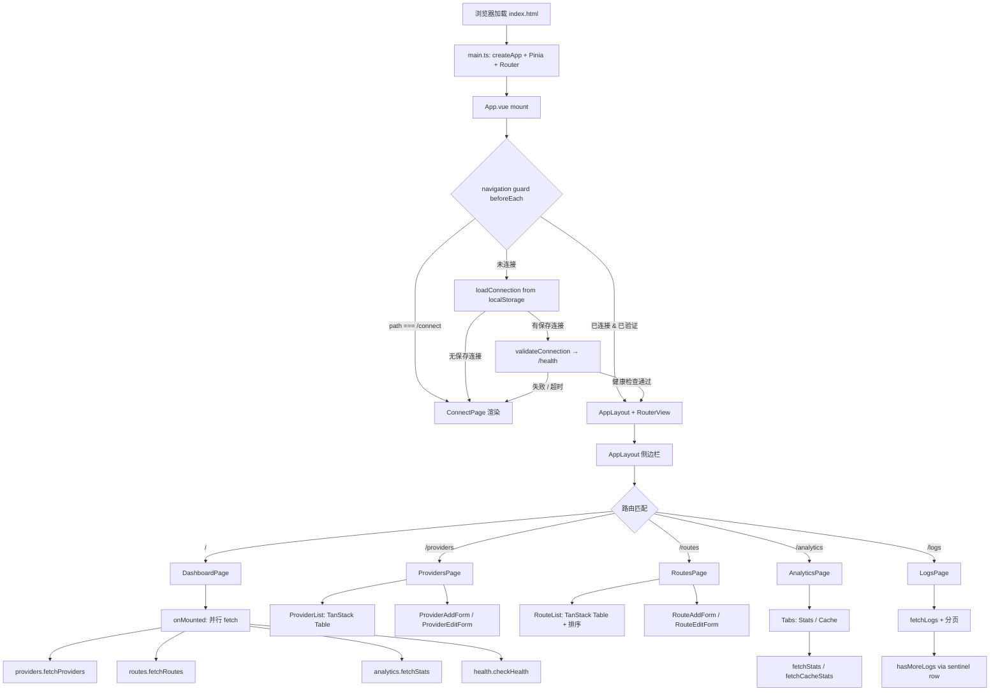

# UI 管理面板 — 规格

## 关键文件

### 入口与路由

- [sag-ui/src/main.ts](https://github.com/rainbowatcher/sag/blob/main/sag-ui/src/main.ts) — Vue 应用入口：createPinia + createRouter + mount
- [sag-ui/src/App.vue](https://github.com/rainbowatcher/sag/blob/main/sag-ui/src/App.vue) — 根组件：TooltipProvider、连接验证 loading overlay、Toaster、RouterView
- [sag-ui/src/router/index.ts](https://github.com/rainbowatcher/sag/blob/main/sag-ui/src/router/index.ts) — 路由定义（懒加载 6 个路由）+ `beforeEach` 导航守卫

### 状态管理

- [sag-ui/src/stores/connection.ts](https://github.com/rainbowatcher/sag/blob/main/sag-ui/src/stores/connection.ts) — 连接生命周期：localStorage 持久化、Bearer token 同步、健康检查验证、TTL 30 天过期、401 全局拦截
- [sag-ui/src/stores/health.ts](https://github.com/rainbowatcher/sag/blob/main/sag-ui/src/stores/health.ts) — 网关版本号和在线状态轮询
- [sag-ui/src/stores/providers.ts](https://github.com/rainbowatcher/sag/blob/main/sag-ui/src/stores/providers.ts) — Provider CRUD + 上游模型拉取 + 乐观删除+回滚
- [sag-ui/src/stores/routes.ts](https://github.com/rainbowatcher/sag/blob/main/sag-ui/src/stores/routes.ts) — Route CRUD + provider models 懒加载
- [sag-ui/src/stores/analytics.ts](https://github.com/rainbowatcher/sag/blob/main/sag-ui/src/stores/analytics.ts) — Stats、Logs、Cache、Trend、Distribution 查询 + 分页状态管理

### 页面

- [sag-ui/src/pages/DashboardPage.vue](https://github.com/rainbowatcher/sag/blob/main/sag-ui/src/pages/DashboardPage.vue) — 仪表板：统计卡片 + Token/Calls 趋势折线图 + 调用分布饼图
- [sag-ui/src/pages/ProvidersPage.vue](https://github.com/rainbowatcher/sag/blob/main/sag-ui/src/pages/ProvidersPage.vue) — Provider 列表页（组合 ProviderList + ProviderAddForm）
- [sag-ui/src/pages/RoutesPage.vue](https://github.com/rainbowatcher/sag/blob/main/sag-ui/src/pages/RoutesPage.vue) — Route 列表页（组合 RouteList + RouteAddForm）
- [sag-ui/src/pages/AnalyticsPage.vue](https://github.com/rainbowatcher/sag/blob/main/sag-ui/src/pages/AnalyticsPage.vue) — 用量统计（Stats + Cache 双 Tab）
- [sag-ui/src/pages/LogsPage.vue](https://github.com/rainbowatcher/sag/blob/main/sag-ui/src/pages/LogsPage.vue) — 请求日志（12 列表格 + 筛选 + 分页）
- [sag-ui/src/pages/ConnectPage.vue](https://github.com/rainbowatcher/sag/blob/main/sag-ui/src/pages/ConnectPage.vue) — 连接配置页面

### 核心组件

- [sag-ui/src/components/AppLayout.vue](https://github.com/rainbowatcher/sag/blob/main/sag-ui/src/components/AppLayout.vue) — 侧边栏 + 主内容区布局，响应式断点控制内容宽度和侧边栏宽度
- [sag-ui/src/components/providers/ProviderList.vue](https://github.com/rainbowatcher/sag/blob/main/sag-ui/src/components/providers/ProviderList.vue) — Provider 列表（TanStack Table）
- [sag-ui/src/components/providers/ProviderAddForm.vue](https://github.com/rainbowatcher/sag/blob/main/sag-ui/src/components/providers/ProviderAddForm.vue) — Provider 添加表单
- [sag-ui/src/components/providers/ProviderEditForm.vue](https://github.com/rainbowatcher/sag/blob/main/sag-ui/src/components/providers/ProviderEditForm.vue) — Provider 编辑表单（Drawer/Dialog 自适应）
- [sag-ui/src/components/routes/RouteList.vue](https://github.com/rainbowatcher/sag/blob/main/sag-ui/src/components/routes/RouteList.vue) — Route 列表（TanStack Table + 排序）
- [sag-ui/src/components/routes/RouteEditForm.vue](https://github.com/rainbowatcher/sag/blob/main/sag-ui/src/components/routes/RouteEditForm.vue) — Route 编辑表单
- [sag-ui/src/components/routes/TargetEditor.vue](https://github.com/rainbowatcher/sag/blob/main/sag-ui/src/components/routes/TargetEditor.vue) — Target 编辑器（provider + real_model + priority + retries）
- [sag-ui/src/components/Combobox.vue](https://github.com/rainbowatcher/sag/blob/main/sag-ui/src/components/Combobox.vue) — 通用模糊搜索下拉框

### 工具函数与类型

- [sag-ui/src/lib/client.ts](https://github.com/rainbowatcher/sag/blob/main/sag-ui/src/lib/client.ts) — 共享 axios 实例（Authorization header 由 connection store 同步）
- [sag-ui/src/lib/utils.ts](https://github.com/rainbowatcher/sag/blob/main/sag-ui/src/lib/utils.ts) — `cn()`、`getErrorMessage()`、`formatDuration()`、`successRateColor()`
- [sag-ui/src/types/api.ts](https://github.com/rainbowatcher/sag/blob/main/sag-ui/src/types/api.ts) — 所有 API 类型定义（Provider、RouteConfig、CallLog、StatsRow 等）
- [sag-ui/src/composables/useTheme.ts](https://github.com/rainbowatcher/sag/blob/main/sag-ui/src/composables/useTheme.ts) — 亮/暗主题切换（基于 `@vueuse/core` 的 `useDark`）
- [sag-ui/src/composables/useChartTheme.ts](https://github.com/rainbowatcher/sag/blob/main/sag-ui/src/composables/useChartTheme.ts) — Chart.js 配色跟随主题（通过 DOM probe element 解析 CSS 变量）

## SPA 生命周期数据流

## 关键决策

### 401 集中处理 vs 逐请求拦截

`connection.ts` 的 `handle401()` 由各 store 在 catch 块中主动调用，而非通过 axios interceptor 全局拦截。

**Trade-off**:
- ✅ 各 store 在 catch 路径显式调用 `handle401()`，调用点明确、可追踪
- ✅ 避免了 axios interceptor 在 `connect()` 流程中误触发（连接阶段本身就是验证 API key）
- ❌ 每个 store 的每个 catch 分支都需要写 `if (e.response?.status === 401) handle401()`，存在遗漏风险

### localStorage 连接 TTL 30 天 vs 永久/会话存储

**Trade-off**:
- ✅ 30 天过期避免了"永远记住但 API key 已失效"的静默失效——过期后用户重新连接到 `/connect` 页面
- ✅ `savedAt` 时间戳精确控制 TTL，跨会话不变
- ❌ 高频使用场景下每 30 天需要重新输入连接信息

### 乐观删除 + 回滚 vs 等待服务端确认

`deleteProvider()` 先将 provider 从列表中移除，API 调用失败后再恢复 `oldProviders`。

**Trade-off**:
- ✅ 删除操作即时响应，UI 不会因网络延迟卡顿
- ✅ 失败时回滚到旧列表，用户无感
- ❌ 删除期间如果 API 成功但列表未刷新（其他数据变更），回滚逻辑只会恢复本地快照（实际上 `fetchRoutes()` 在成功后触发刷新，副作用可控）

### TanStack Table vs shadcn-vue Table

ProviderList 和 RouteList 使用 TanStack Table，LogsPage 和 AnalyticsPage 使用 shadcn-vue Table 组件。

**Trade-off**:
- ✅ TanStack Table：需要排序、复杂列定义（如 Status Switch、Actions 按钮组）、动态 cell render 的场景，TanStack 的 `createColumnHelper` + `h()` render 函数更灵活
- ✅ shadcn-vue Table：纯展示型表格（Logs 12 列、Analytics Stats/Cache），用 Vue 模板 `<Table>` → `<TableHeader>` → `<TableBody>` 更直观、更少 boilerplate
- ❌ 两套表格系统增加了认知负担——需要知道什么时候用哪个。但决策规则简单：需要排序或复杂交互 → TanStack；纯展示 → shadcn-vue

### Chart.js CSS 变量解析 via DOM Probe Element

`useChartTheme` 通过创建隐藏 `` 元素、设置 `style.color = var(--chart-N)`、读取 `getComputedStyle()` 来解析 CSS 变量为 `rgb()` 字符串，供 Chart.js 使用。

**Trade-off**:
- ✅ Chart.js 原生不支持 CSS 变量引用，probe element 是最小侵入的桥接方案
- ✅ 主题切换时通过 `watch(isDark)` + `requestAnimationFrame` 自动重新解析，图表配色跟随主题
- ❌ 每次主题切换时创建和销毁 8 个 DOM 元素（一次性开销，可忽略）

### 分页 sentinel row（limit+1）vs 总数计数

`fetchLogs` 请求 `limit + 1` 行，若返回行数 > limit 则 `hasMoreLogs = true`，多余行裁剪。

**Trade-off**:
- ✅ 避免"恰好满页时误显示 Next 按钮，点击后空结果"的 bug——sentinel row 精确判断下一页是否存在
- ✅ 无需后端额外提供 `total_count` 字段
- ❌ 每页多请求 1 行，网络开销可忽略

### 纯 Tailwind CSS 响应式 vs JavaScript 媒体查询

大屏幕优化计划中的全部响应式效果通过 Tailwind 的 `xl:` 和 `2xl:` 前缀实现，不使用 `window.matchMedia()` 或 `useMediaQuery`。

**Trade-off**:
- ✅ 零 JavaScript 开销，样式在构建时确定
- ✅ Tailwind 断点与框架无关，无需在 Vue 组件中管理媒体查询生命周期
- ❌ 无法根据视口动态切换组件行为（如移动端折叠侧边栏）——但 `ProviderEditForm.vue` 已有的 `useMediaQuery` 负责这类场景

### cnfast vs clsx + tailwind-merge

使用 `cnfast` 作为 `cn()` 工具函数，而非社区常见的 `clsx` + `tailwind-merge` 组合。

**Trade-off**:
- ✅ 编译时优化，零运行时开销
- ✅ 与 Tailwind CSS v4 深度集成
- ❌ 社区生态较小，遇到问题时参考资料少于 `clsx`/`tailwind-merge`

## 不变式

- **路由守卫链路**：`/connect` 始终可以直接访问；其他路由必须通过 `loadConnection()` → `validateConnection()` 验证链。导航守卫中 `RouterView` 永不卸载（Loading overlay 用 `v-if` 叠加，而非 `v-if/v-else` 切换）
- **axios Authorization header**：全局 `api.defaults.headers.common.Authorization` 由 `setBearer()` 唯一写入，各 store 不自行设置。`connection.ts` 的 `loadConnection()`、`connect()`、`disconnect()`、`handle401()` 是仅有的四个调用点
- **日志分页 offset 不变式**：`logsOffset` 仅在 `fetchLogs` 成功后由传入的 `filter.offset` 更新；失败时 `logsOffset` 保持不变（调用方无需回滚）
- **shadcn-vue 组件**：`sag-ui/src/components/ui/` 目录由 shadcn-vue CLI 生成，手动修改会在下次 `npx shadcn-vue@latest add` 时被覆盖
- **Pinia store 懒加载**：`connection.ts` 的 `connect()` 中使用 `await import("./health")` 和 `await import("./routes")` 动态导入，避免循环依赖
- **Chart.js 注册**：`ChartJS.register()` 在 `DashboardPage.vue` 的 `<script setup>` 顶层执行（模块加载时），非 `onMounted` 内

## 测试策略

SAG UI 当前无自动化前端测试（需求文档已标注「不包含：端到端测试」）。验证方式：

| 层面 | 方法 | 工具 |
|------|------|------|
| 类型检查 | `pnpm typecheck`（vue-tsc） | TypeScript 编译器 |
| 代码风格 | `pnpm lint`（oxlint）、`pnpm format`（oxfmt） | oxlint / oxfmt |
| 构建验证 | `pnpm build`（Vite） → `just build-test`（内嵌到 gateway 二进制） | Vite / Cargo |
| 视觉验证 | 浏览器手动检查：1920×1080、2560×1440、1024×768、1366×768 | Chrome DevTools |
| API 集成 | 通过 `scripts/test-env.py` 启动 gateway 测试实例，浏览器连接验证 | test-env |

关键验证场景：

1. **连接生命周期**：首次访问 → `/connect` 重定向 → 输入 URL/API key → `/health` + `/api/providers` 验证 → 进入 Dashboard
2. **响应式布局**：`lg:`（<1280px）→ 2 列图表，`xl:`（≥1280px）→ 3 列图表，`2xl:`（≥1536px）→ 1440px 内容宽度
3. **乐观删除**：删除 Provider → 立即从列表消失 → API 成功 → Routes 刷新；模拟 API 失败 → 列表恢复
4. **日志分页**：首页满 50 条 → Next 按钮可用 → 点击 → offset +50 → 末页不满 50 条 → Next 按钮禁用
5. **401 全局处理**：任何 API 返回 401 → `handle401()` 清除连接状态 → 重定向 `/connect?reason=expired`

## 变更记录
- [0001 初始化与大屏幕响应式优化](changes/0001-initial.md)
