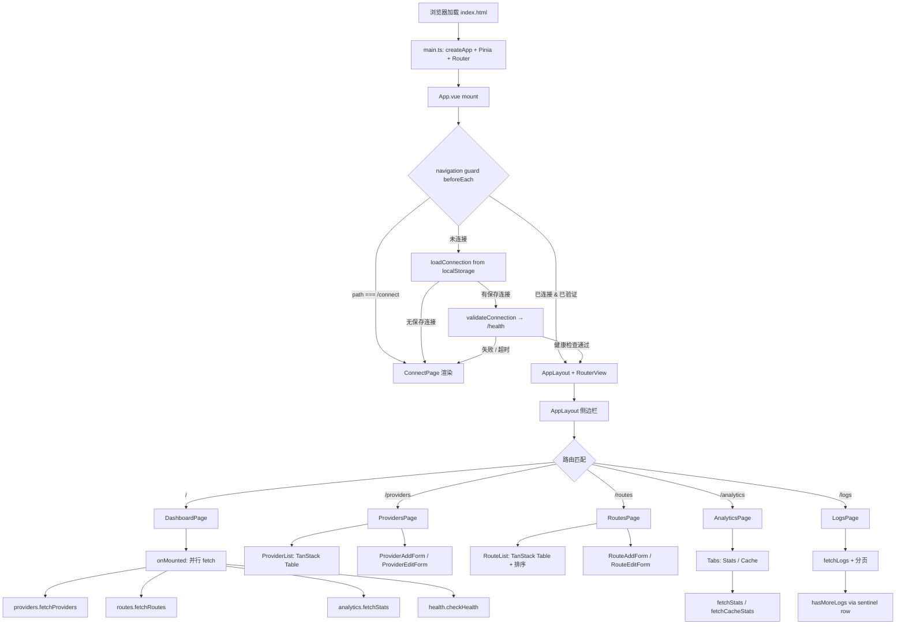

# UI 管理面板 — 规格

## 关键文件

### 入口与路由

- [sag-ui/src/main.ts](../../../sag-ui/src/main.ts) — Vue 应用入口：createPinia + createRouter + mount
- [sag-ui/src/App.vue](../../../sag-ui/src/App.vue) — 根组件：TooltipProvider、连接验证 loading overlay、Toaster、RouterView
- [sag-ui/src/router/index.ts](../../../sag-ui/src/router/index.ts) — 路由定义（懒加载 6 个路由）+ `beforeEach` 导航守卫

### 状态管理

- [sag-ui/src/stores/connection.ts](../../../sag-ui/src/stores/connection.ts) — 连接生命周期：localStorage 持久化、Bearer token 同步、健康检查验证、TTL 30 天过期、401 全局拦截
- [sag-ui/src/stores/health.ts](../../../sag-ui/src/stores/health.ts) — 网关版本号和在线状态轮询
- [sag-ui/src/stores/providers.ts](../../../sag-ui/src/stores/providers.ts) — Provider CRUD + 上游模型拉取 + 乐观删除+回滚
- [sag-ui/src/stores/routes.ts](../../../sag-ui/src/stores/routes.ts) — Route CRUD + provider models 懒加载
- [sag-ui/src/stores/analytics.ts](../../../sag-ui/src/stores/analytics.ts) — Stats、Logs、Cache、Trend、Distribution 查询 + 分页状态管理

### 页面

- [sag-ui/src/pages/DashboardPage.vue](../../../sag-ui/src/pages/DashboardPage.vue) — 仪表板：统计卡片 + Token/Calls 趋势折线图 + 调用分布饼图
- [sag-ui/src/pages/ProvidersPage.vue](../../../sag-ui/src/pages/ProvidersPage.vue) — Provider 列表页（组合 ProviderList + ProviderAddForm）
- [sag-ui/src/pages/RoutesPage.vue](../../../sag-ui/src/pages/RoutesPage.vue) — Route 列表页（组合 RouteList + RouteAddForm）
- [sag-ui/src/pages/AnalyticsPage.vue](../../../sag-ui/src/pages/AnalyticsPage.vue) — 用量统计（Stats + Cache 双 Tab）
- [sag-ui/src/pages/LogsPage.vue](../../../sag-ui/src/pages/LogsPage.vue) — 请求日志（12 列表格 + 筛选 + 分页）
- [sag-ui/src/pages/ConnectPage.vue](../../../sag-ui/src/pages/ConnectPage.vue) — 连接配置页面

### 核心组件

- [sag-ui/src/components/AppLayout.vue](../../../sag-ui/src/components/AppLayout.vue) — 侧边栏 + 主内容区布局，响应式断点控制内容宽度和侧边栏宽度
- [sag-ui/src/components/providers/ProviderList.vue](../../../sag-ui/src/components/providers/ProviderList.vue) — Provider 列表（TanStack Table）
- [sag-ui/src/components/providers/ProviderAddForm.vue](../../../sag-ui/src/components/providers/ProviderAddForm.vue) — Provider 添加表单
- [sag-ui/src/components/providers/ProviderEditForm.vue](../../../sag-ui/src/components/providers/ProviderEditForm.vue) — Provider 编辑表单（Drawer/Dialog 自适应）
- [sag-ui/src/components/routes/RouteList.vue](../../../sag-ui/src/components/routes/RouteList.vue) — Route 列表（TanStack Table + 排序）
- [sag-ui/src/components/routes/RouteEditForm.vue](../../../sag-ui/src/components/routes/RouteEditForm.vue) — Route 编辑表单
- [sag-ui/src/components/routes/TargetEditor.vue](../../../sag-ui/src/components/routes/TargetEditor.vue) — Target 编辑器（provider + real_model + priority + retries）
- [sag-ui/src/components/Combobox.vue](../../../sag-ui/src/components/Combobox.vue) — 通用模糊搜索下拉框

### 工具函数与类型

- [sag-ui/src/lib/client.ts](../../../sag-ui/src/lib/client.ts) — 共享 axios 实例（Authorization header 由 connection store 同步）
- [sag-ui/src/lib/utils.ts](../../../sag-ui/src/lib/utils.ts) — `cn()`、`getErrorMessage()`、`formatDuration()`、`successRateColor()`
- [sag-ui/src/types/api.ts](../../../sag-ui/src/types/api.ts) — 所有 API 类型定义（Provider、RouteConfig、CallLog、StatsRow 等）
- [sag-ui/src/composables/useTheme.ts](../../../sag-ui/src/composables/useTheme.ts) — 亮/暗主题切换（基于 `@vueuse/core` 的 `useDark`）
- [sag-ui/src/composables/useChartTheme.ts](../../../sag-ui/src/composables/useChartTheme.ts) — Chart.js 配色跟随主题（通过 DOM probe element 解析 CSS 变量）

## 核心设计

### SPA 生命周期数据流



### 固定高度布局渲染数据流

```mermaid
flowchart TD
    subgraph AppLayout[AppLayout.vue — 根布局容器]
        direction LR
        ASIDE[aside: 侧边栏<br/>flex-col / w-60 xl:w-64 2xl:w-72<br/>nav: flex-1 占满高度]
        MAIN[main: flex-1 overflow-hidden<br/>主内容区不整体滚动]
    end

    MAIN --> PAGE{路由匹配 → 页面组件}

    subgraph Dashboard[DashboardPage]
        D_FIXED[shrink-0: 标题 + 4 张统计卡片<br/>+ 时间范围切换 + provider 筛选]
        D_SCROLL[flex-1 overflow-y-auto<br/>图表网格: 饼图 / Token趋势 / Calls趋势]
    end

    subgraph Providers[ProvidersPage → ProviderList]
        P_FIXED[shrink-0: 标题 + Add/Refresh 按钮<br/>+ 筛选栏 Model/Type/Sort]
        P_SCROLL[flex-1 → [&>div]:h-full → Table wrapper overflow-auto<br/>Provider 表格 TanStack Table: sticky 表头]
    end

    subgraph Routes[RoutesPage → RouteList]
        R_FIXED[shrink-0: 标题 + Add Route 按钮]
        R_SCROLL[flex-1 → [&>div]:h-full → Table wrapper overflow-auto<br/>Route 表格 TanStack Table: sticky 表头]
    end

    subgraph Analytics[AnalyticsPage]
        A_FIXED[shrink-0: 标题 + Tabs 标签栏<br/>+ 4 张统计卡片 + 筛选栏]
        A_SCROLL[flex-1 → [&>div]:h-full → Table wrapper overflow-auto<br/>Stats 表格 / Cache 表格: sticky 表头 + backdrop-blur]
    end

    subgraph Logs[LogsPage]
        L_FIXED1[shrink-0: 标题 + 筛选栏]
        L_SCROLL[flex-1 → [&>div]:h-full → Table wrapper overflow-auto<br/>日志表格 12 列: sticky 表头 + backdrop-blur]
        L_FIXED2[shrink-0: 分页控件]
    end

    PAGE -->|\/| Dashboard
    PAGE -->|\/providers| Providers
    PAGE -->|\/routes| Routes
    PAGE -->|\/analytics| Analytics
    PAGE -->|\/logs| Logs
```

## 关键决策

### 401 集中处理 vs 逐请求拦截

`connection.ts` 的 `handle401()` 由各 store 在 catch 块中主动调用，而非通过 axios interceptor 全局拦截。

**Trade-off**:
- ✅ 各 store 在 catch 路径显式调用 `handle401()`，调用点明确、可追踪
- ✅ 避免了 axios interceptor 在 `connect()` 流程中误触发（连接阶段本身就是验证 API key）
- ❌ 每个 store 的每个 catch 分支都需要写 `if (e.response?.status === 401) handle401()`，存在遗漏风险

### localStorage 连接 TTL 30 天 vs 永久/会话存储

**Trade-off**:
- ✅ 30 天过期避免了"永远记住但 API key 已失效"的静默失效——过期后用户重新连接到 `/connect` 页面
- ✅ `savedAt` 时间戳精确控制 TTL，跨会话不变
- ❌ 高频使用场景下每 30 天需要重新输入连接信息

### 乐观删除 + 回滚 vs 等待服务端确认

`deleteProvider()` 先将 provider 从列表中移除，API 调用失败后再恢复 `oldProviders`。

**Trade-off**:
- ✅ 删除操作即时响应，UI 不会因网络延迟卡顿
- ✅ 失败时回滚到旧列表，用户无感
- ❌ 删除期间如果 API 成功但列表未刷新（其他数据变更），回滚逻辑只会恢复本地快照（实际上 `fetchRoutes()` 在成功后触发刷新，副作用可控）

### TanStack Table vs shadcn-vue Table

ProviderList 和 RouteList 使用 TanStack Table，LogsPage 和 AnalyticsPage 使用 shadcn-vue Table 组件。

**Trade-off**:
- ✅ TanStack Table：需要排序、复杂列定义（如 Status Switch、Actions 按钮组）、动态 cell render 的场景，TanStack 的 `createColumnHelper` + `h()` render 函数更灵活
- ✅ shadcn-vue Table：纯展示型表格（Logs 12 列、Analytics Stats/Cache），用 Vue 模板 `<Table>` → `<TableHeader>` → `<TableBody>` 更直观、更少 boilerplate
- ❌ 两套表格系统增加了认知负担——需要知道什么时候用哪个。但决策规则简单：需要排序或复杂交互 → TanStack；纯展示 → shadcn-vue

### Chart.js CSS 变量解析 via DOM Probe Element

`useChartTheme` 通过创建隐藏 `<span>` 元素、设置 `style.color = var(--chart-N)`、读取 `getComputedStyle()` 来解析 CSS 变量为 `rgb()` 字符串，供 Chart.js 使用。

**Trade-off**:
- ✅ Chart.js 原生不支持 CSS 变量引用，probe element 是最小侵入的桥接方案
- ✅ 主题切换时通过 `watch(isDark)` + `requestAnimationFrame` 自动重新解析，图表配色跟随主题
- ❌ 每次主题切换时创建和销毁 8 个 DOM 元素（一次性开销，可忽略）

### 分页 sentinel row（limit+1）vs 总数计数

`fetchLogs` 请求 `limit + 1` 行，若返回行数 > limit 则 `hasMoreLogs = true`，多余行裁剪。

**Trade-off**:
- ✅ 避免"恰好满页时误显示 Next 按钮，点击后空结果"的 bug——sentinel row 精确判断下一页是否存在
- ✅ 无需后端额外提供 `total_count` 字段
- ❌ 每页多请求 1 行，网络开销可忽略

### 纯 Tailwind CSS 响应式 vs JavaScript 媒体查询

大屏幕优化计划中的全部响应式效果通过 Tailwind 的 `xl:` 和 `2xl:` 前缀实现，不使用 `window.matchMedia()` 或 `useMediaQuery`。

**Trade-off**:
- ✅ 零 JavaScript 开销，样式在构建时确定
- ✅ Tailwind 断点与框架无关，无需在 Vue 组件中管理媒体查询生命周期
- ❌ 无法根据视口动态切换组件行为（如移动端折叠侧边栏）——但 `ProviderEditForm.vue` 已有的 `useMediaQuery` 负责这类场景

### cnfast vs clsx + tailwind-merge

使用 `cnfast` 作为 `cn()` 工具函数，而非社区常见的 `clsx` + `tailwind-merge` 组合。

**Trade-off**:
- ✅ 编译时优化，零运行时开销
- ✅ 与 Tailwind CSS v4 深度集成
- ❌ 社区生态较小，遇到问题时参考资料少于 `clsx`/`tailwind-merge`

### 固定高度布局 vs 整体页面滚动

`<main>` 从 `overflow-y-auto`（整体滚动）改为 `overflow-hidden`（页面固定高度，容器内滚动）。

**Trade-off**:
- ✅ 页面标题、筛选栏、统计卡片始终可见，用户滚动表格时不会丢失上下文
- ✅ 侧边栏导航和底部状态栏始终可交互，无需滚回顶部
- ✅ Logs 分页控件固定在表格下方，翻页操作无需滚到底部
- ❌ 每个页面需要显式管理固定区域和滚动区域的分割（`shrink-0` / `flex-1 overflow-y-auto`），增加模板复杂度
- ❌ 嵌套 flex 容器在极端内容量下可能有性能开销（但 SAG UI 的数据规模下可忽略）

选择固定高度布局是 pragmatic 的选择——SAG 管理面板的核心场景是浏览大量 Provider/Route/Log 数据，保持筛选条件可见比更简单的实现更重要。

### Table.vue 包裹 div 的 overflow-auto：作为滚动容器 vs 放在 tbody

shadcn-vue 的 `<Table>` 组件渲染结构为 `<div class="overflow-auto">` 包裹 `<table>`。这个 `<div>` 是表格内容的滚动容器，`position: sticky` 相对于此容器定位。

**设计选择**：将 `overflow-auto` 保留在 `<Table>` 的包裹 div 上，外层容器仅提供高度约束（`h-full` / `min-h-0 flex-1`），不设 overflow。滚动发生在 Table 包裹 div 内部，sticky 表头相对于此容器固定。

**Trade-off**:
- ✅ `<thead>` 的 `position: sticky; top: 0` 天然相对于 Table 包裹 div 的滚动视口，无需额外 DOM 层级
- ✅ 列宽由原生 `<table>` 布局自动同步（`<thead>` 和 `<tbody>` 处于同一 `<table>` 内），不破坏列对齐
- ✅ 滚动条出现在表格容器内部，表头在视觉上位于滚动区域上方
- ❌ Table 包裹 div 的 `overflow-auto` 会成为 sticky 的 nearest scrolling ancestor——若外层容器也设 `overflow`，sticky 会被外层拦截，表头无法固定
- ❌ 不能将 `overflow-y-auto` 直接放在 `<tbody>` 上——这会迫使 `<tbody>` 变成 `display: block`，破坏 `<thead>`/`<tbody>` 之间的原生列宽计算，需要手动对齐每列宽度

**核心约束**：外层容器（`rounded-lg border` div）必须**仅**提供高度约束，**不得**设置 `overflow-auto`。若外层有 overflow，它会创建新的滚动上下文，Table 包裹 div 的 `overflow-auto` 将不再成为 sticky 的参照点——表头随内容一起滚动。

## 不变式

- **路由守卫链路**：`/connect` 始终可以直接访问；其他路由必须通过 `loadConnection()` → `validateConnection()` 验证链。导航守卫中 `RouterView` 永不卸载（Loading overlay 用 `v-if` 叠加，而非 `v-if/v-else` 切换）
- **axios Authorization header**：全局 `api.defaults.headers.common.Authorization` 由 `setBearer()` 唯一写入，各 store 不自行设置。`connection.ts` 的 `loadConnection()`、`connect()`、`disconnect()`、`handle401()` 是仅有的四个调用点
- **日志分页 offset 不变式**：`logsOffset` 仅在 `fetchLogs` 成功后由传入的 `filter.offset` 更新；失败时 `logsOffset` 保持不变（调用方无需回滚）
- **shadcn-vue 组件**：`sag-ui/src/components/ui/` 目录由 shadcn-vue CLI 生成，手动修改会在下次 `npx shadcn-vue@latest add` 时被覆盖
- **Pinia store 懒加载**：`connection.ts` 的 `connect()` 中使用 `await import("./health")` 和 `await import("./routes")` 动态导入，避免循环依赖
- **Chart.js 注册**：`ChartJS.register()` 在 `DashboardPage.vue` 的 `<script setup>` 顶层执行（模块加载时），非 `onMounted` 内
- **固定高度布局根约束**：`<main>` 必须为 `overflow-hidden`，不得出现 `overflow-y-auto`。若不遵守，整个页面将整体滚动，固定区域失效
- **页面 flex 列布局**：每个页面组件（Connect 除外）必须使用 `flex flex-col h-full` 作为根元素。固定区域用 `shrink-0`，滚动区域用 `flex-1 overflow-y-auto`。若忘记 `h-full`，flex-1 无法计算剩余高度
- **滚动容器内边距**：滚动容器内的 `space-y-*` 或 `gap-*` 间距必须在滚动容器内部生效，而非外部——否则间距会参与 flex 高度计算导致溢出
- **Logs 三区结构**：LogsPage 是唯一有三个区域的页面：固定头（筛选栏）+ 滚动体（表格）+ 固定尾（分页）。分页必须用 `shrink-0`，不能放在 `flex-1` 滚动区内
- **侧边栏 flex 分配**：侧边栏 `<nav class="flex-1">` 自动占满 header 和 footer 之间的剩余高度，不需显式高度计算
- **表格滚动容器层级**：表格所在的外层 `<div class="rounded-lg border">` 只能设置高度约束（`h-full`）+ `[&>div]:h-full`，不得设置 `overflow-auto` 或 `overflow-hidden`。overflow 必须由 `<Table>` 组件的包裹 div 处理。若外层也有 overflow，sticky 表头将相对于外层容器定位，而 Table 包裹 div 的 `overflow-auto` 会创建中间滚动上下文导致 sticky 失效。`<tbody>` 上不得设置 `overflow-auto` —— 会使 `<tbody>` 变为 `display: block`，破坏 `<thead>`/`<tbody>` 之间的原生列宽同步
- **sticky 表头**：所有使用 `<Table>` 的页面必须在 `<TableHeader>` 上设置 `class="bg-background/90 sticky top-0 z-10 backdrop-blur-xs"`。`bg-background/90` + `backdrop-blur-xs` 提供玻璃拟态效果，确保滚动时表头覆盖下方行内容且视觉层次清晰
- **[&>div]:h-full 高度传递**：表格的外层 `<div class="rounded-lg border">` 使用 `[&>div]:h-full` 将高度约束传递给 `<Table>` 组件的包裹 div（`overflow-auto`），使其成为 sticky 表头的滚动参照点。不使用此模式时外层 div 不得设置 overflow，否则会创建多余滚动上下文导致 sticky 失效

## 测试策略

SAG UI 当前无自动化前端测试（需求文档已标注「不包含：端到端测试」）。验证方式：

| 层面 | 方法 | 工具 |
|------|------|------|
| 类型检查 | `pnpm typecheck`（vue-tsc） | TypeScript 编译器 |
| 代码风格 | `pnpm lint`（oxlint）、`pnpm format`（oxfmt） | oxlint / oxfmt |
| 构建验证 | `pnpm build`（Vite） → `just build-test`（内嵌到 gateway 二进制） | Vite / Cargo |
| 视觉验证 | 浏览器手动检查：1920×1080、2560×1440、1024×768、1366×768 | Chrome DevTools |
| API 集成 | 通过 `scripts/test-env.py` 启动 gateway 测试实例，浏览器连接验证 | test-env |

关键验证场景：

1. **连接生命周期**：首次访问 → `/connect` 重定向 → 输入 URL/API key → `/health` + `/api/providers` 验证 → 进入 Dashboard
2. **响应式布局**：`lg:`（<1280px）→ 2 列图表，`xl:`（≥1280px）→ 3 列图表，`2xl:`（≥1536px）→ 1440px 内容宽度
3. **乐观删除**：删除 Provider → 立即从列表消失 → API 成功 → Routes 刷新；模拟 API 失败 → 列表恢复
4. **日志分页**：首页满 50 条 → Next 按钮可用 → 点击 → offset +50 → 末页不满 50 条 → Next 按钮禁用
5. **401 全局处理**：任何 API 返回 401 → `handle401()` 清除连接状态 → 重定向 `/connect?reason=expired`
6. **固定高度布局**：加载 Logs/Providers 页面，添加足够数据使表格超出视口 → 页面标题和筛选栏保持可见，仅表格内部滚动 → 验证侧边栏导航和底部状态栏始终可交互
7. **固定高度布局边界**：将浏览器窗口调至极小高度（如 600px）→ 图表/表格应有最小可见区域，固定区域不应挤压滚动区至零高度

## 变更记录
- [0002 表格固定表头与玻璃拟态效果](changes/0002-sticky-header.md)
- [0001 初始化与大屏幕响应式优化](changes/0001-initial.md)
