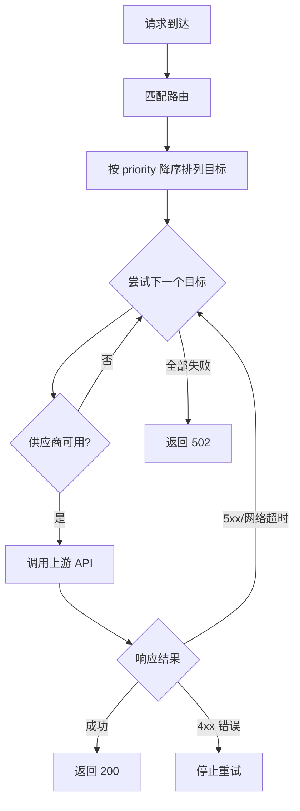

# 路由

## 为什么需要路由

SAG 作为网关，核心职责是将客户端请求转发到正确的上游 LLM 供应商。但实际情况中：

- **同一个模型名**在不同供应商上有不同的实际模型名（如 OpenAI 的 `gpt-4o` 对应 Anthropic 的 `claude-sonnet-4`）
- **需要故障转移** — 一个供应商不可用时自动切换到另一个
- **不同模型**需要不同的处理端点（聊天 `/v1/chat/completions`、图像 `/v1/images/generations`）

路由系统就是用来解决这些问题的：**将客户端的模型名映射到具体的供应商和模型，并管理故障转移策略**。

## 路由匹配

SAG 通过 `routes` 配置来定义路由表。当请求到达时，按以下顺序匹配：

1. **精确匹配** — 遍历路由表，找到 `model_name` 与请求模型完全相同的路由
2. **通配匹配** — 如果没有精确匹配，查找 `model_name = "*"` 的兜底路由
3. **匹配失败** — 返回 `404 ModelNotFound`

```toml
[[routes]]
model_name = "gpt-4o"
api_endpoint = "/v1/chat/completions"

[[routes.targets]]
provider = "openai"
real_model = "gpt-4o"
priority = 100

[[routes]]
model_name = "*"          # 兜底路由
api_endpoint = "/v1/chat/completions"

[[routes.targets]]
provider = "openai"
real_model = "gpt-4o"
priority = 10
```

## 配置详解

### `RouteConfig` — 路由定义

| 字段 | 类型 | 说明 |
|------|------|------|
| `model_name` | string | 客户端请求的模型名。支持精确匹配，或使用 `"*"` 作为通配符匹配所有模型 |
| `api_endpoint` | string | 上游 API 端点路径，默认 `"/v1/chat/completions"` |
| `strategy` | string | 目标选择策略：`fill_first` (默认) 或 `round_robin` |
| `retries` | integer (可选) | 每个目标的重试次数，覆盖全局 `retries`。省略则使用全局默认值 |
| `targets` | array | 目标供应商列表，按优先级排序 |

### `RouteTarget` — 路由目标

| 字段 | 类型 | 说明 |
|------|------|------|
| `provider` | string | 供应商名称，必须匹配 `[providers]` 中定义的名称 |
| `real_model` | string (可选) | 实际发送给供应商的模型名。**省略此项**则透传客户端请求的原始模型名 |
| `priority` | integer | 优先级，默认 `0`。**值越大优先级越高**，优先尝试 |
| `retries` | integer (可选) | 此目标的重试次数，覆盖路由级别及全局的 `retries`。省略则回退到路由级别，再回退到全局默认值 |
| `extra` | object (可选) | 针对该目标的额外 JSON 字段，合并到上游请求体中。**应用时机晚于供应商级别的 `body_overrides`**，因此目标级别的 key 具有更高优先级 |

### `api_endpoint` 说明

`api_endpoint` 定义了该路由使用什么 API 端点。SAG 会据此选择处理逻辑：

- `/v1/chat/completions` — 聊天补全请求
- `/v1/images/generations` — 图片生成请求（需要对应端点含 `/images/generations`）

## 优先级与故障转移

路由内的目标按 `priority` **降序**排列（值越大越优先）。处理逻辑：



- **4xx 错误**（BadRequest、Unauthorized、ModelNotFound）— **立即停止**，不尝试下一个目标。因为这是客户端的问题，换其他供应商也会失败
- **5xx/网络超时/其他** — 收集错误信息，继续尝试下一个目标
- **全部目标失败** — 返回 `502 All Providers Exhausted`，附带上所有失败原因

## 使用场景

### 1. 多供应商故障转移

同一个模型配置多个供应商，主供应商失败时自动切换到备用：

```toml
[[routes]]
model_name = "gpt-4o"
api_endpoint = "/v1/chat/completions"

[[routes.targets]]
provider = "openai"
real_model = "gpt-4o"
priority = 100

[[routes.targets]]
provider = "anthropic"
real_model = "claude-sonnet-4-20250514"
priority = 50
```

客户端请求 `gpt-4o` 时，优先用 OpenAI；如果 OpenAI 返回 5xx 或超时，自动切换到 Anthropic 的 `claude-sonnet-4`。

### 2. 模型名透传

客户端使用的模型名与供应商的模型名一致时，省略 `real_model` 即可：

```toml
[[routes]]
model_name = "gpt-4o-mini"
api_endpoint = "/v1/chat/completions"

[[routes.targets]]
provider = "openai"
priority = 100                # real_model 省略，使用客户端原始模型名
```

### 3. 图片生成路由

聊天和图片使用不同的端点：

```toml
[[routes]]
model_name = "dall-e-3"
api_endpoint = "/v1/images/generations"

[[routes.targets]]
provider = "openai"
real_model = "dall-e-3"
priority = 100
```

### 4. 通配符兜底路由

为未匹配的模型提供默认处理：

```toml
[[routes]]
model_name = "*"
api_endpoint = "/v1/chat/completions"

[[routes.targets]]
provider = "openai"
priority = 10                 # 透传客户端原始模型名
```

精确匹配优先于通配符，所以 `"*"` 只在没有精确匹配时生效。

## 完整示例

```toml
[providers.openai]
type = "openai"
api_key = "${OPENAI_API_KEY}"
base_url = "https://api.openai.com/v1"

[providers.anthropic]
type = "anthropic"
api_key = "${ANTHROPIC_API_KEY}"
base_url = "https://api.anthropic.com"

# 主模型 — OpenAI 优先，Anthropic 兜底
[[routes]]
model_name = "gpt-4o"
api_endpoint = "/v1/chat/completions"

[[routes.targets]]
provider = "openai"
real_model = "gpt-4o"
priority = 100
extra = { temperature = 0.7 }

[[routes.targets]]
provider = "anthropic"
real_model = "claude-sonnet-4-20250514"
priority = 50
extra = { max_tokens = 8192 }

# 轻量模型 — 透传模型名（省略 real_model）
[[routes]]
model_name = "gpt-4o-mini"
api_endpoint = "/v1/chat/completions"

[[routes.targets]]
provider = "openai"
priority = 100

# 图片生成
[[routes]]
model_name = "dall-e-3"
api_endpoint = "/v1/images/generations"

[[routes.targets]]
provider = "openai"
real_model = "dall-e-3"
priority = 100

# 兜底路由（透传原始模型名）
[[routes]]
model_name = "*"
api_endpoint = "/v1/chat/completions"

[[routes.targets]]
provider = "openai"
priority = 10
```

## `extra` 字段详解

`RouteTarget.extra` 允许为每个目标指定额外的 JSON 字段，这些字段会合并到发送给上游供应商的请求体中。

**合并顺序**（后者覆盖前者）：

1. 客户端原始请求体
2. 供应商级别的 `body_overrides`
3. 目标级别的 `extra`（**最高优先级**）

### 使用场景

#### 固定模型参数

某些供应商对同一模型有不同的参数要求：

```toml
[[routes]]
model_name = "my-model"

[[routes.targets]]
provider = "openai"
real_model = "gpt-4o"
priority = 100
extra = { temperature = 0.7, max_tokens = 4096 }

[[routes.targets]]
provider = "anthropic"
real_model = "claude-sonnet-4-20250514"
priority = 50
extra = { max_tokens = 8192, thinking = { type = "enabled", budget_tokens = 1600 } }
```

#### 供应商特定的非标准参数

```toml
[[routes.targets]]
provider = "openai"
real_model = "deepseek-chat"
extra = { model_id = 39 }
```
